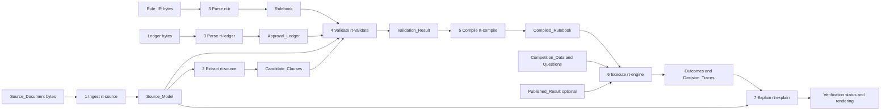
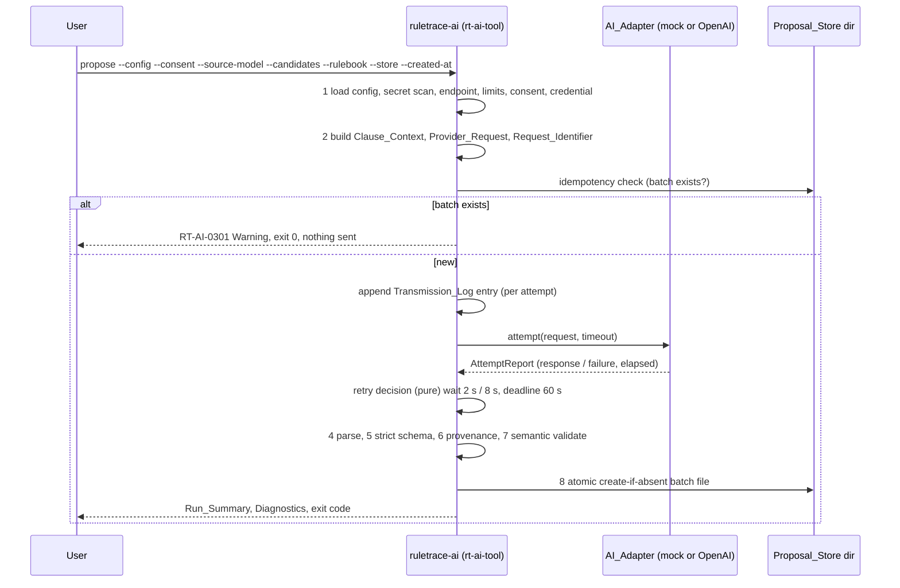
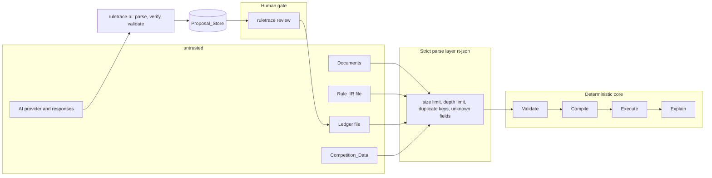
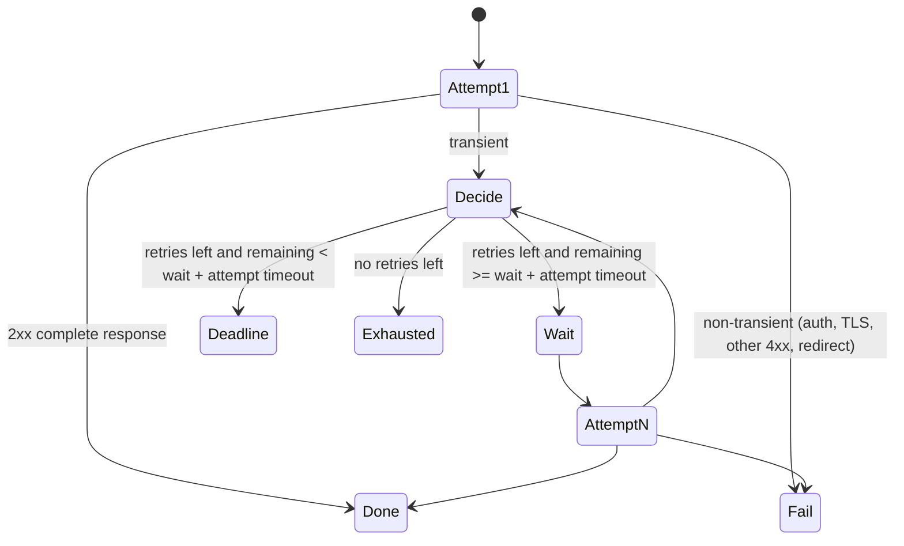
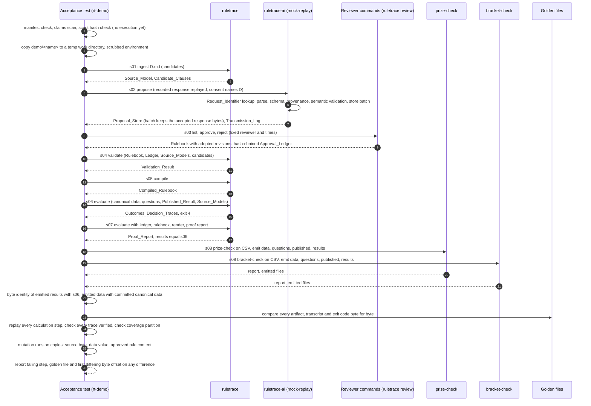

# Design Document: ruletrace-compiler

## Overview

RuleTrace is a competition rulebook compiler. This document is the design for requirements 1 to 34 of `requirements.md` (not edited here). Requirements 31 to 34 and the changed criteria of the scope amendment of 2026-11-14 add two thin demonstration Application_Layers (Prize_Check, Bracket_Check) over the one shared engine and a reproducible end-to-end demonstration. It specifies the Cargo workspace, the typed stage interfaces, the Rule_IR, the exact numeric representation, ingestion and provenance, validation, compilation, deterministic execution, the optional AI proposal pipeline, the approval ledger and adoption protocol, the two RuleTrace executables and the two Demonstration_Executables, the application layers, the qualification options, the end-to-end demonstration and its honest-claims controls (§8), the diagnostic catalogue, the security model, the test strategy and the implementation phases (§7.5, organized as three demonstration slices).

Section numbers (`§n.m`) are used by the traceability table in §10.

### 1.1 Decisions carried from the user (confirmed 2026-11-14)

| # | Decision | Where designed |
| --- | --- | --- |
| 1 | Approving a Pending_Proposal atomically adopts it into the Rulebook as a new revision with its Approval_Record. Pending proposals never block compilation. A Proposed revision inside the Rulebook still blocks (Req 26). Revision_Number is assigned **at adoption** (recommended and adopted here). | §3.8, §3.7 |
| 2 | Execution-time conflict detection kept. Runtime conflict gives Indeterminate and exit code 4, never 3. | §3.6 |
| 3 | Bounded rational with decimal literals preferred. Full comparison documented. Final selection is **recommended, pending user confirmation of the documented comparison**. | §4.2 |
| 4 | Defaults: revision cap 4,294,967,295; 20 clauses per request (1 to 100); deadline 60 s, attempt 20 s, two retries (2 s, 8 s), response limit 1 MiB. | §3.7 |
| 5 | Earlier AI batches may be kept when a later batch fails. The run is incomplete, with a Run_Summary. Steering text needs an exception (§9.3). | §3.7, §9.3 |
| 6 | A Decision_Trace with no resolvable source reference is marked not verified. | §3.5 |
| 7 | Empty aggregation: count 0, sum 0, min/max undefined, Indeterminate with RT-DGN-0005 when required. | §3.6 |
| Steering note | Contradictory diagnostic states are rejected as invalid input. `has_errors` and `no_errors` are derived from one `DiagnosticState`; no type holds them as fields. | §3.4, §4.3 |

### 1.2 Design principles

1. **Deterministic core.** Every core stage is a pure function of its listed typed inputs. No clock, randomness, environment, file or network access in core crates.
2. **One source of truth per fact.** Diagnostic validity comes from one list. Approval status comes from the ledger. Locations come from one `Location` type.
3. **Untrusted input everywhere.** Documents, Rule_IR, ledger, data, proposals and provider responses are parsed by one strict positioned parser, with size and depth limits, before any use.
4. **No guessing.** Unknown, ambiguous, unsupported and missing information are values or Diagnostics, never defaults.
5. **Prefer std.** Third-party crates are listed in §3.2 with justification and alternatives.
6. **The demonstration is the deliverable that counts.** A real public rulebook goes in; AI proposes; a human approves; RuleTrace compiles, calculates and proves each decision against the source; one engine powers two applications. The number of properties or layers is not the goal. Safety tests stay required and attach to the phase where their code appears, but the order of work reaches a thin working demonstration first (§7.5).

### 1.3 Scope amendment of 2026-11-14: applications and demonstration

| # | Decision or input | Status | Where designed |
| --- | --- | --- | --- |
| 8 | Two thin Application_Layers, `prize-check` and `bracket-check`, each one package with a library (input mapping, Questions, report layout) and a small Demonstration_Executable (UD-33, option B: recommended and applied, user confirmation pending) | Applied | §3.1, §3.3, §8.2 |
| 9 | Qualification only as a Qualification_Predicate. Both UD-32 options are designed; Rank_Reference confirmed by the user with constraints (`tools/decisions/UD-32.md`) | UD-32 Confirmed | §8.9 |
| 10 | The Proposal_Store retains the accepted response bytes and a deterministic export writes the Recorded_Provider_Script (UD-36, option 1: Confirmed) | Applied, Confirmed | §3.7.5, §8.11.7 |
| 11 | Reproducible offline demonstration with golden files, an acceptance test that executes the runbook, mutation checks, a Coverage_Statement and a Proof_Report | Designed | §8.11 |
| 12 | Honest-claims statements and a prohibited-phrase scan | Designed | §8.12 |
| 13 | Demonstration-first phase plan: Demo Slice 0 (hand-authored rules), Slice 1 (mock AI and human approval), Slice 2 (real provider, two applications, published checks, mutation checks) | Designed | §7.5 |
| Open | UD-34 (which public documents: Confirmed, see `tools/decisions/UD-34.md`), UD-35 (real or synthetic data, Open). The harness is document-agnostic and names no document. UD-32: Confirmed, Rank_Reference | UD-34 Confirmed; UD-35 Open | §8.11.1, §9.2 |

## Architecture

### 2.1 Pipeline and data flow



Each arrow is a typed value of the Pipeline_Contract (Req 24.1). The auxiliary stages (AI proposal generation, review) are in §2.3 and §2.4.

### 2.2 Crate dependency graph

```mermaid
flowchart TD
  subgraph core[Core crates]
    hash[rt-hash]
    found[rt-foundation]
    num[rt-numeric]
    json[rt-json]
    sm[rt-srcmodel]
    src[rt-source]
    ir[rt-ir]
    led[rt-ledger]
    prop[rt-proposals]
    val[rt-validate]
    cpd[rt-compiled]
    cmp[rt-compile]
    dat[rt-data]
    trc[rt-trace]
    eng[rt-engine]
    exp[rt-explain]
    rev[rt-review]
    cli[rt-cli : ruletrace]
  end
  subgraph aux[Auxiliary crates]
    adp[rt-ai-adapter]
    mock[rt-ai-mock]
    oai[rt-ai-openai]
    tool[rt-ai-tool : ruletrace-ai]
  end
  subgraph appl[Application layers]
    pc[prize-check : lib and bin]
    bc[bracket-check : lib and bin]
  end
  subgraph tools[Tooling and tests]
    demo[rt-demo]
    xt[rt-xtask]
  end
  json --> found
  sm --> found & hash & json
  src --> found & hash & json & sm
  ir --> found & hash & json & num
  led --> ir & hash & json & found
  prop --> ir & hash & json & found
  val --> sm & ir & led & num & hash & json & found
  cpd --> ir & num & hash & json & found
  cmp --> val & cpd & ir & led & hash & num & found
  dat --> json & num & found
  trc --> num & json & found
  eng --> cpd & dat & trc & num & found
  exp --> sm & trc & json & num & found
  rev --> val & led & prop & exp & sm & ir & hash & json & found
  cli --> rev & cmp & eng & exp & dat & src & sm & val & cpd & prop & led & ir & trc & json & hash & found
  adp --> json & hash & found
  mock --> adp & json & found
  oai --> adp & json & hash & found
  tool --> adp & mock & oai & val & prop & sm & ir & led & json & hash & found
  pc --> found & num & dat & cpd & eng & exp & sm
  bc --> found & num & dat & cpd & eng & exp & sm
  xt --> found & json & prop
  demo --> found & json & hash & sm & ir & led & prop & val & trc & exp & xt
```



Forbidden edges are listed in §3.3. In particular no `aux` crate points to `cmp`, `eng`, `rev`, and `rt-ledger` has no append function. Nothing points to an application layer, an application layer points to no `aux` crate, no network crate and not to `cli`, `rev`, `led`, `val`, `cmp`, `src`, `ir` (directly) or the other application, and `demo` and `xt` are depended on by nothing. `rt-srcmodel` is split out of the earlier `rt-source` because Req 24.12 lets an application use the Source_Model crate but not the Ingestor or Extractor.

### 2.3 AI proposal pipeline sequence



### 2.4 Approval and adoption sequence

```mermaid
sequenceDiagram
  participant R as Reviewer
  participant C as ruletrace review (rt-cli + rt-review)
  participant F as Files: Rulebook, Ledger, Proposal_Store
  R->>C: review list
  C->>F: read (no write)
  C-->>R: pending proposals, prospective revision and content hash, source text via Explainer
  R->>C: review approve --rule --revision --content-hash --reviewer --time
  C->>C: take lock; load and verify ledger chain; load rulebook, store, source models
  C->>C: resolve target; assign revision at adoption; recompute hash; compare (stale check)
  C->>C: reviewer checks; dry-run validate of post-approval state
  C->>F: write temp files, fsync, journal, rename ledger then rulebook, remove journal
  C-->>R: exit 0, or REVIEW_* Diagnostic and files unchanged
```

### 2.5 Trust boundaries



AI output reaches the core only through the Proposal_Store and a human `review approve`.

### 2.6 Key design decisions

| # | Decision | Alternatives | Recommendation and reason |
| --- | --- | --- | --- |
| D-1 | Rule language: declarative JSON AST (UD-1) | Embedded expression string sub-language | AST. Every node carries a type, location and span; no second parser; no injection surface. Cost: verbose files. |
| D-2 | Format: strict JSON subset "RT-JSON" with hand-written positioned parser (UD-2) | serde_json; TOML; RON; custom text | RT-JSON. Needs byte, line, column positions for every value, duplicate-key detection, depth limit and no float coercion. Cost: ~600 lines plus typed decoders. |
| D-3 | Numeric: bounded rational R-128 (UD-3) | Bounded decimal D; R-Big; hybrid | R-128, pending confirmation (§4.2). |
| D-4 | Revision_Number assigned at adoption | Assigned at proposal creation | At adoption. Avoids gaps (Req 25.1). Two hashes: Draft hash and prospective Rule_Content_Hash (§3.8). |
| D-5 | Two-file commit: lock + temp files + journal + ordered rename (UD-27) | Single combined file; no journal; database | Journal. Keeps the ledger a separate file (Req 26.1). |
| D-6 | Ledger format: JSON Lines, header line then one record per line | Single JSON document | JSON Lines. Line number is the record location. |
| D-7 | Proposal_Store: directory of one file per batch, create-if-absent by hard link | Single file; database | Directory. Atomic, idempotent, concurrent-safe. |
| D-8 | Review writes no Proposal_Store file; adoption state is derived from Origin proposal id in the Rulebook | Write a reference file | Derived. One fewer file in the atomic commit. See requirements note RN-2. |
| D-9 | Engine faults (division by zero, overflow) are never absorbed by Kleene logic; missing values and empty min/max are | Absorb everything | Matches Req 8.5, 8.6 text and Req 8.30. See RN-4. |
| D-10 | Applications: one Cargo package per application with a library target and a binary target of the same name (UD-33 option B) | Third executable with subcommands; library only; separate library and binary packages | One package per application. Satisfies Req 15.8 and 31.3 literally; I/O confined to `io.rs` by the file allowlist (§8.2). |
| D-11 | Application_Input_Format is CSV with schema-driven typing; canonical RT-JSON only as `--emit-*` output | JSON input | CSV. Spreadsheet-native, keeps the mapping step real, loses only the empty text value (§8.3). |
| D-12 | One serializer for the results file, in `rt-explain`, used by `ruletrace evaluate` and both applications | Each executable serializes its own | One function. Byte identity (Req 31.5) holds by construction (§8.10). |
| D-13 | Report model, writers and Proof_Report builder live in `rt-explain` | New `rt-report` crate | `rt-explain`. A new crate needs an addition to the Req 24.12 whitelist (RN-22). |
| D-14 | Rank reference is one expression node that reuses the ranking function and always reads the ranking over all participants (only if UD-32 selects it) | Separate rank computation; per-question population | One node, one memo table, population independent of the Questions asked (§8.9). |
| D-15 | Proposal_Store retains the accepted response payload inside the batch file; export to a Recorded_Provider_Script is a pure function run by `rt-xtask` (UD-36 option 1, Confirmed) | Recording file written by `ruletrace-ai`; recording in test code | Retention in the batch. No new write target (§8.11.7). |

Further decisions are recorded where they arise and in the register §9.2.

## Components and Interfaces

### 3.1 Cargo workspace: crates and responsibilities

All crates: edition 2021, `#![forbid(unsafe_code)]`, `rust-toolchain.toml` pins a full `major.minor.patch` (chosen in Phase 0, UD-15). Layout `crates/<name>`. Class: C = core, A = auxiliary, P = application layer (an Application_Layer library and its Demonstration_Executable in one package), T = tooling or test only.

| Crate | Class | Purpose | Stage | Allowed internal dependencies |
| --- | --- | --- | --- | --- |
| rt-hash | C | SHA-256 wrapper, `Sha256Hex` newtype | all | none (external: sha2) |
| rt-foundation | C | `Location`, `Diagnostic`, `Severity`, `Code` catalogue enum, `DiagnosticState`, canonical ordering, limits, `RuleId`, `RevisionNumber`, `DocumentId` | all | none |
| rt-numeric | C | `ExactNumber`, rounding, decimal and fraction codecs | all | none (std only) |
| rt-json | C | RT-JSON strict positioned parser and canonical writer | all | foundation |
| rt-srcmodel | C | Source_Model and Candidate_Clause types, canonical parse and print, hash and span verification helpers (pure). Split from `rt-source` so that Application_Layers and the Explainer can use Source_Models without depending on the Ingestor or Extractor (Req 24.12) | 1 types | foundation, hash, json |
| rt-source | C | Ingestion and extraction (Ingestor, Extractor) | 1, 2 | foundation, hash, json, srcmodel |
| rt-ir | C | Rulebook types, parse, print, Rule_Content hash, expression AST | 3 | foundation, hash, json, numeric |
| rt-ledger | C | Approval_Ledger types, parse, print, chain verify, status derivation. **No append function** | 3 | foundation, hash, json, ir |
| rt-proposals | C | Proposal_Store data model, parse, print (no AI logic) | aux | foundation, hash, json, ir |
| rt-validate | C | Validator, `ValidationResult`, content-only entry point | 4 | foundation, numeric, hash, json, srcmodel, ir, ledger |
| rt-compiled | C | Compiled_Rulebook types, canonical serialization and parse | 5 types | foundation, numeric, hash, json, ir |
| rt-compile | C | Compiler | 5 | foundation, numeric, hash, ir, ledger, validate, compiled |
| rt-data | C | Competition_Data, Questions, Published_Result types and parsers; module `tabular`: CSV table parsing, schema-driven mapping to Competition_Data and Published_Result, canonical serialization of the three (no competition knowledge, §8.3) | 6 input | foundation, json, numeric |
| rt-trace | C | Outcome, Decision_Trace, three-valued `Tri`, replay | 6 types | foundation, numeric, json |
| rt-engine | C | Rules_Engine. Re-exports `Outcome`, `DecisionTrace`, `Evaluation` | 6 | foundation, numeric, compiled, data, trace |
| rt-explain | C | Explainer (provenance), control-character escaping; module `results` (results-file serializer shared by `ruletrace evaluate` and both applications); module `report` (report model, human and machine writers, header statements, Proof_Report builder) | 7 | foundation, srcmodel, trace, json, numeric |
| rt-review | C | Review library: approval operations, adoption plan, ledger record append (pure, returns bytes) | review | foundation, hash, json, ir, ledger, proposals, validate, srcmodel, explain |
| rt-cli | C | `ruletrace` binary: arguments, file I/O, `Fs` trait, atomic commit, rendering, exit codes | all | all core crates |
| rt-ai-adapter | A | `AiAdapter` trait, request/response/failure types, retry policy (pure) | aux | foundation, hash, json |
| rt-ai-mock | A | Mock_Provider and simulated clock | aux | adapter, foundation, json |
| rt-ai-openai | A | OpenAI Responses integration, monotonic clock, TLS | aux | adapter, foundation, json, hash |
| rt-ai-tool | A | `ruletrace-ai` binary and library: config, consent, request build, schema, provenance, store write | aux | adapter, mock, openai, foundation, hash, json, srcmodel, ir, ledger, validate, proposals |
| prize-check | P | Prize_Check Application_Layer: `src/lib.rs` (input mapping call, Question construction, report layout; no I/O) and Demonstration_Executable `prize-check` (`src/main.rs`, `src/io.rs`) | app | foundation, numeric, data, compiled, engine, explain, srcmodel |
| bracket-check | P | Bracket_Check Application_Layer and Demonstration_Executable `bracket-check`, same layout | app | foundation, numeric, data, compiled, engine, explain, srcmodel |
| rt-demo | T | Demonstration harness and acceptance tests: manifest and runbook parsers, subprocess runner with a scrubbed environment, golden comparison and bless mode, Coverage_Statement generator, mutation drivers, claims helpers. Runs the four executables as subprocesses in tests only | test | foundation, json, hash, srcmodel, ir, ledger, proposals, validate, trace, explain, xtask (library) |
| rt-tests-core | T | Cross-crate property tests, golden fixtures, isolation, dependency tests (core and application layers; no AI crate) | test | all core, prize-check, bracket-check |
| rt-tests-ai | T | Mock and stub-server tests | test | all |
| rt-xtask | T | Graph check, tree check, source scans (core and application layers), catalogue generation and baseline check, claims generation and scan, executable-set check, justification check, `export-script` (UD-36). Library plus a thin development binary that is not a delivered executable (RN-25) | tooling | foundation, json, proposals |

Rationale for the splits that matter:

- `rt-ledger` (read) versus `rt-review` (write). AI crates may validate content, which needs ledger types, but must never reach an append function. The append function exists only in `rt-review` and is reached only from `rt-cli`.
- `rt-compiled` separate from `rt-compile`. The engine needs the compiled types but must not depend on compiler logic.
- `rt-trace` separate from `rt-engine`. The Explainer needs trace types and must not depend on the engine (Req 15.9).
- `rt-proposals` in core. `review` (core) must read the store; the AI tool writes it through the same model.
- `rt-numeric` has no dependencies so the differential tests can wrap it freely.
- `rt-srcmodel` separate from `rt-source`. Req 24.12 allows applications the Source_Model crate and forbids the Ingestor and Extractor, so the types and the verification helpers cannot live next to the ingest code.
- Applications are single packages (library plus binary of one name). Each application depends on the engine library interface and on shared parsing and rendering code in crates it is allowed to use; it never depends on `rt-cli`, so no application can reach the review or ledger-append code (§8.2).
- `rt-demo` is a test-only crate. Nothing depends on it, it is not an executable, and it is the only code that starts the delivered executables as subprocesses.

### 3.2 Third-party dependencies and justification

Rule: a dependency needs purpose, alternatives including std, and maintenance status in the commit message (Req 21.5, 21.6). `serde` is not used anywhere: all typed decoding is hand-written over `rt-json`.

| Dependency | Used by | Purpose | Alternatives | Decision |
| --- | --- | --- | --- | --- |
| sha2 (RustCrypto) | rt-hash only | SHA-256, FIPS 180-4, pure Rust, deterministic on all platforms | hand-rolled SHA-256 (risk of subtle bugs); `ring` (C and asm, larger); std (none) | sha2 with default features off. Wrapped so the crate can be replaced. Maintenance: widely used, active. Verified against NIST test vectors in tests. |
| proptest (dev) | core unit tests, rt-tests-* | Property tests, seed and shrunk case printed on failure (Req 20.24) | quickcheck (weaker shrinking); hand-rolled generators (reinventing) | proptest. Dev-only. Not network, not AI. |
| num-bigint (dev) | rt-tests-core | Independent arbitrary-precision reference model for the differential numeric test (Req 20.22) | hand-written test bigint (not independent enough, more code) | Dev-only, test code only. Never in `ruletrace` runtime tree. |
| toml_edit | rt-ai-tool only | Parse AI_Configuration with spans (line and column for Req 28.3) without serde | `toml` crate with serde (brings serde); hand-written TOML subset parser (risk of divergence from TOML) | toml_edit, parse-only API. Confirm exact span API at Phase 6. |
| ureq (blocking HTTP client) | rt-ai-openai only | HTTPS POST, per-request timeout, no async runtime | reqwest (pulls tokio, hyper); hyper directly (async); curl bindings (C library) ; std only (no TLS) | ureq with rustls. Redirects disabled (Req 28.19). Proxy autodetection from the environment disabled explicitly (Req 28.5 reads one env var only). Version pinned in lockfile at Phase 8. |
| rustls and webpki-roots (transitive of ureq) | rt-ai-openai | TLS with certificate and host-name verification, no option to disable (Req 28.6) | native-tls (platform OpenSSL, varying behaviour) | rustls. Root store embedded: reproducible across platforms. |
| cargo-deny (tool) | CI | Advisories, bans, licences (Req 21.7) | cargo-audit (advisories only) | cargo-deny. Its `bans` section lists network and AI crates with `wrappers = ["rt-ai-openai"]`. |

No dependency is added for argument parsing (hand-written grammar in §3.9; needs Cli_Location diagnostics and byte-identical messages, which clap does not give), for Markdown (hand-written line parser in §3.5, UD-10), for JSON (§4.1) or for temp files (the `Fs` trait in rt-cli).

### 3.3 Allowed edges, forbidden edges and automatic checks

**Machine-readable list** (Req 24.5, 24.9): file `tools/allowed-edges.v1`, one line per crate, parsed by `rt-xtask`:

```text
# format: ruletrace-allowed-edges v1
crate rt-hash        class core   deps -
crate rt-foundation  class core   deps -
crate rt-numeric     class core   deps -
crate rt-json        class core   deps rt-foundation
crate rt-srcmodel    class core   deps rt-foundation rt-hash rt-json
crate rt-source      class core   deps rt-foundation rt-hash rt-json rt-srcmodel
crate prize-check    class app    deps rt-foundation rt-numeric rt-data rt-compiled rt-engine rt-explain rt-srcmodel
crate bracket-check  class app    deps rt-foundation rt-numeric rt-data rt-compiled rt-engine rt-explain rt-srcmodel
crate rt-demo        class tool   deps rt-foundation rt-json rt-hash rt-srcmodel rt-ir rt-ledger rt-proposals rt-validate rt-trace rt-explain rt-xtask
crate rt-xtask       class tool   deps rt-foundation rt-json rt-proposals
crate rt-ir          class core   deps rt-foundation rt-hash rt-json rt-numeric
crate rt-ledger      class core   deps rt-foundation rt-hash rt-json rt-ir
crate rt-ai-adapter  class aux    deps rt-foundation rt-hash rt-json
crate rt-ai-tool     class aux    deps rt-ai-adapter rt-ai-mock rt-ai-openai rt-foundation rt-hash rt-json rt-srcmodel rt-ir rt-ledger rt-validate rt-proposals
stage rt-srcmodel 1
stage rt-source 1
stage rt-ir 3
stage rt-validate 4
stage rt-compile 5
stage rt-engine 6
stage rt-explain 7
forbid-class core -> aux
forbid-class core -> app
forbid-class aux  -> app
forbid-class app  -> aux
forbid-class app  -> tool
forbid-transitive prize-check bracket-check -> rt-cli rt-review rt-ledger rt-validate rt-compile rt-source rt-proposals rt-ai-* rt-demo rt-xtask
forbid-name  prize-check -> bracket-check
forbid-name  bracket-check -> prize-check
forbid-name  rt-ai-* -> rt-compile rt-engine rt-review rt-cli rt-compiled
forbid-name  rt-engine -> rt-explain rt-ir rt-hash
```

(Abbreviated here; the file lists every crate of §3.1.) External crates are listed under `external <crate> allowed-in <crate...>`.

**Forbidden edges**, each with a negative fixture graph (Req 24.10):

| Forbidden | Rule |
| --- | --- |
| Any cycle | Tarjan SCC on `cargo metadata` graph |
| Edge not in list | Set difference |
| core to aux | Class check |
| core, rt-cli or rt-ai-mock to a network client, AI provider library or rt-ai-openai | `forbid-external` list: ureq, rustls, hyper, reqwest, h2, tokio, openssl, native-tls, curl, isahc, attohttpc, ring (except under rt-ai-openai) |
| AI crate to rt-compile, rt-engine, rt-review (approval and append), rt-compiled | `forbid-name` |
| rt-engine to rt-explain, rt-ir, rt-hash | `forbid-name` |
| Stage crate to a later stage crate | `stage` numbers |
| Engine, compiler, validator or explainer to a crate that does file I/O | Only rt-cli, rt-ai-*, and the `io.rs` and `main.rs` files of `prize-check` and `bracket-check` do I/O |
| Application layer to `rt-cli`, `rt-review`, `rt-ledger`, `rt-validate`, `rt-compile`, `rt-source`, `rt-proposals`, any `rt-ai-*`, a network client, the other application, `rt-demo` or `rt-xtask`, directly or transitively (Req 24.12) | `forbid-transitive`, `forbid-class`, `forbid-name`, `forbid-external`; any direct edge not in the allowed list also fails |
| Any Core_Crate, Auxiliary_Crate or test crate depending on an application layer, except `rt-tests-core` | `forbid-class core -> app`, `aux -> app`; `rt-tests-core` is the only crate allowed to name them (tests only, no delivered crate depends on it) |

**Automatic checks** (all in `rt-xtask`, run in CI and by tests in `rt-tests-core`):

1. `check-graph`: reads `cargo metadata --format-version 1 --all-features` (parsed with `rt-json`), builds the graph, applies the table above, prints crate and edge, exits non-zero. Missing or malformed list: its own failure (Req 24.9).
2. `check-tree`: for `rt-cli` and each core crate, resolves the full tree (normal, build, dev, all features) and fails on a network or AI crate, naming the path (Req 27.5, 21.13).
3. `scan-sources`: token scan (no regex dependency, simple tokenizer) of core crates for `static mut`, `thread_local!`, `lazy_static`, `OnceLock`, `OnceCell`, `std::env`, `std::fs`, `std::net`, `std::time::{SystemTime,Instant}`, `rand`, `f32`, `f64`, `unsafe`, `Command`, `libloading`. Allowlist is per file in `tools/scan-allow.v1` with a mandatory reason (only `rt-cli` I/O modules and aux crates). `forbid(unsafe_code)` presence per crate (Req 19.7). Prize or bracket terms in the engine (Req 15.1).
4. `check-catalogue`: every `Code` variant appears in `catalogue/diagnostics.v1.json`; baseline comparison (Req 7.11, 7.12).
5. `check-justification`: every external crate in `Cargo.lock` that is new relative to `tools/dependencies.v1` needs an entry with purpose, alternatives, status (Req 21.6).
6. `check-app-layers`: token scan of `prize-check/src` and `bracket-check/src` for duplicated business logic and I/O (Req 31.10, 31.11). Four rule groups and a negative fixture per violation, described in §8.10. Library files may not use `std::fs`, `std::env`, `std::process`, `std::io`, `std::net`, `std::time`; only `io.rs` and `main.rs` are allowlisted.
7. `check-executables`: from `cargo metadata`, the set of binary targets of packages of class core, aux and app equals exactly `ruletrace`, `ruletrace-ai`, `prize-check`, `bracket-check`; any other name fails (Req 27.1, 27.15). Class tool (the `rt-xtask` development binary) is not a delivered executable (RN-25).
8. `check-tree` also resolves the full tree of each application and fails on any crate of the forbidden-transitive list, and resolves the tree of `ruletrace` and `ruletrace-ai` and fails if either contains an application layer (Req 27.15).
9. `scan-claims` and `gen-claims`: honest-claims statements and prohibited phrases (Req 34.7), §8.12. `gen-claims` regenerates `rt-explain/src/statements.rs` from `claims/required-statements.v1.json`, and CI fails if the checked-in file differs.

Core-only job: `cargo test --workspace --exclude rt-ai-adapter --exclude rt-ai-mock --exclude rt-ai-openai --exclude rt-ai-tool --exclude rt-tests-ai`, then `ruletrace` output bytes compared with the full build (Req 20.16). The core-only job builds and runs `prize-check` and `bracket-check` and the `hand` profile of the demonstration acceptance test, which needs no AI crate; the `ai` profile runs in the full job (§8.11.12).

### 3.4 Public Rust interfaces

Declarations below are design-level; bodies are omitted. No `unwrap`, `expect` or `panic!` in library paths reachable from input; all fallible functions return typed errors or `Diagnostic`s. Slices are borrowed; results own their data.

#### 3.4.1 Foundation types (rt-foundation)

```rust
pub struct DocumentId(String);          // opaque UTF-8, backslash already normalised by CLI
pub struct InputId(String);
pub struct RuleId(String);              // [a-z][a-z0-9_.-]{0,127}
pub struct RevisionNumber(u32);         // 1..=4_294_967_295, newtype
pub struct RuleRef { pub rule: RuleId, pub revision: Option<RevisionNumber> }
pub struct ByteOffset(u32);             // documents are limited to 16 MiB

pub enum Location {
    Source(SourceSpan),                 // only constructible from a Source_Model or a verified Rule
    Document(DocumentId),
    Input(InputLocation),
    Cli(CliLocation),
    None(NoLocationReason),             // reason is a catalogue Code
}
pub struct SourceSpan { pub doc: DocumentId, pub start: ByteOffset, pub end: ByteOffset,
                        pub line: u32, pub column: u32 }
pub struct InputLocation { pub input: InputId, pub line: Option<u32>, pub column: Option<u32>,
                           pub field: Option<String> }
pub enum CliLocation { Argument { position: u32, name: Option<String> }, Command(String) }

pub enum Severity { Error, Warning, Ambiguity, Unsupported }
impl Severity { pub fn is_blocking(self) -> bool; }

/// Every catalogue code. No other way to name a code exists.
pub enum Code { /* RT-DGN-0001 ... generated from catalogue/diagnostics.v1.json */ }
impl Code {
    pub fn id(self) -> &'static str;          // "RT-APR-0001"
    pub fn mnemonic(self) -> &'static str;    // "APPROVAL_UNRESOLVED"
    pub fn severity(self) -> Severity;        // fixed by the catalogue
    pub fn exit_code(self) -> ExitCode;
}

pub struct Diagnostic { /* private */ }
impl Diagnostic {
    /// Severity comes from the code. A caller cannot supply a different severity (Req 7.18).
    pub fn new(code: Code, message: String, primary: Location) -> Self;
    pub fn with_related(self, related: Vec<Location>) -> Self;
    pub fn with_rules(self, rules: Vec<RuleRef>) -> Self;
    pub fn code(&self) -> Code;
    pub fn severity(&self) -> Severity;
    pub fn primary(&self) -> &Location;
    pub fn related(&self) -> &[Location];
    pub fn rules(&self) -> &[RuleRef];
    pub fn message(&self) -> &str;
}
impl Ord for Diagnostic { /* total order of Req 7.10 and 7.22 */ }
```

#### 3.4.2 DiagnosticState: contradictory states cannot exist (Req 22)

```rust
/// The only canonical diagnostic state: an ordered list. There is no field for any flag.
pub struct DiagnosticState { items: Vec<Diagnostic> }       // private field

impl DiagnosticState {
    pub fn empty() -> Self;
    pub fn push(&mut self, d: Diagnostic);
    pub fn extend(&mut self, other: DiagnosticState);
    pub fn sorted(self) -> Self;                             // canonical order
    pub fn as_slice(&self) -> &[Diagnostic];
    pub fn has_errors(&self) -> bool;     // any Error, Ambiguity, Unsupported
    pub fn no_errors(&self) -> bool;      // !has_errors, computed, never stored
    pub fn outcome(&self) -> ValidationOutcome;  // Passed | Failed
    pub fn has_unresolved_approval(&self) -> bool; // any APPROVAL_UNRESOLVED
}
pub enum ValidationOutcome { Passed, Failed }
```

`has_errors` and `no_errors` are methods of one list; no constructor takes either as input. Wire parsing is in `rt-json` decoders: any key named `has_errors`, `no_errors`, `validation_status`, `validation_result`, or `passed` in an input object makes the decoder return `RT-DGN-0001` (one flag) or `RT-DGN-0002` (both flags), whether the supplied value agrees or disagrees (UD-11 resolved, RN-9). Lifecycle keys `approval_status`, `is_approved`, `is_rejected`, `is_proposed`, `approval_record` return `RT-DGN-0003` (Req 22.17, 4.10). Exactly one Diagnostic per rejected input (Req 22.9, 22.10); primary Location is the first offending field. The API test of Req 22.8 is a compile-fail style test (`trybuild`-free: a doc test that fails to compile is replaced by a reflection-free check that the public item list of the crate, extracted by `rt-xtask scan-api`, contains no `pub fn` or `pub` field returning or taking the two flags) plus the property test over generated lists (Property 4).

Staged results:

```rust
pub struct Staged<T> { pub value: T, pub diagnostics: DiagnosticState } // diagnostics hold Warnings only
pub struct Rejected { pub diagnostics: DiagnosticState }                // at least one blocking item
pub type StageResult<T> = Result<Staged<T>, Rejected>;
```

#### 3.4.3 Stage functions (match the Pipeline_Contracts exactly, Req 24.2)

```rust
// Stage 1 (rt-source)  inputs: bytes, document identifier, effective size limit
pub fn ingest(bytes: &[u8], id: &DocumentId, format_hint: FormatHint, limit: ByteLimit)
    -> StageResult<SourceModel>;

// Stage 2 (rt-source)  inputs: Source_Model, extraction mode
pub fn extract(model: &SourceModel, mode: ExtractionMode) -> StageResult<Vec<CandidateClause>>;

// Stage 3 (rt-ir, rt-ledger)
pub fn parse_rulebook(bytes: &[u8], input: &InputId, size: ByteLimit, depth: DepthLimit)
    -> StageResult<Rulebook>;
pub fn parse_ledger(bytes: &[u8], input: &InputId, size: ByteLimit) -> StageResult<ApprovalLedger>;
// Approval_Status operation (rt-review), inputs exactly: Rulebook, Approval_Ledger, Review_Decision,
// Source_Models (plus the Proposal_Store entry for the adoption case)
pub fn plan_review(rulebook: &Rulebook, ledger: &ApprovalLedger, store: &ProposalStore,
                   decision: &ReviewDecision, sources: &SourceModels)
    -> Result<CommitPlan, Rejected>;

// Stage 4 (rt-validate)  inputs: Rulebook, Approval_Ledger, Source_Models, optional Candidate_Clauses
pub fn validate(rulebook: &Rulebook, ledger: &ApprovalLedger, sources: &SourceModels,
                candidates: Option<&[CandidateClause]>) -> ValidationResult;
// content-only pass used by ruletrace-ai (no ledger, no approval gating)
pub fn validate_content(declarations: &Rulebook, draft: &RuleDraft, sources: &SourceModels)
    -> DiagnosticState;

// Stage 5 (rt-compile)  input: Validation_Result (plus compiler version constant)
pub fn compile(result: &ValidationResult) -> StageResult<CompiledRulebook>;

// Stage 6 (rt-engine)
pub fn evaluate(rulebook: &CompiledRulebook, data: &CompetitionData, questions: &[Question],
                published: Option<&PublishedResult>) -> Evaluation;

// Stage 7 (rt-explain)  inputs: Decision_Trace, pre-loaded Source_Models
pub fn verify_trace(trace: &DecisionTrace, models: &SourceModels) -> TraceVerification;
pub fn render_trace(trace: &DecisionTrace, models: &SourceModels, v: &TraceVerification) -> String;
```

`ValidationResult` holds the Rulebook, the Approval_Ledger as supplied and the `DiagnosticState` (Req 9.11):

```rust
pub struct ValidationResult { /* private */ }
impl ValidationResult {
    pub fn rulebook(&self) -> &Rulebook;
    pub fn ledger(&self) -> &ApprovalLedger;
    pub fn state(&self) -> &DiagnosticState;
    pub fn checked_conflict_classes(&self) -> &[ConflictClass];   // ascending, no repeats (Req 6.23)
    pub fn rule_metadata(&self) -> &BTreeMap<RuleId, RuleMetadata>; // field dependencies (Req 6.10)
}
pub struct Evaluation {
    pub outcomes: Vec<Outcome>, pub traces: Vec<DecisionTrace>,
    pub diagnostics: DiagnosticState, pub comparison: Option<Comparison>,
}
pub enum Outcome { Decided(Value), Indeterminate(Vec<Reason>) }
```

No function reads a clock, environment, file or global; every parameter is listed in the contract (Req 24.7). A signature test in `rt-tests-core` parses each `pub fn` in the stage modules (via `rt-xtask scan-api`) and compares parameter and result type names with `tools/contracts.v1` (Req 24.2).

#### 3.4.4 Revisions, approval status and reviewer

```rust
pub struct RuleKey { pub id: RuleId, pub revision: RevisionNumber }   // Ord by (id bytes, revision)
pub struct RuleRevision { pub key: RuleKey, pub origin: Origin, pub content: RuleContent }
pub enum Origin { Manual { author: Option<Identity> },
                  AiProposal(AiOrigin) }       // AiOrigin: proposer, provider, model, adapter version,
                                               // request hash, response hash, proposal id, AI identities
pub enum ApprovalStatus { Proposed, Approved, Rejected }  // derived, never stored or deserialized

/// Pure derivation, Req 26.10. Precondition: the ledger was verified by `parse_ledger`.
pub fn derive_statuses(rb: &Rulebook, ledger: &ApprovalLedger) -> BTreeMap<RuleKey, ApprovalStatus>;
pub fn effective_revisions(rb: &Rulebook, st: &BTreeMap<RuleKey, ApprovalStatus>) -> BTreeMap<RuleId, RuleKey>;
pub fn unresolved(rb: &Rulebook, st: &BTreeMap<RuleKey, ApprovalStatus>) -> Vec<RuleKey>;

/// Reviewer has no AI variant. The only constructor validates length and non-emptiness.
pub struct Reviewer(ReviewerName);       // 1..=200 Unicode scalar values
impl Reviewer {
    pub fn new(raw: &str) -> Result<Self, Diagnostic>;                 // REVIEW_REVIEWER_INVALID
    pub fn check_not_ai(&self, known: &AiIdentitySet) -> Result<(), Diagnostic>; // REVIEW_SELF_APPROVAL
}
```

#### 3.4.5 AI adapter

```rust
pub trait AiAdapter {
    /// One attempt. Never retries, never sleeps. Returns untrusted bytes or a typed failure.
    fn attempt(&mut self, request: &ProviderRequest, timeout: Duration) -> AttemptReport;
    fn clock(&self) -> &dyn MonotonicClock;          // real in rt-ai-openai, simulated in rt-ai-mock
}
pub trait MonotonicClock { fn now(&self) -> Duration; fn wait(&self, d: Duration); }

pub struct AttemptReport { pub outcome: AttemptOutcome, pub elapsed: Duration, pub detail: Option<String> }
pub enum AttemptOutcome {
    Response(ProviderResponse),
    Failure(ProviderFailure),
}
pub struct ProviderResponse { pub completion: Completion, pub payload: Vec<u8>, pub meta: ProviderMeta }
pub enum Completion { Complete, Refused, Incomplete }
pub enum ProviderFailure {
    Unavailable, Timeout, RateLimited { retry_after_secs: Option<u32> },
    AuthFailed, TlsFailed, Other { http_status: Option<u16> },
}

pub struct ProviderRequest { /* version, task, model, limits, clause context, declarations, vocabulary */ }
impl ProviderRequest {
    pub fn canonical_bytes(&self) -> Vec<u8>;
    pub fn request_id(&self) -> RequestId;            // SHA-256 of canonical_bytes, 64 hex chars
}
pub trait ProviderFactory {                             // implemented by mock and openai
    fn kind(&self) -> &'static str;
    fn build(&self, settings: &ProviderSettings, env: &dyn EnvReader)
        -> Result<Box<dyn AiAdapter>, Diagnostic>;      // reads only credential_env_var
}

/// Pure retry decision (Req 29.13): no clock, no sleep.
pub fn next_step(policy: &RetryPolicy, history: &[AttemptRecord], elapsed: Duration) -> RetryStep;
pub enum RetryStep { Attempt { wait_before: Duration }, Stop(RetryStop) }
pub enum RetryStop { Success, Exhausted { attempts: u8 }, DeadlineExceeded { attempts: u8 },
                     NonTransient(ProviderFailure) }
```

`ProviderRequest`, `ProviderResponse` and the trait contain no provider-specific type (Req 18.12). Mock_Provider implements `AiAdapter` with scripted reports and a `SimulatedClock`.

#### 3.4.6 Error types

Library error enums (`IngestError`, `ParseError`, `NumericError`, `LedgerError`, `PlanError`, `StoreError`) are private to their crates and are converted into `Diagnostic`s at the crate boundary through exhaustive `match` so a new variant fails to compile until it has a code. Internal invariants use `Result<_, InternalError>`; the CLI converts `InternalError` to `RT-CLI-0006` exit 70. `catch_unwind` is not used.

### 3.5 Source ingestion and provenance resolution

**Source_Model** (`rt-source`), serialized as RT-JSON:

```text
{ "format":"ruletrace-source-model", "version":1, "document":"rules.md", "kind":"markdown",
  "sha256":"<64 hex>", "bytes":1234, "content":"<entire document as a JSON string>",
  "elements":[ {"id":0,"kind":"heading","level":1,"label":null,"start":0,"end":19,"line":1,"column":1,"parent":null}, ... ] }
```

The model embeds the full text so the Explainer and review display derive source text only from it (Req 13.15). On load, SHA-256 of `content` must equal `sha256` and `bytes` must equal the content length; otherwise `RT-PRV-0005`. Element kinds: `heading`, `paragraph`, `list_item`, `code_block`, `table`, `table_row`, `blank`-free (blank lines are not elements). Elements are ordered by `start` ascending; `parent` is the element id of the enclosing heading or list item.

**Markdown mapping (UD-10 resolved):**

| Markdown | Element | Span |
| --- | --- | --- |
| ATX heading `#` to `######` | `heading` with `level`, `label` = leading numbering label if present | The heading line without line terminator |
| Paragraph (consecutive non-blank lines not matching other rules) | `paragraph` | First line start to last line end |
| List item (`-`, `*`, `+`, `N.`, `N)`), including nested | `list_item` with depth in `parent` chain | Item's own lines only, up to the next nested item, next sibling or blank-line-ended block. Nested children are separate elements. No span overlaps another |
| Fenced code block | `code_block` (one element, not extracted) | Fence to closing fence |
| Pipe table (header row, delimiter row, body rows) | `table` and one `table_row` per header or body row. Delimiter row is not an element | Row line without terminator |
| Setext headings, HTML blocks, block quotes | Treated as `paragraph` text (no special structure) | As paragraph |
| Plain text | Same rules without markup recognition except list and numbering labels | As above |

Format detection: extension `.md` or `.markdown` gives `markdown`; `.txt`, `.text` or none gives `text`; any other extension, or a prefix `%PDF-`, `PK\x03\x04`, `\x89PNG`, or `<!doctype html`/`<html` within the first 512 bytes, gives `RT-ING-0002` (Unsupported). Order of checks: size limit (RT-LIM-0001 or RT-ING-0003), format, UTF-8 (`RT-ING-0001`, message gives first invalid byte offset), then structure. `--format` may override the extension, never the magic check.

**Spans (Req 1.2).** Offsets are byte offsets into the raw document bytes. A leading UTF-8 BOM is kept in the byte count and in column 1 of line 1 (it is one scalar value); structure detection skips it. Lines end at LF, CRLF or lone CR; each is one terminator. Line numbers start at 1 and increase by one per terminator. Column = 1 + number of Unicode scalar values from the line start to the span start (a tab counts as 1). A span never includes its final terminator but may contain terminators inside. Bytes inside spans are not normalized (Req 1.4).

**Extraction** (`ingest --candidates`, Req 2.4): mode `first_version` produces one Candidate_Clause per `list_item`, and per `heading` or `paragraph` whose text starts with a numbering label matching one of: `\d+(\.\d+)*[.)]?`, `\([a-z]{1,2}\)`, `\([ivxlc]+\)`, `[A-Z][.)]`, followed by whitespace. Table rows count only if the first cell starts with such a label. Text is the exact span bytes. Clauses are ordered by start offset. No interpretation. Zero clauses gives `RT-ING-0005` Warning (Req 2.6, 2.8). Candidate list file: `{"format":"ruletrace-candidates","version":1,"document":..,"clauses":[{"document","start","end","line","column","label","text"}]}`.

**Explainer** (`rt-explain`) is the only crate that resolves, hash-verifies and renders source text, plus the display call in `rt-review`. Algorithm for each `SourceSpanRef` of a trace (first matching row of Req 13.16 wins, one Diagnostic per span):

1. no models at all: one `RT-PRV-0006` Warning for the trace, state not verified;
2. no model for document: `RT-PRV-0001`;
3. recorded hash differs from model hash: `RT-PRV-0002`;
4. `start >= end` or `end > len`: `RT-PRV-0003`;
5. offset not on a scalar boundary: `RT-PRV-0004`;
6. model structurally invalid (checked once per model, hash of content, element spans): `RT-PRV-0005` with Document_Location.

A trace is `Verified` iff it has at least one span, every span resolved and its verification state has no blocking item. Zero spans: Warning `RT-PRV-0007` and not verified. All spans failed: not verified, no text rendered. Rendering escapes every Unicode `Cc` character except the line feed that ends an output line, as `\u{XXXX}` in printable ASCII (Req 19.5, 19.10). The engine never receives a model: the verification section is a separate part of the evaluate output (RN-14).

Unresolvable document or span: no text invented. Diagnostic code and exit codes as in §4.3: `evaluate` exits 2 when an Error row applies and no earlier stage failed. An Indeterminate Outcome (stage 6, exit 4) outranks a stage 7 provenance Error, so the exit is 4 when both apply. Complete outcomes and traces are written in both cases, with unaffected traces remaining `verified` (Req 13.18, 13.24, 16.17).

### 3.6 Validation, compilation and deterministic execution

#### 3.6.1 Validation passes (Req 6)

`validate` runs the passes below on every Rule_Revision except that Rejected and superseded revisions get only pass 1 structural checks (Req 6.25, 25.12). All passes run; findings are collected, never short-circuited (Req 6.11). A node that failed name resolution gets the internal type `Error` and suppresses downstream type findings on that node, so each defect yields one Diagnostic.

| Pass | Checks | Codes |
| --- | --- | --- |
| 1 Structure | duplicate (id, revision); at least one Source_Span; every field has a declared type; span document declared, `start < end`, bounds, UTF-8 boundary, line and column equal to the Source_Model; Rulebook limits | RT-VAL-0013..0016, 0019, 0022 |
| 2 Sources | each declared document has a Source_Model, hash equal, span inside document | RT-VAL-0017, 0018, 0019 |
| 3 Names | fields, collections, sets, enum members, Rule targets resolve (only to Effective revisions) | RT-VAL-0002 |
| 4 Types | every node's declared `t` equals the type the operator computes from operand types; operand types compatible | RT-VAL-0001 |
| 5 Numeric declarations | rounding mode and places present, places integer 0..28 | RT-VAL-0020, 0021 |
| 6 Boundary | unrecognized kind, operator, type, rounding mode, tie policy; unbounded iteration or recursion | RT-VAL-0003 |
| 7 Markers | ambiguity and incompleteness markers | RT-VAL-0004, 0005 |
| 8 Graph | reference cycles (Tarjan), dependency metadata (Req 6.10) | RT-VAL-0011 |
| 9 Conflicts | the four classes among Effective revisions; precedence checks | RT-VAL-0006..0010, 0012 |
| 10 Approval gate | derive statuses; unresolved; none executable; stale records; rejected modified; rejected warning | RT-APR-0001..0004, 0006 |
| 11 Candidates | unreferenced Candidate_Clause Warning (Req 2.5) | RT-ING-0006 |

`validate_content` runs passes 1 to 8 on a draft (no passes 9 to 11). Both Manual and AI drafts go through exactly the same functions; Origin is not an argument of any check (Req 18.5).

**Conflict detection (decidable subset).** Among Effective revisions, keyed by Rule id:

- `DuplicateTarget`: two or more rules of kind eligibility, derived or weighted_score with the same Target (value namespace). Two or more `default` rules with equal literal values and same field are also DuplicateTarget.
- `DuplicateRankKey`: two or more ranking rules with the same Target (ranking namespace).
- `ContradictoryDefault`: `default` rules on the same input field with unequal literals or different types.
- `InputShadowing`: a value or ranking Target equal to a declared input field name. Not resolvable by precedence.
- Resolution: a `Precedence_Declaration` that lists every rule of the conflict in a total order resolves the three first classes and yields Warning `RT-VAL-0010`. A cycle across declarations, or a listed rule that does not exist or is not Effective, gives `RT-VAL-0012`.
- Undetected classes (Req 6.22): contradiction in meaning between different Targets, overlap needing satisfiability reasoning, divergence from the source clause. They go to the user-facing support-boundary document.
- `checked_conflict_classes` = `["ContradictoryDefault","DuplicateRankKey","DuplicateTarget","InputShadowing"]`.

**Approval gating.** Statuses derive from the verified ledger (§3.8). Pass 10 emits `APPROVAL_UNRESOLVED` per unresolved revision (primary Location: first span of the rule), `APPROVAL_NO_EXECUTABLE_RULES` if no Effective revision, `APPROVAL_RECORD_STALE` Warning for every ledger record (approval or rejection) that matches no current revision or is non-matching, `APPROVAL_REVISION_REJECTED` Warning, and `APPROVAL_REJECTED_REVISION_MODIFIED` when a Rejected revision's current content hash differs from the hash in its rejection record. A non-matching record never counts as an approval and no fallback to a lower revision occurs.

#### 3.6.2 Compilation (Req 9)

`compile(&ValidationResult)`:

1. Re-derive statuses from the rulebook and ledger inside the result. Compare the set of blocking diagnostics of `state()` with a fresh run of passes 9 to 10; any difference gives `RT-APR-0005` and no output (Req 9.12).
2. If `state().has_errors()` return the blocking Diagnostics unchanged and in order (Req 9.2).
3. If no Effective revision: `RT-APR-0002` with the whole-input Location (an Input_Location naming the `rulebook` input, no line or column; Req 5.7, 7.14), no artifact (Req 9.13).
4. Lower each Effective revision to the compiled form (§4.1.6): names resolved to indices, types resolved, spans copied in order, Origin and approval data dropped.
5. Evaluation order: Kahn's algorithm over value-rule dependencies with a `BTreeSet<RuleId>` ready set, so ties pick the lowest identifier bytewise (Req 9.8). A cycle gives `RT-CMP-0001` (defensive; validation already reports it).
6. Record IR_Version, Rulebook content hash, compiler version, referenced document hashes (Req 9.5).
7. Atomic: the function returns either a whole `CompiledRulebook` or `Rejected`. There is no partial value in any code path, and the CLI creates the output file only after success (Req 9.10, 16.21).

Rulebook content hash input: canonical bytes of `{ir_version, types, rules:[Rule_Content of each Effective revision, ascending key], precedence, documents}`. Origin, ledger and non-effective revisions are excluded, so a manually authored and an AI-origin Rulebook with equal Rule_Content give byte-identical compiled output (Req 16.18).

Compiled form canonical serialization: RT-JSON compact, fixed key order (§4.1.6). The Compiler version is a `const &str` from `CARGO_PKG_VERSION` of `rt-compile` (build metadata only, not the clock).

#### 3.6.3 Execution (Req 10, 11, 12)

Inputs are in-memory typed values only. Participants are keyed by identifier in a `BTreeMap`, rules by `RuleId`; no `HashMap` appears in core crates (scan-enforced), so no iteration-order dependence.

*Values.* `Value = Number | Bool | Text | Date | Enum | Ranking`. Intermediate result type `Eval = Known(Value) | Unknown(Unknowns) | Fault(Vec<Diagnostic>)`. `Unknowns` is a sorted set of reasons: missing input (participant id, field), or empty minimum or maximum (field name).

*Three-valued logic (UD-4).* T, F, U. Faults are outside the table: any `Fault` operand gives `Fault` (merged in operand order).

| a | b | AND | OR | | a | NOT a |
| --- | --- | --- | --- | --- | --- | --- |
| T | T | T | T | | T | F |
| T | F | F | T | | F | T |
| T | U | U | T | | U | U |
| F | T | F | T | | | |
| F | F | F | F | | | |
| F | U | F | U | | | |
| U | T | U | T | | | |
| U | F | F | U | | | |
| U | U | U | U | | | |

Comparison, arithmetic, membership and aggregation with a `U` operand give `U`. Every operand of every node is evaluated left to right with no short-circuit, so the trace order is fixed. `n`-ary `and`/`or` fold left.

*Missing handling (Req 11).* A field value absent or explicitly `null` is missing. Zero, `false` and `""` are present. A `default` rule on the field supplies the literal and the default's spans are recorded in the trace (Req 11.2). Otherwise the node is `U` with the missing-input reason. A rule whose final value is `U` yields Indeterminate with the Rule id, field name and the Rule's first span. Other rules still run (Req 11.6).

*Faults.* Division by zero `RT-EXE-0002`, overflow `RT-EXE-0003`, rounding overflow, bad numeric input `RT-EXE-0005`, input type mismatch `RT-EXE-0004`. A fault makes the rule's value a fault and every dependent rule and question Indeterminate with the Error Diagnostic; independent questions are unchanged (Req 10.6).

*Aggregation (decision 7).* Over a collection supplied by the data: `count` and `sum` of an empty collection are `Known(0)` with no Diagnostic and the trace records "empty collection" and the result. `min` and `max` of an empty collection are `Unknown(EmptyAggregate{field})`. If the final Outcome is Indeterminate because of it, the Outcome carries `RT-DGN-0005` naming the Rule and collection with the rule's first span. If Kleene absorption decides the Outcome (for example `false AND min(...) > 3`), no Diagnostic is produced (Req 8.30). A collection absent from the data is missing information (Req 8.29, 11).

*Ranking (Req 12).* For a ranking question over participant set P:

1. Compute the key and each tie-breaker value per participant. Each criterion has an explicit `direction` (`asc` or `desc`).
2. If any key is Unknown or Fault: every participant of P is Indeterminate, with `RT-EXE-0006` naming each participant lacking a value. (A missing value is never treated as zero or lowest; every position depends on that comparison.)
3. Sort by key. Within groups equal on the key, apply tie-breakers in declared order, only to the participants still tied. If a needed criterion value is missing for a member of a tied set, all members of that set are Indeterminate (`RT-EXE-0006`); participants behind the set are unaffected because their rank counts the whole set.
4. Equal after all criteria gives a `TieGroup`. Members are listed in ascending participant id (bytewise) for serialization only.
5. Rank_Position = 1 + number of participants strictly ahead. Tie groups of size k at position p are followed by p + k. Every participant gets exactly one of: alone, member of one group, Indeterminate (Property 17, 18).
6. Trace records of a ranking (Req 12.7, 32.1). Besides the `read` entries of keys and tie-breaker values, the trace of a `rank` Question has one `compare` entry per pair of adjacent entries of the final order, `{"seq":5,"kind":"compare","between":["p3","p7"],"criteria":[{"index":0,"rule":"rank.total","direction":"desc","left":{"type":"number","value":"9"},"right":{"type":"number","value":"7"},"result":"first"}],"result":"first_ahead"}` (the entry `result` is `first_ahead` or `tied`, and each criterion `result` is `first`, `second` or `equal`), which lists the criteria applied in declared order until one decided, and one `place` entry per participant that is alone at its position and one `tie_group` entry per Tie_Group, each `{"seq":6,"kind":"tie_group","position":2,"members":["p1","p2"]}` with the members in ascending identifier order. Bracket_Check copies these entries and computes nothing.

*Precedence and conflicts (Req 12.5, 12.10, 12.11).* If a target has several compiled rules and a precedence record, only the first-listed rule's result is used; the others appear in the trace as considered and not applied with the precedence id as the reason; if the first is Indeterminate the Outcome is Indeterminate. If a target has several rules and no precedence (reachable only through test-only compiled rulebooks or a compiler defect) and their Known results are not equal, the subject is Indeterminate with one `RT-DGN-0004` whose primary Location is the first span of the lowest rule id, other spans related; no result is selected. The CLI exit code is 4 (Req 16.23).

*Order-dependent operations (UD-8 resolved).* The first version has no order-dependent operation (none in the Req 14.2 list), so input order never matters: participants and collections are sorted internally by identifier or by their position-independent multiset. Req 10.4 holds for every rule; Req 10.5 is reserved for a future rule kind with a declared ordering field (`RT-EXE-0007`), tested through a test-only compiled rulebook (RN-5).

*Published comparison (Req 13.12, 8.26).* Exact value equality, no tolerance. Differences are listed in participant then field order with published value, computed value and trace entry reference. If the computed value serializes as a fraction the message adds that it is non-terminating and that the Rule declares no rounding that yields the published value.

*Published comparison for rankings (Req 31.7, 32.6).* For a `rank` Question the published value of a participant is a Rank_Position, compared exactly with the computed Rank_Position of that participant. A computed Tie_Group is the set of participants that share one computed position, so a published file that gives different positions to members of one computed Tie_Group yields one difference for each member whose published position differs from the shared computed position, with `kind: "tie_broken_without_declared_criterion"` and the computed group members attached. A published tie between participants that the engine separates yields `kind: "tie_not_in_computed_result"`. Only entries that the published file lists are compared; participants without an entry are not compared and the result lists the entries that were. The comparison lives in the engine, so both applications and `ruletrace evaluate` report the same differences, and an application applies no comparison, tolerance or tie-breaking of its own.

*Rank reference (only where UD-32 selects Rank_Reference).* The expression node `rank_reference` reads a Rank_Position from a table that is computed by the ranking algorithm above over all participants of the Competition_Data. Evaluation order, trace entries and the tie-group rule are in §8.9.

*Decision_Trace.* One per Outcome (Req 13.1), canonical RT-JSON written by `rt-trace` (`DecisionTrace::to_value`). The schema below is the implemented canonical schema, and the golden files `crates/rt-trace/tests/golden/trace_decided.json` and `trace_indeterminate.json` are checked against both the writer and the examples of this section. Keys appear in the order shown, every key is always present, and numbers are written as the canonical text of `rt-numeric`; the examples use integers so that they hold under both UD-3 options.

Every value is a typed object, so that a text value that looks like a number is never confused with a number: `{"type":"number","value":"24"}`, `{"type":"bool","value":true}`, `{"type":"text","value":".."}`, `{"type":"date","value":".."}`, `{"type":"enum","value":".."}`, `{"type":"rank","position":2,"group":["p1","p2"]}` and `{"type":"standings","places":[{"position":1,"members":["p1"]}]}`. A step result may also be `{"type":"undefined"}` (`min` or `max` of an empty collection) or `{"type":"fault","code":"RT-EXE-0002"}`, and a decision value may be `{"type":"unknown"}`.

| Field | Content | Requirement |
| --- | --- | --- |
| `question` | `kind` (`value` or `rank`), `target`, `participant` (text or `null`) | 13.1 |
| `outcome` | `{"state":"decided","value":<value>}` or `{"state":"indeterminate","reasons":[..]}`. A reason is `{"kind":"missing_input","participant":..,"field":..}`, `{"kind":"empty_aggregate","field":..}` or `{"kind":"diagnostic","code":..}`, sorted and without repeats | 13.1, 13.5 |
| `rules` | One object per rule involved, ascending by (`rule`, `revision`): `rule`, `revision`, `spans`. `spans` lists every span the Compiled_Rulebook retains for the rule, in its order, each with `document`, `sha256` (the recorded document hash), `start`, `end`, `line`, `column`, and no text | 13.2 |
| `entries` | Entries in evaluation order, each with `seq` (1, 2, 3, .. without gaps) and `kind`; see below | 13.3 |
| `not_applied` | One object per considered rule that did not apply, ascending by (`rule`, `revision`): `rule`, `revision`, `spans`, and `reason`, exactly one of `{"kind":"condition_not_satisfied","condition":..}`, `{"kind":"missing_input","input":..}`, `{"kind":"precedence","id":..}` | 13.4, 13.21 |
| `missing` | Missing values the Outcome depends on, ascending: `participant`, `field`. No `read` entry carries a value for a listed value | 13.5 |
| `diagnostics` | The Diagnostics of the Outcome in the canonical order of Req 7.10: `code`, `severity`, `message`, `primary`, `related`, `rules`. A conflict (`RT-DGN-0004`) lists each conflicting rule in `rules` and in the Diagnostic, with no entry that marks a rule as applied or as the winner | 13.6 |

Entry kinds: `read` (`name`, `participant`, `value`, `rule`, `default_spans`; the default spans are not empty when the value came from a declared default, Req 11.2); `step` (`op`, for `round` also `places` and `mode`, then `operands`, `result`, `rule`, `field`); `decision` (`rule`, `op` of `pass`, `and`, `or`, `not` or `recorded`, `value`, `from`, the sequence numbers of earlier entries); `compare`, `place` and `tie_group` (ranking, see Ranking 6). Replay re-derives each `step` from `op` and `operands` and each `decision` from the entries in `from`; the Outcome is that of the last decision entry (Req 13.11).

Canonical example, decided:

```json
{
  "question": {"kind": "value", "target": "score.total", "participant": "p1"},
  "outcome": {"state": "decided", "value": {"type": "number", "value": "24"}},
  "rules": [
    {
      "rule": "score.total", "revision": 1,
      "spans": [{"document": "rules.md", "sha256": "abababababababababababababababababababababababababababababababab", "start": 120, "end": 180, "line": 4, "column": 1}]
    }
  ],
  "entries": [
    {"seq": 1, "kind": "read", "name": "judges", "participant": "p1", "value": {"type": "number", "value": "8"}, "rule": "score.total", "default_spans": []},
    {"seq": 2, "kind": "read", "name": "weight", "participant": "p1", "value": {"type": "number", "value": "3"}, "rule": "score.total", "default_spans": []},
    {"seq": 3, "kind": "step", "op": "mul", "operands": [{"type": "number", "value": "8"}, {"type": "number", "value": "3"}], "result": {"type": "number", "value": "24"}, "rule": "score.total", "field": null},
    {"seq": 4, "kind": "decision", "rule": "score.total", "op": "pass", "value": {"type": "number", "value": "24"}, "from": [3]}
  ],
  "not_applied": [
    {
      "rule": "score.alt", "revision": 1,
      "spans": [{"document": "rules.md", "sha256": "abababababababababababababababababababababababababababababababab", "start": 200, "end": 260, "line": 6, "column": 1}],
      "reason": {"kind": "precedence", "id": "prec.score"}
    }
  ],
  "missing": [],
  "diagnostics": []
}
```

Canonical example, indeterminate:

```json
{
  "question": {"kind": "value", "target": "elig.age", "participant": "p3"},
  "outcome": {"state": "indeterminate", "reasons": [{"kind": "missing_input", "participant": "p3", "field": "age"}]},
  "rules": [
    {
      "rule": "elig.age", "revision": 1,
      "spans": [{"document": "rules.md", "sha256": "abababababababababababababababababababababababababababababababab", "start": 120, "end": 180, "line": 4, "column": 1}]
    }
  ],
  "entries": [
    {"seq": 1, "kind": "decision", "rule": "elig.age", "op": "recorded", "value": {"type": "unknown"}, "from": []}
  ],
  "not_applied": [],
  "missing": [{"participant": "p3", "field": "age"}],
  "diagnostics": [
    {
      "code": "RT-EXE-0001", "severity": "error",
      "message": "rule elig.age: required input 'age' of participant 'p3' is a Missing_Value",
      "primary": {"kind": "document", "document": "rules.md"},
      "related": [],
      "rules": [{"rule": "elig.age", "revision": 1}]
    }
  ]
}
```

The conformance test `crates/rt-trace/tests/canonical_schema.rs` builds both traces by hand, compares their canonical text with the golden files, replays them, and checks that these two examples equal the golden files after canonical re-printing.

Trace entries hold Locations and hashes only, no source text (Req 10.11). Replay (`rt_trace::replay`) re-derives each step's result from `op` and `operands` using `rt-numeric` and recomputes decisions from the recorded entries; Outcome equality is exact (Property 21).

*Determinism guarantees.* Pure functions; `BTreeMap` and sorted `Vec` only; no `HashMap`, no float, no time; numbers via `rt-numeric`; text sorting by bytes (never locale); output via canonical writer; golden comparison on the three-OS matrix. Two compiled rulebooks share nothing: `CompiledRulebook` owns all its data and `evaluate` takes `&CompiledRulebook` with no interior mutability (Req 9.7, 10.8).

*Cross-platform CI matrix (Req 21.10).* `ubuntu-24.04` (x86_64), `macos-15` (arm64), `windows-2022` (x86_64) runner labels, pinned in `.github/workflows/ci.yml`, recorded as UD-15 (pending user confirmation). Jobs per platform: fmt, clippy, test, golden byte compare (`.gitattributes` `* -text`), plus Linux-only graph, tree, scan, deny, core-only. Failure output names golden file and platform.

### 3.7 AI proposal pipeline and provider adapter

#### 3.7.1 Pipeline with typed data

| Step | Function (rt-ai-tool) | Typed input | Typed output | Failure codes (exit) |
| --- | --- | --- | --- | --- |
| 1 | `load_config`, `check_consent`, `resolve_credential` | config path, consent list, environment reader | `AiConfig`, `Consent`, `Credential` | RT-AI-0001..0008 (2) |
| 4 (order of Req 16.17) | `load_inputs`, `idempotency_check` | candidates, source models, rulebook declarations, store dir, created-at | `RunPlan` (ordered requests with ids) | RT-AI-0302, 0304, 0308 (2); RT-AI-0301 Warning (0) |
| 2 | `build_request`, `log_transmission` | one chunk, config | `ProviderRequest`, log entry | RT-AI-0010 (70) |
| 3 | `call_with_policy` | request, adapter, policy | `ProviderResponse` or stop | RT-AI-0101..0108 (5) |
| 4 | `parse_response` | payload bytes | `RtJsonValue` | 0201, 0203, 0205 (6) |
| 5 | `check_schema` | value | `ProposalBatchDraft` | 0202, 0204 (6) |
| 5a | `revision_target` (revision runs only) | `ProposalBatchDraft`, Rule identifier of `--revise-rule` | `ProposalBatchDraft` | 0207 (6) |
| 6 | `verify_provenance` | batch, source models, request context | `VerifiedBatch` | RT-PRV-0101..0104 (3) |
| 7 | `semantic_validate` | verified rule suggestions, declarations | `StoredBatch` with Semantic_Outcome | none (Semantic_Outcome is not a failure) |
| 8 | `store_batch` | `StoredBatch` | file | RT-AI-0303 (70) |

(The step numbers 1 to 8 are those of Req 23.1; the stage order for exit codes is Req 16.17.) The tool depends on `rt-validate` for step 7 and never on the compiler, engine, review or append crates.

#### 3.7.2 Request building, Clause_Context and Request_Identifier

1. Candidates are sorted by (start offset, document id bytes, end offset). The list is split into consecutive chunks of at most `max_clauses` (default 20, range 1 to 100) and also split greedily when a chunk would exceed 256 KiB of canonical request bytes. A single clause longer than 8,192 bytes rejects the whole run with `RT-AI-0304` before any transmission (no truncation, UD-25 resolved).
2. Each chunk becomes a `ProviderRequest`. Canonical bytes are RT-JSON compact with fixed key order:

```text
{"v":1,"task":"propose_rules","model":"<model id>",
 "limits":{"deadline_s":60,"attempt_s":20,"retries":2,"response_bytes":1048576},
 "clauses":[{"document":"rules.md","sha256":"..","start":120,"end":180,"line":4,"column":1,"text":"..."}],
 "declarations":{"ir_version":"1","inputs":[..],"enums":[..],"sets":[..],"collections":[..],
                 "highest_revision":{"score.total":2}},
 "vocabulary":{"rule_kinds":[..],"operations":[..],"types":[..],"rounding_modes":[..],
                "unsupported":[{"name":"rank_reference","capability":"rank reference"},..]},
 "revise":null}
```

The endpoint, credential, retention flag and HTTP framing are not part of it. `request_id = SHA-256(canonical bytes)` in lowercase hex, computed once before the first attempt and identical in every attempt (Req 29.7, 29.16). No other document text appears (Req 23.2).
3. Rulebook declarations are read from the Rulebook file the user names (`--rulebook`, read only). `highest_revision` is informational and lets the tool compute a provisional revision hint (§3.8.2, RN-1).
4. A revision request (`--revise-rule`, `--revise-revision`, `--feedback-file`, Req 23.16) replaces `"revise":null` in every request of the run by `"revise":{"rule":"<id>","revision":<n>,"content":"<text>","feedback":"<text>"}`. `content` is the canonical compact draft of the named Rule_Revision (the rule object of §4.1.2 without `revision` and `origin`), carried as a string because a draft can hold decimal literals that an RT-JSON number cannot carry. `feedback` is the bytes of the file, which must be UTF-8 of 1 to 8,192 bytes, and is kept unchanged. The Request_Identifier covers both members, so another revision, other content or one other byte of feedback gives another identifier. The feedback is untrusted data and is not a Source_Document. It adds no identifier to the Transmission_Consent, because Req 28.7 compares the identifiers of the documents whose clauses the request holds. It travels inside the same request, so it is sent only when `allow_document_text` and that consent allow the clauses to be sent. The Transmission_Log entry has the fields of Req 28.8 and never holds the feedback. The feedback and the content are part of the request bytes, so a credential in either is refused with `RT-AI-0308` before any send (§3.9.2). Every refusal exits with code 2 before any send: a missing option is `RT-CLI-0002` naming it, a malformed value `RT-CLI-0004`, an unreadable feedback file `RT-CLI-0003`, a feedback file above 8,192 bytes `RT-LIM-0001` (Req 19.3, §3.9.2), and an empty or non-UTF-8 feedback file, an unknown Rule identifier or an unknown Revision_Number is `RT-AI-0304` at the argument or file concerned. The resulting Proposal is an ordinary Proposal. Adoption assigns the next Revision_Number of the rule that its draft names (§3.8.2), so it becomes a new revision of the named rule only when the provider's draft names that rule. The response check of §3.7.4 step 2a makes sure of it: a draft that names another rule rejects the whole batch with `RT-AI-0207`.

#### 3.7.3 Proposal_Schema (UD-24) and OpenAI structured outputs

**Format and version.** RT-JSON object `{"schema_version":"1","proposals":[...]}`. Proposal kinds (exactly five, Req 18.2): `clause_interpretation`, `rule_suggestion`, `clause_relationship`, `conflict_highlight`, `candidate_test`. Common fields: `kind`, `proposer` (1 to 200 scalar values), `rationale` (text), `evidence` (array of `{document, sha256, start, end, line, column, quote}`, at least one). `rule_suggestion` adds `rule`, a Rule_IR rule draft object (same field set and canonical form as a Rule_IR rule, without `revision`, `origin`, and with `spans` equal to the evidence spans). The schema has no property named approval, reviewer, status, `has_errors`, `no_errors`, `passed`, script, command or reference (Req 23.4). Every object of the schema is closed. The names in §3.7.4 step 1 are RT-AI-0204. Any other field, including `script`, `command` and `reference`, is an unknown field and RT-AI-0202 at every nesting level. The authoritative check is the local strict parser, not the provider-side schema.

**Unrecognized constructs (design addition for Req 14.6, 14.13, 33.6).** The `expr` union and the rule `kind` field each carry one more variant, `{"node":"unrecognized","name":"<[a-z][a-z0-9_]*>","detail":"<text>"}` (for a kind: `{"kind":"unrecognized","name":..,"detail":..}`). It lets a model state that a clause needs a capability the vocabulary does not offer, in place of inventing a construct. The local parser maps it to the opaque construct of §4.1.3 and §4.1.4, and the validator reports RT-VAL-0003 Unsupported with the capability name from `tools/known-unsupported.v1` or, for an unlisted name, `unrecognized construct '<name>'`. The variant never compiles under any IR_Version. On the AI path a rule kind or expression node name outside the request vocabulary is RT-AI-0202, and only `unrecognized` states a missing capability. An `op` or `fn` value that is unknown but well formed is carried as an opaque node (with its field set checked like any node) and reaches the validator as Unsupported, RT-VAL-0003 (Req 14.6, 30.2). No field or value of a provider response is ever executed or interpreted as code, a command or a reference. The code reads provider strings only as data. The `unsupported` list of the request `vocabulary` names the reserved names and their capabilities (§8.9). Where UD-32 selects Rank_Reference, `rank_reference` leaves that list and becomes a supported node.

**JSON Schema sent to the provider** (a strict-mode subset): `type: object`, every property listed in `required`, `additionalProperties: false`, optional values as `anyOf` with `null`, kinds as single-value `enum`, recursion for expressions through `$defs` and `$ref`. Constraints that strict mode may not enforce (`minLength`, `maxLength`, `pattern`, `format`) are advisory. Excerpt:

```json
{ "type":"object", "additionalProperties":false, "required":["schema_version","proposals"],
  "properties":{
    "schema_version":{"type":"string","enum":["1"]},
    "proposals":{"type":"array","items":{"$ref":"#/$defs/proposal"}}},
  "$defs":{
    "proposal":{"anyOf":[{"$ref":"#/$defs/rule_suggestion"},{"$ref":"#/$defs/clause_interpretation"},
                         {"$ref":"#/$defs/clause_relationship"},{"$ref":"#/$defs/conflict_highlight"},
                         {"$ref":"#/$defs/candidate_test"}]},
    "expr":{"anyOf":[{"$ref":"#/$defs/num"},{"$ref":"#/$defs/binary"}, "..."]} } }
```

**OpenAI Responses API (verified 2026-11 from the vendor documentation).** Sources: [Structured model outputs guide](https://developers.openai.com/api/docs/guides/structured-outputs), [Responses create reference](https://developers.openai.com/api/reference/resources/beta/subresources/responses/methods/create), [data retention discussion](https://community.openai.com/t/data-retention-for-model-response-need-clarification/1355501). Content was rephrased for compliance with licensing restrictions.

| Topic | Finding | Design use |
| --- | --- | --- |
| Request | `POST {endpoint}/v1/responses`. Structured output is `text.format = {"type":"json_schema","name":..,"schema":..,"strict":true}` | `rt-ai-openai` builds this body deterministically from `ProviderRequest` |
| Strict-mode rules | Root must be an object (not `anyOf`); every field required (optional emulated with a `null` union); `additionalProperties:false`; up to 5000 object properties and 10 nesting levels; recursion via `$ref`/`$defs` supported | Schema follows these rules. Expression recursion uses `$ref`. Risk R-D1: the 10-level limit may constrain expression depth; verified by the live job; fallback is a flat node-table form lowered to the same IR |
| Refusals and incomplete | A refusal is a content item of type `refusal`; truncated output gives `status: "incomplete"` with `incomplete_details.reason` (for example `max_output_tokens`); strict output applies only to completed, non-refusal output | Mapped to `Completion::Refused` or `Incomplete`, then `RT-AI-0205` (exit 6) |
| Retention | Responses are stored by default; `store: false` disables storage | Always set `"store": false` (Req 28.13). A canary stub test asserts it |
| Tools | None enabled | Request sets no `tools`, no web or file search; the model cannot call anything |
| Model and provider | Chosen by `model` string in the configuration | No model name in code; `provider = "openai-responses"` is a configuration value (Req 28.12) |

Handling of the HTTP response: read at most `response_bytes + 1` bytes; more gives `RT-AI-0203`. Parse the OpenAI envelope with `rt-json` (the envelope is also untrusted): require `status == "completed"`, exactly one output message with exactly one `output_text` item; its `text` is the `payload`. HTTP 401 and 403 give `AuthFailed`; TLS errors `TlsFailed`; 429 `RateLimited` with `Retry-After` only if a decimal integer of 1 to 9 digits; 5xx and connection errors `Unavailable`; timeouts `Timeout`; 3xx (no redirect followed, no credential or text sent to the target) and other 4xx `Other` (Req 28.19). `max_output_tokens` is a constant of the crate chosen so output fits the response limit; truncation maps to `Incomplete`.

#### 3.7.4 Response parsing, strict validation and provenance

1. `parse_response`: UTF-8 check, `rt-json` parse with duplicate-key rejection and depth limit 32 (Req 23.5). Order of the single Diagnostic: too large, malformed, incomplete or refusal, forbidden field, schema violation. Forbidden-field names (any depth): `approval`, `approval_status`, `status`, `reviewer`, `approved_by`, `validation_status`, `validation_result`, `has_errors`, `no_errors`, `passed`, `is_approved`, `is_rejected`, `is_proposed`. Present with agreeing or contradictory values alike gives `RT-AI-0204` (Req 30.9, 22.16). `RT-AI-0204` is limited to these thirteen names. A field such as `script`, `command` or `reference` is not one of them and is `RT-AI-0202`.
2. `check_schema`: closed field sets, exact types, array limits (at most 100 proposals, 16 evidence items, 64 spans per rule), string limits. Proposer identity 1 to 200 scalar values.
2a. `revision_target`, only in a revision run (`--revise-rule`, Req 23.16): every `rule_suggestion` must name the Rule identifier of `--revise-rule`. The first proposal in ascending index that names another identifier rejects the whole batch with `RT-AI-0207`, exit 6, at the field `proposals[n].rule`. The message does not repeat the identifier of the draft, because that text comes from the provider. The check follows `parse_response` and `check_schema` (so the order 0203, 0201, 0205, 0204, 0202 decides first and a malformed response never reaches it) and precedes `verify_provenance` and the credential check, because it needs only the parsed identifiers and is a protocol failure of the batch. Advisory kinds have no draft and are not checked. A run without a revision request does not apply it.
3. `verify_provenance` for every span of every proposal, including advisory kinds, before any file is written (Req 30.10). Algorithm in the order of Req 23.7, first failure only:

   1. document in the supplied models, else `RT-PRV-0101`;
   2. claimed sha256 equals the model's recorded hash, else `RT-PRV-0102`;
   3. `start < end`, `end <= len`, both on scalar boundaries, else `RT-PRV-0101`;
   4. claimed line and column equal the recomputed values from the model, else `RT-PRV-0101`;
   5. span lies inside at least one Candidate_Clause sent in this request, else `RT-PRV-0103`;
   6. `quote` equals the span bytes exactly, else `RT-PRV-0104`.

   Locations in the response: `RT-PRV-0103` depends on both offsets and is reported at the evidence item. A span with `start >= end` is reported at `end`. Every other failure is reported at the field the check names (`document`, `sha256`, `start`, `end`, `line`, `column`, `quote`).

   Every Diagnostic has an Input_Location of the offending field in the response (never a Source_Span, Req 7.15). Nothing is repaired, trimmed or re-anchored (Req 23.8). All failing proposals are reported in ascending proposal index; the exit code is that of the earliest failing stage (6 if any schema failure, else 3).
4. `semantic_validate`: for each `rule_suggestion`, build a `RuleDraft` and call `validate_content(declarations, draft, sources)`. The result is the Semantic_Outcome (Ambiguity, Unsupported, Error findings with their codes). It never changes the exit code (Req 30.2). The stored `has_errors`-style status is derived from this `DiagnosticState` only, and no provider-supplied flag is stored (Req 30.5).

   Each stored finding keeps its code and message. Its location is `Field("rule.<field>")` when the validator names a rule field, and `Field("rule")` when no field is known. A finding at a Source_Span or a document keeps that location. The stored draft is the canonical compact print of the decoded Rule_Content (the rule object of §4.1.2 without `revision` and `origin`), not the provider's text, so equal content gives equal stored bytes and equal Draft hashes (UD-36, canonical proposals). The draft's span document hashes are those of the verified Source_Models, and adoption recomputes the Draft hash against the Rulebook and refuses a mismatch with `RT-APR-0213`.
5. Credential scrub: `accept_batch` is the only producer of a rejection. The guarantee is that no text copied from the response that contains an 8-character window of the credential reaches a returned Diagnostic. A window is any run of 8 consecutive characters of the credential in its plain, JSON-escaped or control-escaped form (`Redactor::finds_fragment`), and a credential shorter than 8 characters is matched whole. If the message, a location or the rendered text of any Diagnostic of a rejection contains the credential or such a window, the rejection is replaced by one `RT-AI-0206` (exit 6). A credential that overlaps RuleTrace's own fixed text, such as the message of `RT-AI-0206`, is an exception, because that text is not copied from the response. The field path of the replacement keeps only leading segments that RuleTrace writes itself: the fixed schema member names (`kind`, `proposer`, `rationale`, `rule`, `expr`, `node`, `document`, `quote`) and the counted indexes `proposals[n]`, `evidence[n]` and `outcome[n]`. The path stops at the first other segment, so it is never cut inside provider text, and a path that itself matches the credential is shortened further. When no segment remains the field is `response`. The field is `payload` when the raw payload is the match, and is produced by the accepted-batch check, not by the path rule. An accepted batch is checked with the same test. The raw payload and every decoded text that the store keeps (the proposer, the rationale, each evidence quote, the provider's rule text, the stored canonical draft and each stored finding message) are refused with `RT-AI-0206` at the field that holds the match, `payload` being checked first (Req 28.9). The match is case-sensitive and per text, so an upper-cased copy or a credential split into pieces shorter than 8 characters, across texts or within one text, is not found. This is a stated limit. A low-entropy credential can make a legitimate batch refused, because any 8 characters of it that occur in ordinary text count as a match (see `traceability.md`). A provenance rejection (`RT-PRV-0101` to `RT-PRV-0104`, exit 3) that echoes the credential becomes `RT-AI-0206` with exit 6. This is an intentional exception to "the earliest failing stage decides the code" for security: the code of the replacement must not reveal which stage echoed the value, and the original text is dropped.

Advisory kinds create no Rule draft (Req 30.7).

#### 3.7.5 Proposal_Store layout (UD-21 resolved), idempotency and atomic writes

```text
proposal-store/
  batches/<request_id>.json     one file per accepted batch (immutable once created)
  .tmp/<request_id>.<pid-free-random-from-request>.tmp    transient
```

No pid, clock or random value is used for names: the temp name is `<request_id>.tmp`, or `<request_id>.<n>.tmp` for the first free `n` from 1 to 7 when an interrupted run left an earlier file. Each temp file is made with `create_new`, so no two runs share one, and a file left behind is never reused or removed. With all eight names taken the write is refused with `RT-AI-0303`. A batch file contains: `format`, `version`, `request_id`, `response_sha256`, `response` (`completion` and the exact `payload` text of the accepted Provider_Response, UD-36), provider kind, model, adapter version, the AI identities from the configuration, `created_at` (caller-supplied), and `proposals[]`. Each proposal has `proposal_id = SHA-256(request_id ":" index)`, kind, proposer, evidence, the rule draft with its Draft hash, and the Semantic_Outcome Diagnostics. A `Pending_Proposal` is any `rule_suggestion` whose id is not referenced by an `Origin` in the Rulebook. The `response` member exists only for a batch that passed steps 4 to 7 (a rejected response is never stored, Req 30.1), is the source of the Recorded_Provider_Script export (§8.11.7), and is never written when the payload contains the credential value (RT-AI-0206).

Write algorithm (all within `rt-ai-tool`, via its own `Fs` trait):

1. Check `batches/<request_id>.json` exists (idempotency, step 4). If yes: Warning `RT-AI-0301`, exit 0.
2. Write `.tmp/<request_id>.tmp` fully, flush, `sync_all`.
3. `hard_link(tmp, final)`. Success means this process stored the batch. `AlreadyExists` means a concurrent run won: remove tmp, Warning `RT-AI-0301`, exit 0 (Req 29.11). The store fails closed. There is no `.lock` marker and no `rename` fallback. If `hard_link` is unsupported or fails for any reason other than "already exists", the write is refused with `RT-AI-0303`, exit 70, the store is unchanged and tmp is removed. If the link target already exists the outcome is `RT-AI-0301` (user decision of 2026-11-15).
4. `sync` the directory, remove tmp. A failure to sync the directory after the link is `RT-AI-0303` (exit 70) and leaves the whole batch file in place, because a concurrent run may already have reported it as stored. A later run reports it as `RT-AI-0301`. The Run_Summary lists the clauses of that batch as `stored, durability not confirmed` (section 3.7.7), and the failure carries a `kept` marker so the call loop can tell it from a refused write.

If any step before the link fails: remove tmp, `RT-AI-0303`, exit 70, no file in `batches/` (Req 29.19). A temp file that cannot be removed gives the Warning `RT-AI-0307` and changes no outcome. With all eight temp names taken, the `RT-AI-0303` message lists the eight paths so the operator can delete the stale ones. The final file appears whole or not at all. A malformed existing store (unparseable batch file) gives `RT-AI-0302` exit 2 before any provider call.

Batch file name and size (user decision, 8.15 follow-up). A batch is found by the name `batches/<request_id>.json`, so a file whose stem is not its own internal `request_id` would be missed by the idempotency check and a second batch for the same request could be stored beside it. Such a file is a malformed entry: `RT-AI-0302` at that file, exit 2, no provider call. A file larger than `MAX_PROPOSAL_BATCH_BYTES` (16 MiB) is `RT-LIM-0001` (user decision, 8.15 follow-up), because Req 19.8 applies Req 19.3 to every Proposal_Store file: the Diagnostic names the file, the limit and the true size, which `StoreFs::len` takes from the file system metadata, and the file is rejected before its content is read. A file of exactly the limit is not oversize. The exit code is 2 in both cases. `parse_batch` reports bytes above the limit as `RT-LIM-0001` with the length of the bytes it was handed, and not as `RT-AI-0302`. That length is the true size only when the caller passes the whole file, so a caller that reads a bounded prefix takes the size from the file system first and refuses the file before reading it. The review path (`rt-cli`, `review list`, `approve` and `reject`) does this through `Fs::len`, which `StdFs` takes from the file metadata, and reports the file with the same message as above (exit 2, no `RT-APR-0213` wrapping).

Order inside step 4. Req 16.17 names step 4 "Input load and idempotency check" and the table above lists `load_inputs` before `idempotency_check`. The inputs are therefore loaded first, and a Req 22 flag or lifecycle key in an input file (`RT-DGN-0001` to `0003`) ends the run before the store is read. The 23.33 table lists the store row before the Req 22 row, but that row order is not read as a precedence among the failures of one step. Test: `tests_store_invalid::a_lifecycle_key_in_an_input_file_precedes_a_malformed_store`.

#### 3.7.6 Retry and deadline state machine

Pure function `next_step(policy, history, elapsed)`; the loop in the tool calls it, then `clock.wait(d)` and `adapter.attempt(..)`. Defaults: deadline 60 s, per-attempt 20 s, retries 2, waits 2 s then 8 s, no jitter.



- `wait = max(scheduled, Retry-After seconds)` for HTTP 429 with a decimal-integer header, else scheduled. `Retry-After: 0` leaves it unchanged. Date-form values are ignored.
- Retry is permitted only if `remaining >= wait + attempt_timeout` (equality permits, Req 29.5).
- Outcomes: `AI_PROVIDER_RETRY_EXHAUSTED` (attempts = 1 + retries all transient), `AI_PROVIDER_DEADLINE_EXCEEDED`, or the non-transient code with one per-attempt Warning for each earlier transient failure. Exhausted and deadline are mutually exclusive.
- Worked example, defaults, all timeouts: attempt 1 ends at 20 s; wait 2 needs 40 >= 22: ok; attempt 2 ends at 42 s; wait 8 needs 18 >= 28: no, so `DEADLINE_EXCEEDED` after 2 attempts. With immediate HTTP 503: attempts at 0, 2, 10 s; the third fails, so `RETRY_EXHAUSTED` after 3 attempts. With defaults, three consecutive 20 s timeouts cannot fit the 60 s deadline (20+2+20+8+20 = 70), so exhaustion by timeouts alone needs a smaller attempt timeout (RN-13, informational).
- A complete 2xx response is never retried; a malformed one is rejected once (Req 29.12). Attempts are sequential; the response of a timed-out attempt is never read because the connection is closed at the timeout (Req 29.8).

#### 3.7.7 Failure-handling table

| Failure | Code | Severity | Exit | Proposal_Store effect | Other effect |
| --- | --- | --- | --- | --- | --- |
| No config or not enabled | RT-AI-0001 | Error | 2 | none | no env read, nothing sent |
| Config invalid TOML, field, type | RT-AI-0002 | Error | 2 | none | nothing sent |
| Inline secret, key-like field, URL userinfo or query | RT-AI-0003 | Error | 2 | none | value never echoed |
| Insecure endpoint | RT-AI-0004 | Error | 2 | none | |
| Limit out of range | RT-AI-0005 | Error | 2 | none | |
| Unknown provider | RT-AI-0006 | Error | 2 | none | |
| Credential missing | RT-AI-0007 | Error | 2 | none | |
| Consent missing or not equal | RT-AI-0008 | Error | 2 | none | |
| Inputs invalid, clause too long | RT-AI-0304 | Error | 2 | none | |
| Credential in a built request | RT-AI-0308 | Error | 2 | none | nothing sent, no log line |
| Store malformed | RT-AI-0302 | Error | 2 | none | |
| Batch already stored | RT-AI-0301 | Warning | 0 | unchanged | no call |
| Log write failed | RT-AI-0010 | Error | 70 | none | nothing sent |
| Transient attempt | RT-AI-0101..0103 | Warning | 0 | none | per attempt |
| Auth, other, TLS | RT-AI-0104, 0105, 0108 | Error | 5 | none | no retry |
| Exhausted, deadline | RT-AI-0106, 0107 | Error | 5 | none | |
| Malformed, schema, too large, forbidden field, incomplete, credential echoed in the payload | RT-AI-0201..0206 | Error | 6 | none | whole batch rejected |
| Provenance | RT-PRV-0101..0104 | Error | 3 | none | whole batch rejected |
| Semantic outcome with blocking findings | RT-AI-0305 | Warning | 0 | batch stored | proposals non-executable |
| Store write failed (write, link or name exhaustion) | RT-AI-0303 | Error | 70 | none | |
| Store write failed at the directory sync after the link | RT-AI-0303 | Error | 70 | the whole batch file stays | clauses listed as stored, durability not confirmed |
| Temp file not removed | RT-AI-0307 | Warning | 0 | none | file is never read |
| Earlier batch kept, later request failed | RT-AI-0306 | Warning | exit of failing request | earlier batches kept | Run_Summary incomplete |

**Run_Summary and incomplete runs (decision 5).** Requests run in order of first clause. After the first failure no further request is sent. The summary on stdout lists `complete` or `incomplete` and three sorted lists of clause ids, each written as document, start and end: `processed` (requests that completed steps 1 to 8, including `RT-AI-0301`), `stored` (clauses of batches this run wrote, subset of processed), `unprocessed` (the rest). `complete` only if `unprocessed` is empty. One exception adds a fourth list. When the directory sync after the link fails for a request, its batch file is whole in the store, so its clauses are neither processed nor unprocessed. They are listed under the heading `stored, durability not confirmed`. The heading and its list appear only when the list is not empty. The run then states `incomplete` even when `unprocessed` is empty. The text is, for a three-request run whose second sync failed:

```text
run summary: incomplete
processed:
  rules.md 0 11
stored:
  rules.md 0 11
stored, durability not confirmed:
  rules.md 12 27
unprocessed:
  rules.md 28 32
```

The request that failed this way ends the run with `RT-AI-0303` and exit 70. `RT-AI-0305` follows its batch when the batch has blocking findings, because the file is in the store and a reviewer will meet it. `RT-AI-0306` does not follow because of that batch. Its trigger stays an earlier request that stored a batch, so a run whose first request fails this way has no `RT-AI-0306`, and the `RT-AI-0303` message already says that the file stays. `RT-AI-0306` is emitted once when an earlier request of this run stored a batch and a later request failed. A request that found its batch already stored (`RT-AI-0301`) wrote nothing and does not trigger it. The lists are sorted by start offset, then document identifier, then end offset (Req 23.36). The exit code is that of the failing request; with several failures the earliest stage rule applies. No output ever states that all clauses were processed on an incomplete run (Req 23.36 to 23.38).

#### 3.7.8 Prompt injection and exfiltration controls

| Threat | Control |
| --- | --- |
| Clause text tells the model to approve or reveal secrets | Fixed system prompt states that clause text is data. Schema has no approval field. Any approval-like field gives `RT-AI-0204`. Nothing in a response is executed. Only a human `review approve` approves |
| Model invents spans or quotes | Six provenance checks recomputed from Source_Models; nothing repaired |
| Document text leaves the machine unintentionally | `allow_document_text` and `--consent` equal to the set of documents of the run (RN-7); log entry before every attempt; clause texts are the only document text sent |
| Credential leaks | Credential held only in `rt-ai-openai` (`Debug` prints `[REDACTED]`, no `Display`). All tool output goes through one `Out` type that applies `Redactor` (also the `Bearer <value>` form). Clippy `disallowed-macros` forbids `println!`, `eprintln!`, `print!`, `eprint!` in the AI crates. Canary tests for every failure mode (Req 23.23) |
| Redirect exfiltration | Redirects disabled; 3xx is `RT-AI-0105` without retry |
| Oversized or hostile response | Streaming read cap, depth 32, count limits, strict parse |
| Environment leakage | Only `credential_env_var` is read; proxy auto-detection disabled; tested with `HTTPS_PROXY` set |

#### 3.7.9 Consent, Transmission_Log and credentials

`--consent <document-id>` is repeatable. Check (Req 28.7, RN-7): `allow_document_text` is true and the consent set equals the set of document ids whose text appears in any request of the run, and each request uses only documents in the set. Log: append-only JSON Lines at the configured path, one entry **before each attempt** with provider kind, model, endpoint host, `[{document, sha256}]`, clause count, request bytes, request id, attempt number, caller time; no text, no response, no credential. Appended with one `write_all` in append mode plus `sync_data`. Failure gives `RT-AI-0010` and nothing is sent. Config check order is exactly Req 28.17; the credential is read only after limits, endpoint, disabled state, provider, and consent pass (Req 28.5). `credential_env_var` must match `[A-Z_][A-Z0-9_]*`. Inline-secret detection: key names containing (case-insensitive) `key`, `token`, `secret`, `password`, `authorization` (other than the exact field `credential_env_var`), values starting `sk-`, `sk_`, `Bearer`, `ghp_`, `AKIA`, and endpoint userinfo or query. Config permission Warning `RT-AI-0009` only where the platform reports mode bits.

#### 3.7.10 Mock_Provider script format and loopback stub testing

Script, RT-JSON, versioned:

```json
{ "format":"ruletrace-mock-script","version":1,
  "steps":[
    {"elapsed_ms":20000,"result":{"failure":"timeout"}},
    {"elapsed_ms":150,"result":{"failure":"rate_limited","retry_after_secs":3}},
    {"elapsed_ms":900,"result":{"response":{"completion":"complete","payload":"<string, exact bytes>"}}}
  ] }
```

Other `result` forms: `{"failure":"unavailable"}`, `auth_failed`, `tls_failed`, `{"failure":"other","http_status":400}`, and `payload_file` (relative path, read by the test harness, never by the mock). Each `attempt` consumes the next step, returns its `elapsed`, advances the `SimulatedClock`, and fails with a `ScriptExhausted` internal error if there are no steps left. `clock.wait(d)` advances simulated time only. No network, clock, randomness or environment (Req 23.25). Identical script and request give identical results.

Recorded replay mode (Req 33.8). `provider = "mock-replay"` reads a Recorded_Provider_Script keyed by Request_Identifier (format in §8.11.7). `attempt` computes `request.request_id()`, returns the matching entry's payload with zero elapsed time, and returns `ProviderFailure::Other` with the Request_Identifier in `AttemptReport.detail` when no entry matches, which `ruletrace-ai` reports as AI_PROVIDER_ERROR (RT-AI-0105, exit 5). A replay goes through the same parse, schema, provenance, semantic validation and store steps as a live response, so the offline demonstration exercises the real pipeline and not a shortcut.

Stub server tests (`rt-tests-ai`): a `std::net::TcpListener` bound to `127.0.0.1:0` for one test, hand-written HTTP/1.1 responses (success, 503, slow body, 429 with `Retry-After`, 401, oversize body, malformed JSON, 302 redirect, refusal). The endpoint is `http://127.0.0.1:<port>` (loopback exception, Req 28.6). The stub records the request so tests assert `store:false`, no credential in body, credential only in the authorization header, no follow of redirect. The only crate with a listener is the test code (Req 21.8). Live tests: a separate non-required CI job.

### 3.8 Approval ledger, hashing and revision lifecycle

#### 3.8.1 Ledger format (UD-27 resolved and confirmed by the user; record in `tools/decisions/UD-27.md`)

JSON Lines in RT-JSON. Line 1 is the header `{"format":"ruletrace-ledger","version":1}`. Each further line is one record in canonical compact form with this key order:

```text
{"seq":1,"kind":"approval","rule":"elig.age","revision":1,"content_hash":"<64 hex>","ir_version":"1",
 "binding":[{"document":"rules.md","sha256":"<64 hex>"}],"reviewer":"A. Reviewer",
 "time":"2026-11-14T09:00:00Z","reason":null,"prev":"<64 zeros for seq 1>","hash":"<64 hex>"}
```

`hash` = SHA-256 of the compact canonical bytes of the record **without** the `hash` key (so it covers `prev`). `reason` is `null` for approvals, 1 to 2000 scalar values for rejections. A ledger with only the header is a valid empty ledger (Req 26.6). `time` is stored verbatim; the only check is the shape `YYYY-MM-DDTHH:MM:SSZ` (no clock read). `parse_ledger` verifies, in this order and stopping at the first failing record: syntax and fields (`RT-APR-0101`), sequence 1.. with no gap (`0103`), chain (`0102`), reviewer validity (`0105`), contradictions: a second decision for one (rule, revision), or an approval after a rejection (`0104`). Any failure is invalid input (exit 2) and no status is derived. Parser and printer round-trip and print twice byte-identically (Req 26.20).

Alternatives:

| Option | Append semantics | Location of a bad record | Fit with atomic commit | Decision |
| --- | --- | --- | --- | --- |
| JSON Lines (header plus one record per line) | Natural, diff-friendly | Line number | Rewrite whole file via temp, same as any option | **Recommended** |
| One JSON document with `records` array | Rewrite of whole document | Line within pretty output | Same | Rejected: records are not independently addressable |
| TOML or binary | | | | Rejected: no canonical form needed beyond RT-JSON; extra parser |

#### 3.8.2 Rule_Content hash, Draft hash and the Revision_Number problem (decision 1)

*Problem.* Req 25.4 puts the Revision_Number into the Rule_Content, so a proposal's content hash depends on the number. A proposal that receives its number when created may be adopted in a different order from other proposals of the same Rule, leaving a gap that Req 25.1 rejects.

*Decision (recommended and adopted): the Revision_Number is assigned at adoption.*

| Option | Gap risk | Hash stability | Reviewer experience |
| --- | --- | --- | --- |
| A. Assign at creation (Req 23.9 literal) | Yes, if adopted out of order or one is rejected without adoption | Hash fixed at creation | Simple |
| B. Assign at adoption | None: number = 1 + highest revision of the Rule id in the Rulebook at that instant | Content hash known only at adoption; solved by a prospective hash shown at listing and rechecked under lock | Reviewer approves the prospective hash; if the Rulebook changed, `REVIEW_STALE_HASH` and re-list |
| C. Reserve numbers in a counter file | None, but needs a third file and a lock for the AI tool | Fixed | Adds a writer to the store from the AI side |

*Definitions.*

- **Draft**: Rule_Content without `revision`. **Draft hash** = SHA-256 of the canonical bytes of the Draft with the IR_Version. It is stored in the proposal and identifies it. It is excluded from every approval record.
- **Prospective revision** for a Pending_Proposal of rule id R: `1 + max(revision of R in the Rulebook)`, or 1. Rejected and Proposed revisions in the Rulebook count (no reuse, no gap).
- **Rule_Content_Hash** (the hash approvals bind): SHA-256 of the canonical bytes of Rule_Content **including** the revision number, `ir_version`, and the declared document hash of each span (Req 25.4, 25.5). Excluded: Origin, approval data, comments, derived values, span line and column (derived from the document).
- `review list` shows for each Pending_Proposal its prospective revision and prospective Rule_Content_Hash computed against the current Rulebook.
- `review approve` takes `--rule R --revision N --content-hash H`. Under the lock it recomputes. If the proposal is resolved by hash and revision equals the prospective one, it proceeds; otherwise `REVIEW_STALE_HASH` (exit 3) or `REVIEW_TARGET_NOT_FOUND` (exit 2).
- The AI tool stores a **provisional revision hint** (the number it would assign at proposal time, from `highest_revision`). It is informational, not hashed and not bound (RN-1).
- Revision_Number overflow: if the next number would exceed 4,294,967,295, `RT-APR-0210 REVIEW_REVISION_EXHAUSTED`, exit 3.

*Status derivation (Req 26.10)* for each key (R, n): `Rejected` if a rejection record names (R, n); else `Approved` if some approval record matches; else `Proposed`. An approval **matches** iff rule, revision, `content_hash` (recomputed now), `ir_version`, and every binding pair equal the current values, and each bound document hash equals the hash the Rulebook declares for that document. The binding of a revision is the sorted list of (document id, declared hash) for the documents its spans reference. `Effective(R)` = highest-numbered Approved revision. `Unresolved` = Proposed with no higher revision of R that is Approved or Rejected. Superseded = Approved but not Effective. No fallback to a lower revision occurs while a higher one is unresolved (Req 25.11). Statuses are never stored.

Invalidation: any change to Rule_Content, a span offset, a declared document hash, or the IR_Version changes the recomputed hash or the binding, so the old record no longer matches; the revision derives Proposed again, the record yields `APPROVAL_RECORD_STALE` (Warning), and the revision is unresolved (Error). Origin, comments and status changes do not alter the hash (Property 12, 13).

#### 3.8.3 Adoption protocol and atomic two-file commit

`review approve` and `review reject` for a Pending_Proposal both adopt it: the new revision is added to the Rulebook with Origin `AiProposal` (including proposal id), and the ledger gets the approval or rejection record. Rejection adopts the revision as `Rejected` so the ledger record names a revision that exists, the number is consumed with no gap, and the rejected content stays auditable in the Rulebook (Req 26.13). For a revision already in the Rulebook (manual), only the ledger changes. The Proposal_Store is never written by `ruletrace` (D-8).

Protocol (all I/O through the `Fs` trait of `rt-cli`; planning is pure in `rt-review`):

1. Parse arguments. Acquire an exclusive advisory lock on `<ledger>.lock` (`File::try_lock`, std, stable since Rust 1.89; the pinned toolchain must be at least that). There is no lock-file fallback. Another holder: `RT-APR-0212`, exit 70. A file system or platform without advisory locks (`ErrorKind::Unsupported`): `RT-APR-0215`, exit 70, before any file is read or changed (UD-15, user decision of 2026-11-14).
2. If a commit journal `<ledger>.journal` exists: recover (below), then continue.
3. Load and verify the ledger (chain), Rulebook, Proposal_Store and Source_Models for every document in the binding (`RT-APR-0209` if missing, exit 2). `--create-ledger` creates a ledger when the file is missing.
4. `plan_review` (pure): resolve target; reviewer checks (`REVIEW_REVIEWER_INVALID`, `REVIEW_SELF_APPROVAL` against proposer, provider, model and AI identities recorded in the Origin or the batch); refusal checks (stale hash, invalid transition, reason); dry-run validation of the post-state (Rulebook with the adopted revision, ledger with the new record) and refusal with `REVIEW_BLOCKING_DIAGNOSTIC` if any Blocking_Diagnostic names this rule other than its own APPROVAL_UNRESOLVED (this includes a would-be Conflict). The plan holds the exact new bytes of the ledger and of the Rulebook.
5. Write `<ledger>.new` and `<rulebook>.new` in the same directories, `sync_all` each. Hard-link the current files to `<ledger>.old` and `<rulebook>.old` (copy if linking fails). `sync` directories.
6. Write the journal (RT-JSON: old and new SHA-256 of each file, temp and backup names, created-at is not recorded), `sync_all`, `sync` directory. From here the decision is durable.
7. `rename(<ledger>.new, <ledger>)`, sync dir; `rename(<rulebook>.new, <rulebook>)`, sync dir. Ledger first, so the only intermediate pair is a new ledger with the old Rulebook (an orphan record), never a Rulebook that holds the revision while the ledger lacks its record (Req 26.30). The orphan pair is physically inconsistent and is never consumed: while the journal exists every reader refuses (below).
8. Remove journal, `.old` files, sync dir. Release lock. Output Diagnostics, exit 0.

*Failure inside the process after step 6.* Roll back in the reverse of the forward order: rename `<rulebook>.old` back over the Rulebook when it was replaced, then `<ledger>.old` back over the ledger (or remove a ledger that the commit created), then remove temps and journal. The exit code is 70 (`RT-APR-0208`) and the message states exactly one of three cases (Req 26.19). A failure before step 6 deletes temps only.

- (a) Successful rollback: both files are byte-identical to their earlier state (Req 26.31). The message says they are unchanged.
- (b) Rollback failure after both new files are in place: the complete new pair is preserved, the journal is retained, and the message says that the decision is committed. The next review command removes the leftovers.
- (c) Rollback failure in an intermediate state (or one that cannot be inspected): the journal is retained and the message says the files are in an intermediate state and must not be used. Neither file is claimed consistent. The next review command recovers.
- A rollback that restored both files but failed to clean up is case (a) with a retained journal (or leftover temp files when no journal was published). The message says the files were restored and states what remains.

The message classification reads the file hashes after the failure, never the intended state.

*Crash recovery (process killed) and recovery after a failed rollback.* The next `review approve` or `review reject` runs recovery under the lock and before it loads the Rulebook, the ledger, the Proposal_Store or the Source_Models: read the journal; compare current file hashes with the journal.

| Ledger | Rulebook | Action |
| --- | --- | --- |
| new | new | Finish cleanup. |
| new | old, `<rulebook>.new` present and matching | Roll forward: rename it (the decision was durable). |
| new | old, `<rulebook>.new` absent | An interrupted rollback consumed it. Restore the ledger from `<ledger>.old` when its hash matches the journal, or remove the ledger when the commit created it. |
| old | old | Finish cleanup. |
| anything else, including old ledger with new Rulebook | | `RT-APR-0208`, exit 70, no change. |

A malformed journal, a journal that names other files, a damaged or missing backup and a `<rulebook>.new` that does not match also give `RT-APR-0208` and change nothing. Because the rollback and the forward path both change the ledger side and the Rulebook side in opposite orders, the pair "old ledger, new Rulebook" is never produced; recovery therefore has no arm for it.

*Readers.* `validate`, `review list` and `evaluate` with `--proof-report` (and later the Prize Check and Bracket Check applications) read the Rulebook and the ledger through one function, `read_pair` in `rt-cli`, which returns the two files as one verified pair or refuses (Req 26.32):

1. Take the shared lock on `<ledger>.lock` without creating it (`Fs::try_lock_shared`). `Unsupported` refuses with `RT-APR-0215` (exit 70) before any read. A missing lock file is remembered, and support is then probed with a shared lock on the Rulebook, released at once, so that a file system without locks refuses here too. A lock held by a writer, or any other lock or probe error except `NotFound`, refuses with `RT-APR-0214`. If the Rulebook is also absent there is no file to probe and fabricating a probe target is not allowed, so the missing-input refusal wins over `RT-APR-0215`; this is the one exception to the lock-first order.
2. Check `<ledger>.journal`. When it exists, or cannot be inspected, refuse. Nothing else is read.
3. Read the Rulebook, then the ledger.
4. Check the journal again.
5. Read both again, in the same order.
6. Refuse when either file differs from its first read, or when the lock file was missing at step 1 and exists now.
7. Hand the bytes of step 5 to the loaders, which read no file of the pair again.

Every refusal other than step 1 `Unsupported` is `RT-APR-0214` (Error, exit 2). Every refusal changes nothing. Only `review approve` and `review reject` recover. `compile` reads only the Validation_Result artifact, never the live files, so it is covered by `validate`. `RT-APR-0211` stays a Warning (exit 0) for the report of a completed recovery and for a commit that completed with a failed cleanup.

*Why the window is closed.* A mixed pair is a new Rulebook with the old ledger, or the reverse, read at two different times. The shared lock excludes every writer during the reads, and a journal left by a crashed writer is found by step 2. The double read and the second journal check are a second line of defence for a writer that does not take the lock, such as a process of an older version. They do not replace the lock.

*Locking is required (user decision of 2026-11-14).* The earlier text allowed a reader without the shared lock on a file system that has none, and recorded a residual case there: a reader suspended across two further complete commits that fail with identical bytes could read the same mixed pair twice. The user decided to fail closed instead. Both the readers and the review commands refuse with `RT-APR-0215` (Error, exit 70) when the lock cannot be taken because the file system or platform has no advisory locks, before any file is read, and change nothing. The `create_new` lock-file fallback is removed for readers and writers. Req 26.30 therefore has no lock-free residual case. Exit 70 follows UD-14, which classifies lock failure as 70. It is an environment failure, not invalid input (2) and not a blocking result (3). One code serves readers and writers, because the failure mode is the same. `RT-APR-0212` (writer, lock held, 70) and `RT-APR-0214` (reader, lock held, 2) keep their meaning, so a held lock and an unsupported lock stay distinguishable. The message names the path and says that the operation refused because advisory locks are required. `StdFs` removes a lock file that its own failed `try_lock` created.

*Decisions recorded at task 7.3.*

- (a) Cleanup removes the temp and backup files first and the journal last, so every state an interrupted cleanup leaves is one that recovery classifies. Steps 5 to 8 list the removals without an order; this is the order.
- (b) A cleanup failure after both renames returns exit 0 with Warning `RT-APR-0211`, whose text says the commit completed and leftover files remain. The decision is applied, so a rollback or exit 70 would misreport it; the next review command finishes the cleanup.
- (c) The command refuses with `RT-APR-0208`, exit 70 and no change when `<rulebook>.old`, `<ledger>.old`, either `.new` file or `<ledger>.journal.tmp` exists and no earlier attempt accounts for it. Step 5 first writes the complete journal text to `<ledger>.journal.tmp`; a later attempt that finds a decodable marker for the same two files treats the leftovers as its own and replaces them. A marker torn by a crash cannot be told from a user's file and is refused.
- (d) Superseded by the user decision of 2026-11-14. The in-process rollback restores the Rulebook first, which makes its intermediate state the same orphan pair as a forward crash. Recovery restores the ledger from `<ledger>.old` when the Rulebook file is old, the ledger is new and `<rulebook>.new` is gone. The earlier ledger-first order had a recovery arm for an old ledger with the new Rulebook, which made the pair that Req 26.30 forbids; that arm is removed. A failed rollback is reported as case (a), (b) or (c) above, never as "one consistent state".
- (e) The code `RT-APR-0214` (Error, exit 2) is new. Severity is a property of a code, so `RT-APR-0211` cannot be both the Warning of a completed commit with failed cleanup (exit 0, decided at (b)) and the Error of a reader. Exit 2 follows UD-14: the files named on the command line are not usable input. Exit 3 is reserved for Blocking_Diagnostics of the Rulebook and refused review actions, exit 70 for failures that are not invalid input. The catalogue changed with no released baseline, so no renumbering or removal occurred; `check-catalogue` passes.
- (f) After rollback case (b) or the cleanup failure of decision (b), the journal remains although the files are a complete new pair. Readers still refuse, because the journal is the only record that cleanup is pending and a reader cannot tell the states apart without recovery. This costs a command: the user runs any `review approve` or `review reject`, even one that is then refused, and recovery runs first.
- (g) Req 26.30 stays absolute. It is closed by the reader protocol of the Readers paragraph, which replaces the earlier journal check alone and the earlier statement that the guarantee covered only states that persist. Two limits remain. A Rulebook that two ledgers share is not protected by the journal or lock of the other ledger, because both are found from the ledger path. The reader protocol needs advisory locks, and a file system without them refuses (RT-APR-0215), so no residual case remains. The sequence of the protocol was tested with a fault-injecting file system that replaces the files between two reads in both directions (commit and rollback) and for one file alone; the shared lock is tested through the file system double and, on `StdFs`, only by `File::try_lock_shared` itself.
- (h) A torn attempt marker `<ledger>.journal.tmp` (process killed or disk full while it was written) is refused and kept, with a message that names it. Manual removal is safe only when no review command is running and no `<ledger>.journal` exists: delete `<ledger>.journal.tmp`, then remove any `<ledger>.new`, `<ledger>.old`, `<rulebook>.new` and `<rulebook>.old` that you did not create, and run the command again. The user guide `docs/user-guide/review-recovery.md` repeats it (Req 26.36).
- (i) A dangling symbolic link at a reserved name counts as an existing entry. `claim` asks the directory entry (`Fs::exists`, `symlink_metadata` in `StdFs`), so such a link is refused and kept.

*Comparison.*

| Option | Two-file atomicity | Reader never sees revision without record | Complexity | Verdict |
| --- | --- | --- | --- | --- |
| Single combined store | Trivial | Yes | Low, but ledger no longer a separate file (violates Req 26.1) | Rejected |
| Two sequential renames, in-process rollback only | Fails on crash | Yes (ledger first) | Low | Insufficient for crash |
| **Lock + temp + journal + ordered rename + recovery** | Atomic on failure; roll-forward after crash | Yes | Medium, about 300 lines, fault-injection tested | **Recommended** |
| Embedded database or write-ahead log library | Yes | Yes | Adds dependency; "no databases" in steering | Rejected |

*Limits (stated honestly).* No cross-filesystem or network-filesystem guarantee; Windows has no directory fsync (skipped); advisory locks bind only cooperating processes; a person with write access can bypass everything (R-8, R-14). Fault injection through `FaultFs` at every step is a required test (Req 26.31).

*Concurrency.* Two review commands serialize on the lock; the second recomputes under the lock, so a changed Rulebook gives a stale-hash refusal, not a silent mix. `ruletrace-ai` never touches these files.

*Reviewer identity (R-8).* The ledger records a string. The checks refuse an empty or longer than 200 scalar values name, and a name equal to a recorded AI identity. They do not authenticate a person; whoever can write the ledger can append any name. This is documented in the user guide (Req 26.22).

### 3.9 The two executables

Both use hand-written argument parsers that return `Cli_Location` Diagnostics. Options may appear in any order; repeated options are an error unless marked repeatable; `--` is not supported. Time values must match `YYYY-MM-DDTHH:MM:SSZ`. Diagnostics go to stderr in canonical order, one per line group; results go to `--out` or stdout.

#### 3.9.1 `ruletrace`

```text
ruletrace ingest   --document <path> [--document-id <id>] [--format text|markdown]
                   --out <model.json> [--candidates <candidates.json>] [--max-bytes N]
ruletrace validate --rulebook <rb.json> --ledger <ledger.jsonl> --source-model <m.json>...
                   [--candidates <c.json>] --out <validation.json> [--output-format human|json]
                   [--max-bytes N] [--max-depth N]
ruletrace compile  --validation <validation.json> --out <compiled.json>
ruletrace evaluate --compiled <compiled.json> --data <data.json> [--questions <q.json>]
                   [--published <p.json>] [--source-model <m.json>...] --out <results.json>
                   [--output-format human|json] [--render]
                   [--ledger <l> --rulebook <rb> --proof-report <report.txt> [--proof-report-json <report.json>]]
ruletrace review list    --rulebook <rb> --ledger <l> [--proposals <dir>] [--source-model <m>...]
                         [--rule <id> [--revision <n>]]
ruletrace review approve --rulebook <rb> --ledger <l> [--proposals <dir>] --source-model <m>...
                         --rule <id> --revision <n> --content-hash <hex> --reviewer <name>
                         --time <ts> [--create-ledger]
ruletrace review reject  (same as approve) --reason <text>
```

| Command | Reads | Writes | Stages |
| --- | --- | --- | --- |
| ingest | Source_Document | Source_Model, optional candidates | 1, 2 |
| validate | Rulebook, Ledger, Source_Models, candidates | Validation_Result artifact, also when blocking Diagnostics exist, so that `compile` can return them unchanged with exit 3 (Req 9.2, 33.17; RN-29) | 3, 4 |
| compile | Validation_Result | Compiled_Rulebook (only on success) | 5 |
| evaluate | Compiled_Rulebook, data, questions, published, Source_Models; with `--proof-report` also Rulebook and Ledger | results file (`outcomes`, `traces`, `verification`) written by `rt_explain::results::serialize_results`; with `--proof-report` the Proof_Report (§8.11.9) | 6, 7 |
| review list | Rulebook, Ledger, Proposal_Store, Source_Models | none | none |
| review approve, reject | same | Rulebook (adoption only), Ledger | none (Req 5.8 operations) |

`--proof-report` needs `--ledger`, `--rulebook` and at least one `--source-model`; none of the three changes Outcomes or Decision_Traces (Req 13.19). The command derives the approvals from the ledger, checks that the Rulebook's Effective revisions hash to the `rulebook_hash` of the Compiled_Rulebook (mismatch: RT-PRV-0008, exit 2, no proof report), and passes a typed `ApprovalFacts` to the report builder. `--out` omitted: stdout (Req 17.3). Output exists only on success, except the evaluate exceptions of Req 17.4 and 13.18. Existing output files stay byte-identical on failure because writes go to a temp then rename (Req 17.13). The `review` group reads no environment variable, no AI configuration and no clock; reviewer and time come from arguments only (Req 17.11). Validation artifact files carry Rulebook, ledger records, Diagnostics, checked classes and rule metadata. Default questions (RN-6): when `--questions` is absent, one `value` question per participant (ascending id) per value target (ascending name), then one `rank` question per ranking target. The questions file format is `{"format":"ruletrace-questions","version":1,"questions":[{"kind":"value","target":"..","participant":".."},{"kind":"rank","target":"..","participants":null}]}`.

#### 3.9.2 `ruletrace-ai`

```text
ruletrace-ai propose --config <ai.toml> --rulebook <rb.json> --source-model <m.json>...
                     --candidates <c.json> --store <dir> --created-at <ts>
                     --consent <document-id>... [--revise-rule <id> --revise-revision <n>
                     --feedback-file <path>] [--dry-run]
```

Reads: configuration, Source_Models, candidates, Rulebook (declarations only), store directory, one credential environment variable. Writes: `<store>/batches/*`, Transmission_Log. It never opens a ledger file, never writes the Rulebook, and cannot call any approval function because `rt-review` and the append code are not in its dependency tree (Req 27.4). stdout carries the Run_Summary; stderr carries Diagnostics (credential redacted). AI configuration (TOML, schema version 1):

```toml
schema_version = 1
enabled = true
provider = "openai-responses"
model = "<model id>"
endpoint = "https://api.openai.com"
credential_env_var = "OPENAI_API_KEY"
allow_document_text = true
ai_identities = ["openai-responses", "<model id>"]
transmission_log = "transmission.log.jsonl"
max_clauses_per_request = 20
total_deadline_secs = 60
attempt_timeout_secs = 20
max_retries = 2
max_response_bytes = 1048576
```

`--dry-run` builds the Provider_Requests and prints each Request_Identifier, the clauses, the document identifiers and the byte count that a real run would send, then exits 0. It opens no network connection, reads no credential, writes no file (not the store and not the Transmission_Log) and needs no consent because nothing is sent. It lets a person review what would be transmitted and lets an author key an authored script entry (§8.11.7). Because it sends nothing, it does not apply the provider-link check (`RT-AI-0006`) or the Proposal_Store check (`RT-AI-0302`): both checks exist to prevent a provider call (Req 23.33, "no provider call"), and a dry run makes none. A dry run therefore succeeds for a provider kind that this build does not link and for a malformed store, and the real run reports both. No requirement forbids it, and Req 27.3 is unaffected (RN-24).

Credential check of the requests. After the inputs load and the plans are built, and before the Proposal_Store check, the Transmission_Log append and any send, the tool scans the canonical bytes of every planned request with the redactor of the credential. A request that holds the credential, or a run of 8 consecutive characters of it (`Redactor::finds` or `Redactor::finds_fragment`, in the plain, JSON-escaped and control-escaped forms), refuses the run with `RT-AI-0308`, exit 2 (Req 28.14). The scan sits in step 4 of Req 16.17 because the Request_Identifier of step 4 is the hash of the same bytes, and nothing is sent or written before it. The Diagnostic names the request (`request 1 of 2`) and, as an Input_Location field, the member that holds the match: `requests[n].clauses[k]`, `requests[n].revise.feedback`, `requests[n].revise.content`, or the name of the other context member (`declarations`, `vocabulary`, `revise.rule`, `revise.revision`) that holds the match. A match in the `model` value, which the AI configuration sets, names `requests[n].model`. A match in the rest of the fixed head (`v`, `task`, `limits`) or in a key names `requests[n]` alone, because the scan covers all canonical bytes, keys included. A member is examined before the model, so a text that both a clause and the model hold is named by the clause. The members are examined in the order `clauses`, `revise`, `declarations`, `vocabulary`, so that a rule identifier that the user gave with `--revise-rule` is named by `revise.rule` and not by the `highest_revision` key that repeats it. When the match lies outside a clause, the feedback and the revised content, the message adds one sentence that names the source: a match in the `declarations` values (declared names, types, enum members) or in a rule identifier of `highest_revision` says that the credential or part of it occurs in the Rulebook declarations (the fixed type tokens `number`, `boolean`, `text`, `date`, `ranking`, `error` and the `enum:` prefix of an enumeration type are fixed text, so only the name after `enum:` counts as a declared name; a credential that is only such a token is attributed to fixed request text); a match in `revise.rule` says that it occurs in the revision target given with `--revise-rule`; a match in `revise.revision` says the same with `--revise-revision`; a match in the model name says that it occurs in the model name set in the AI configuration; a match in fixed text (the fixed head, a key, the vocabulary) says that it occurs in fixed request text and is likely too short or too common. The sentence holds no text of the request. A match in a clause, the feedback or the revised content adds none. The path is made of names that RuleTrace writes and of counted indexes, so it holds no text of the request. A credential text that a clause, the feedback or a rule marker contains is therefore never sent to the provider and never reaches the store, the log or an output. The scan covers the fixed text of the request as well, so a short or low-entropy credential that occurs in the vocabulary or in a declaration refuses every run, the same trade-off as for `RT-AI-0206` (traceability.md). A `--dry-run` reads no credential and has no redactor, so it never applies this check and prints the identifiers of requests that a real run might refuse.

Revision request. `--feedback-file` names a UTF-8 text file of 1 to 8,192 bytes. The limit is the effective size limit of that input under Req 19.3, and a file of exactly 8,192 bytes is accepted (Req 19.9). A larger file is refused with `RT-LIM-0001`, exit 2, in the message format of the other size refusals: `input file '<path>' is <size> bytes, larger than the effective limit of 8192 bytes`. The size is the one the file system reports for the file, so a file of 3 MB names 3,000,000 and not the size of the bounded read. An empty file and a file that is not UTF-8 are `RT-AI-0304`. A Reviewer may paste text into the feedback file, for example a passage of a document. The tool cannot tell whether such text comes from a document that the Transmission_Consent does not name, because the consent compares document identifiers (Req 28.7) and the feedback is not a Source_Document. Pasting text from a document whose transmission is not consented is the Reviewer's responsibility.

The offline demonstration uses `provider = "mock-replay"`:

```toml
schema_version = 1
enabled = true
provider = "mock-replay"
model = "<model id of the recording>"      # part of every Request_Identifier, so it must equal the recording's
script = "provider/recorded-script.json"
allow_document_text = true
ai_identities = ["openai-responses", "<model id>"]   # identities of the recorded provider, so review refuses them as Reviewer
transmission_log = "work/transmission.log.jsonl"
max_clauses_per_request = 20
```

Relative `script` and `transmission_log` paths are resolved against the working directory of the `ruletrace-ai` process, not against the directory of the configuration file. The loader keeps them as written.

`endpoint` and `credential_env_var` are required for a real provider kind and absent for `mock-replay`; the configuration checks of Req 28 (inline secret, limits, consent, log) still run, so the offline flow exercises the same consent and logging path. It names no real provider and needs no credential (Req 33.9).

Enforcement by crate dependency: `ruletrace` (rt-cli) has no edge to any `rt-ai-*` crate or network crate; `ruletrace-ai` (rt-ai-tool) has no edge to `rt-review`, `rt-compile`, `rt-engine`. Both are checked by `rt-xtask check-graph` and `check-tree`.

#### 3.9.3 `prize-check` and `bracket-check` (Demonstration_Executables)

Hand-written argument parsers with `Cli_Location` Diagnostics, as in §3.9. Synopses and behavior are in §8.3 and §8.4. Both read only the files their arguments name, read no environment variable, no AI_Configuration and no credential, open no network connection, start no subprocess, and write only the report files and `--emit-*` files their arguments name by temp file and rename. Exit codes: 0, 2, 4, 70 only (Req 31.12). They are not commands of `ruletrace`, are not started by `ruletrace` or `ruletrace-ai`, and appear in neither dependency tree (Req 27.15).

## Data Models

### 4.1 Rule_IR schema and compiler representations

#### 4.1.1 Serialization format choice (UD-2)

| Criterion | RT-JSON (strict JSON subset, hand-written parser) | serde_json | TOML | RON | Custom text |
| --- | --- | --- | --- | --- | --- |
| Positions (byte, line, column) for every value and key | Yes, by construction | Errors only | Via toml_edit | Errors only | Yes |
| Duplicate-key and unknown-field control | Yes | Duplicate keys need extra work | Partial | Partial | Yes |
| Depth limit before building values | Yes (counter in parser) | `recursion_limit` yes | Partial | No | Yes |
| No float coercion of numbers | Yes: numbers are strings (below) | Risk with `Number` | Native floats | Native floats | Yes |
| Canonical output | One writer, fixed key order | Needs custom serializer | Hard | Hard | Yes |
| Tooling and diff friendliness | Good | Good | Good | Poor | Poor |
| Dependency cost | None, about 600 lines | serde and serde_json (about 6 crates, proc macros) | toml_edit | ron and serde | None, new grammar to design |
| Third-party review surface | Own code, differential-tested against `serde_json` as a dev-only oracle | Large | Medium | Medium | Own code |

**Recommendation: RT-JSON.** The requirements need exact locations for syntax errors, unknown names and literals (Req 4.2 to 4.4), duplicate and depth control (19.4, 23.5), and byte-identical output (4.5). Trade-off: the parser and typed decoders are written and tested in-house. TOML stays for the AI_Configuration only (UD-18). The decision is **recommended, pending user confirmation** (UD-2).

**RT-JSON dialect.** Standard JSON (RFC 8259) with these restrictions: UTF-8 only, no BOM, no comments, no duplicate keys, nesting depth at most the effective limit, numbers only as non-negative integers up to 9,007,199,254,740,991 in integer fields (offsets, counts, revisions, versions), strings with valid escapes and no unpaired surrogates, no control characters unescaped. A bare JSON number at a position that expects an Exact_Number is an error (RT-IR-0004, the literal text is reported). **Exact_Number values are JSON strings** (`"0.6"`, `"16"`), parsed from the lexeme, never through a float. Reason: other tools silently convert JSON numbers to binary floats.

**Canonical form.** Compact form (no whitespace, used for hashes) and pretty form (two-space indent, one key per line, arrays one element per line, trailing LF, used for files). Both use the same key order and the same string escaping (`\"`, `\\`, `\n`, `\r`, `\t`, `\u00XX` for other controls, all other scalars literal). Key order is fixed per object type by the tables below, not alphabetical. Rules sort by (id bytes, revision); documents by id bytes; set members and enum members keep declared order (they are ordered declarations).

#### 4.1.2 Rulebook and versioning

IR_Version is the single string `"1"` in the field `ir_version`. Unknown version: `RT-IR-0003` (Unsupported) lists supported versions `["1"]` (Req 3.8). Missing or repeated: `RT-IR-0006`. Versioning rule: any change that alters the parse, the canonical form or the hash input bumps the version. A new version gets a new `ir_version` string and a new baseline of the catalogue.

```text
Rulebook (key order)
  format "ruletrace-rulebook" | ir_version | name | version
  documents [ {id, sha256} ]                    exactly one entry per referenced document, unique ids
  types { inputs [ {name, type} ], enums [ {name, members[]} ], sets [ {name, element_type, members[]} ],
          collections [ {name, fields [ {name, type} ]} ] }
  rules [ Rule... ]                             sorted (id bytes, revision)
  precedence [ {id, target, order[], spans[]} ]

Rule (key order)
  id | revision | origin | kind | target | type | <kind fields> | markers | spans
Span (Rule_IR form)   document | start | end | line | column
Origin                {"kind":"manual","author":null|"..."}  |  {"kind":"ai_proposal","proposer","provider","model",
                       "adapter_version","request_hash","response_hash","proposal_id","ai_identities":[...]}
```

Lifecycle and flag keys (`approval_status`, `is_approved`, `is_rejected`, `is_proposed`, `approval_record`, `has_errors`, `no_errors`, `validation_status`) are rejected by the parser with RT-DGN-0001 to 0003 before the Unsupported check (Req 4.10). Other unknown structural names give one `RT-IR-0002` Unsupported each with line and column (Req 4.3). All parse Diagnostics of one file are returned, sorted, with no Rulebook (Req 4.8).

#### 4.1.3 Rule kinds (Req 14.1)

| Kind | Fields after `type` | Meaning |
| --- | --- | --- |
| `eligibility` | `expr` (boolean) | Boolean Target per participant |
| `derived` | `expr` (number) | Numeric Target per participant |
| `weighted_score` | `terms [ {weight: expr, value: expr} ]`, `rounding` null or `{mode, places}` | Sum of weight times value, optional single declared rounding of the sum |
| `ranking` | `key: expr`, `direction` (`asc`/`desc`), `tie_breakers [ {expr, direction} ]`, `ties` (`"group"` only) | Ordered ranking with explicit tie handling |
| `default` | `value: literal` | Declared default for the input field named by Target |
| (precedence, not a rule kind) | `target`, `order [rule ids]` | Total order over rules of one Target |

`type` is mandatory and equals `boolean` for eligibility, `number` for derived and weighted_score, `ranking` for ranking, and the field's type for default. Any other `kind` string that is well formed (`[a-z][a-z0-9_]*`) is carried as an *unrecognized construct* holding its canonicalized raw subtree and is reported by the Validator under Req 14.6 (`RT-VAL-0003`, Req 4.9). A malformed kind name is a parse error. A missing rule `type` is reported by the Validator as `RT-VAL-0015` (Req 8.9, Req 13.5) and is not a parse error, although the field is described as mandatory.

#### 4.1.4 Expression language (UD-1 decision)

Decision: **declarative AST in the data format** (no embedded string expression language). Alternative comparison:

| Dimension | JSON AST | Embedded expression strings (`age >= 16 and licence`) |
| --- | --- | --- |
| Needs a second parser and its own locations | No | Yes, with offsets inside strings |
| Per-node Location, type, trace id | Natural | Must be derived |
| Author ergonomics | Verbose | Good |
| Injection and ambiguity surface | None | Precedence, escaping, locale |
| Canonical form | One | Needs a canonical printer |
| Cost | Authors rely on templates or the AI | Parser, printer, tests |

Trade-off accepted: verbosity. A future `rt-ir` revision may add a pretty expression printer for review display without changing the stored form.

Node forms (each carries `t`, the declared type, directly after `node`; no inference, Req 3.5):

| `node` | Fields after `t` | Type rule |
| --- | --- | --- |
| `num` | `value` (Exact_Number string) | `number` |
| `bool`, `text`, `date` | `value` (`true`/`false`, string, `YYYY-MM-DD` validated) | same |
| `enum` | `enum`, `member` | `enum:<name>` |
| `field` | `name` (declared input, or collection element field inside `agg`) | declared type |
| `ref` | `target` (value Target of another rule) | that rule's type |
| `binary` | `op` (`add sub mul div`), `left`, `right` | `number` |
| `cmp` | `op` (`eq ne lt le gt ge`), `left`, `right` | `boolean`; operands same type; `lt..ge` only for number and date |
| `and`, `or` | `args` (2 to 64) | `boolean` |
| `not` | `arg` | `boolean` |
| `in` | `value`, `set` (declared set name) | `boolean`; element type equals set type |
| `agg` | `fn` (`sum min max count`), `collection`, `field` (null for count) | `number` |
| `round` | `arg`, `places` (0..28 integer), `mode` (`half_even half_away_from_zero toward_zero`) | `number` |
| `rank_reference` (only where UD-32 selects Rank_Reference, else an unrecognized construct) | `target` (ranking Target) | `number`; the Rank_Position of the participant under that ranking (§8.9) |

Unrecognized `node` names (well formed) are carried as opaque and reported `RT-VAL-0003`. Division nodes have no rounding field under the recommended numeric option (§4.2).

#### 4.1.5 Types, markers, limits and locations

Types: `number`, `boolean`, `text`, `date`, `enum:<Name>` (Req 14.3); internal only: `ranking`, `error`.

**Ambiguity and incompleteness markers (UD-5 resolved).** Rule field `markers`: array of `{"kind":"ambiguous","interpretations":["..","..",..]}` (2 to 16 texts, 1 to 1000 scalar values each) or `{"kind":"incomplete","missing":["..",..]}` (1 to 16 names). A marked rule is validated: ambiguity gives one `RT-VAL-0004` listing interpretations in recorded order and selects none; incompleteness gives one `RT-VAL-0005` listing missing elements. Markers are part of Rule_Content (Req 25.4). The first version has no automatic detection.

**Limits (UD-9 resolved defaults).**

| Limit | Default | Where checked |
| --- | --- | --- |
| Source_Document size | 16,777,216 bytes (Req 1.9) | ingest |
| Source_Model, Rulebook, ledger file | 64 MiB, 8 MiB, 8 MiB | parse, before parsing |
| Competition_Data, Proposal batch file | 32 MiB, 16 MiB | parse |
| AI_Configuration, Mock script | 64 KiB, 4 MiB | load |
| JSON container nesting depth | 64 for Rulebook, Source_Model, data; 32 for provider responses | parser |
| Expression node depth | 16 | validator (`RT-LIM-0003`) |
| Rules plus revisions per Rulebook | 10,000 rules, 100,000 revisions | parser (`RT-LIM-0004`) |
| Spans per rule | 64 | parser |
| Participants, collection elements | 100,000; 100,000 per participant | engine input (`RT-LIM-0004`) |
| `--max-bytes` and `--max-depth` | override defaults in either direction | CLI |

A value equal to the limit is accepted; only strictly greater is rejected (Req 19.9). Container depth 64 allows expression depth 16 (each node contributes at most 2 containers, plus rule and document wrapper depth below 16).

**Location and provenance preservation.** Parse attaches an `InputLocation` (line, column) to every value for diagnostics. A rule's `spans` become `Location::Source` only after the validator checks them against a Source_Model; until then they are plain data and a Diagnostic about them uses an Input_Location of the span field (Req 7.15 for untrusted spans, 3.16). The compiled form copies spans verbatim in order; the trace copies them with the document hash from the compiled form; the Explainer resolves them. No stage fabricates a span (Property 8).

#### 4.1.6 Compiled intermediate forms and Compiled_Rulebook

| Form | Crate | Content |
| --- | --- | --- |
| `Rulebook` (parsed) | rt-ir | Tree with `InputLocation`s, raw statuses absent |
| `ValidationResult` | rt-validate | Rulebook, ledger records, DiagnosticState, checked classes, rule metadata |
| `CompiledRulebook` | rt-compiled | Effective rules only. Names resolved to indices; arena of nodes per rule; types resolved; spans with document hashes; evaluation order; precedence table; input schema; document hashes |

Compiled canonical key order: `format "ruletrace-compiled"`, `compiler_version`, `ir_version`, `rulebook_hash`, `documents` (referenced only), `inputs`, `collections`, `enums`, `sets`, `order` (rule ids in evaluation order), `rules`, `precedence`. A compiled rule: `id`, `revision`, `kind`, `target`, `type`, `spans`, then the lowered body (node arena with `idx`, `node`, `t`, children by index). Metadata contains no Origin, no approval data, no `has_errors`, no `no_errors`, no validity flag (Req 22.6). A parser of the compiled artifact rejects those keys under RT-DGN-0001..0003.

#### 4.1.7 Worked example

Source document `rules.md` (171 bytes, LF line endings), computed SHA-256 `eb4d68f2de94881529749748a8de99f39505ae89a2ae4fa9d88a6d7b07de788a`:

```text
# Spring Open Rules

1. A competitor is eligible if age is at least 16 and holds a licence.
2. The score is 0.6 times the judges score plus 0.4 times the technical score.
```

Clause 1 spans bytes 21 to 91 (line 3, column 1). Rulebook excerpt (pretty form, as stored in a file):

```json
{
  "format": "ruletrace-rulebook",
  "ir_version": "1",
  "name": "spring-open",
  "version": "2026.1",
  "documents": [
    { "id": "rules.md", "sha256": "eb4d68f2de94881529749748a8de99f39505ae89a2ae4fa9d88a6d7b07de788a" }
  ],
  "types": {
    "inputs": [ { "name": "age", "type": "number" }, { "name": "licence", "type": "boolean" } ],
    "enums": [], "sets": [], "collections": []
  },
  "rules": [
    {
      "id": "elig.basic", "revision": 1,
      "origin": { "kind": "manual", "author": null },
      "kind": "eligibility", "target": "eligible", "type": "boolean",
      "expr": {
        "node": "and", "t": "boolean",
        "args": [
          { "node": "cmp", "t": "boolean", "op": "ge",
            "left": { "node": "field", "t": "number", "name": "age" },
            "right": { "node": "num", "t": "number", "value": "16" } },
          { "node": "field", "t": "boolean", "name": "licence" }
        ]
      },
      "markers": [],
      "spans": [ { "document": "rules.md", "start": 21, "end": 91, "line": 3, "column": 1 } ]
    }
  ],
  "precedence": []
}
```

Canonical Rule_Content (hash input; compact; includes `ir_version` and each span's declared document hash, excludes `origin` and span `line` and `column`):

```text
{"ir_version":"1","id":"elig.basic","revision":1,"kind":"eligibility","target":"eligible","type":"boolean","expr":{"node":"and","t":"boolean","args":[{"node":"cmp","t":"boolean","op":"ge","left":{"node":"field","t":"number","name":"age"},"right":{"node":"num","t":"number","value":"16"}},{"node":"field","t":"boolean","name":"licence"}]},"markers":[],"spans":[{"document":"rules.md","sha256":"eb4d68f2de94881529749748a8de99f39505ae89a2ae4fa9d88a6d7b07de788a","start":21,"end":91}]}
```

Its SHA-256 (the Rule_Content_Hash, computed with a reference tool while writing this design) is `d1b4158c4852a5cd3d15a8d1226143461defc7c238eea3f84fef425a5d94fe34`. Changing only `origin` leaves it unchanged; changing `"16"` to `"17"`, the span end, or the revision number changes it (Properties 12 and 13). The first fixture of the vertical slice should be built from this example and its golden values re-derived by the test suite.

Weighted score (clause 2) uses exact weights without intermediate rounding: `{"kind":"weighted_score","terms":[{"weight":{"node":"num","t":"number","value":"0.6"},"value":{"node":"field","t":"number","name":"judges"}}, {"weight":{"node":"num","t":"number","value":"0.4"},"value":{"node":"field","t":"number","name":"technical"}}],"rounding":null}`. Weights of `1/3` are written as `{"node":"binary","t":"number","op":"div","left":{"node":"num","value":"1"},"right":{"node":"num","value":"3"}}`; the fraction literal `"1/3"` is not accepted in Rule_IR (Req 8.25, RN-21).

### 4.2 Exact numeric representation (Req 8, UD-3)

**Status: recommended, pending user confirmation of the documented comparison.** Nothing below is final until the user confirms. Phase 2 (Rule_IR finalization) may not exit before that confirmation (§7.5). While pending, `rt-numeric` is written behind the public `ExactNumber` API so that a change of option stays inside that crate and the three schema points in §4.2.8.

#### 4.2.1 Options compared

| Dimension | D: bounded decimal (38 digits, scale 0 to 28) | R-128: bounded rational, 127-bit | R-Big: bounded rational, 256-bit | H: hybrid (decimal at boundary, rational inside one expression) |
| --- | --- | --- | --- | --- |
| Exactness of + - x | Exact or Indeterminate | Exact or Indeterminate | Exact or Indeterminate | Exact inside, decimal at boundary |
| Division | Exact only if terminating, so each division declares scale and mode and rounds once | Exact always (nonzero divisor); no rounding | Exact always | Exact inside, rounded at boundary |
| `1/3 + 1/3 + 1/3` | Needs declared scale, result 0.999... or rounded | Exactly 1 | Exactly 1 | Exactly 1 inside one expression only |
| Weighted score with weights 1/3 | Weights are rounded decimals; sum of weights is not 1 | Exact | Exact | Exact only within one expression; a stored weight is decimal |
| Range and scale | 38 digits and scale 28; fixed, documented | Numerator and denominator at most 2^127 - 1 (about 1.7 x 10^38). No scale limit; value bound only | At most 2^256 - 1 (about 1.2 x 10^77) | Two limits |
| Decimal literal capacity | By definition | 38-digit literal with scale 28 fits: numerator below 10^38 < 2^127, denominator 10^28 < 2^94 | Fits | Fits |
| Rounding | Only at declared points; every division is one | Only at an explicit `round` node or `rounding` field | Same | Both |
| Overflow protection | Checked per operation; product needs 76 digits intermediate | Checked per operation; intermediate up to 255 bits (below) | Unbounded intermediates, bound check on the normalized result | Two checks plus conversion rule |
| Canonical serialization | One decimal string | Decimal string when the denominator has only factors 2 and 5, else `n/d` (Req 8.24) | Same | Decimal in files, both forms in traces |
| Comparison with Published_Result decimals | Exact. Differences only if declared rounding differs | Exact. A non-terminating computed value never equals a decimal; report says so (Req 8.26) | Same | Mixed |
| Dependency cost | None (hand-rolled i128 plus 256-bit multiply) or a decimal crate. `rust_decimal` has a 96-bit coefficient (about 28 digits) and cannot hold 38 digits; unsuitable | None (hand-rolled) | `num-bigint` and `num-rational` (several crates), allocation, `no_std` and maintenance to verify | Both costs, largest test surface |
| Performance | Fast, fixed-size | Fast: binary gcd on 128-bit values, wide steps only for add and subtract numerators | Slower, allocates | Mixed |
| Determinism and portability | Integer only | Integer only | Integer only | Integer only |
| Test surface | Moderate | Moderate (wide helpers differentially tested) | Small (library) but dependency | Largest |
| Fit with published procedures that round each step | Natural | Needs explicit `round` nodes (same as D for steps) | Same | Both |

**Recommendation: R-128.** Reasons: (1) it matches the user's preference; (2) it keeps division and weighted scores exact with no hidden rounding, so a rounding appears in the Rule only where a regulation states it, and the trace shows it; (3) no dependency; (4) the 38-digit literal limit of Req 8.27 fits inside the bound; (5) the differential test against a bignum model covers the narrow wide-arithmetic surface. Accepted costs: chains of unrelated denominators can reach the bound and yield an Indeterminate Outcome (R-7); non-terminating values print as fractions; the author must declare the rounding that a published decimal uses (R-16). R-Big is the fallback if real rulebooks hit the bound (it needs only a swap inside `rt-numeric` and a new `ExactNumber_Limits` constant, plus a baseline change). D is fully specified in §4.2.8 and remains valid.

#### 4.2.2 Representation, integer width and normalization

```rust
pub struct ExactNumber { sign: Sign, num: u128, den: u128 }   // private fields
pub enum Sign { Zero, Positive, Negative }                    // Zero iff num == 0
// Invariants: num <= 2^127 - 1; 1 <= den <= 2^127 - 1; gcd(num, den) == 1; num == 0 => den == 1.
pub enum NumericError { Overflow, DivisionByZero, InvalidLiteral(LiteralFault), InvalidPlaces }
```

Why 127 bits and magnitude plus sign: the requirement bound is 2^127 - 1 (Glossary); a sign-and-magnitude pair makes the range symmetric, and `i128::MIN` never occurs. Why `u128` and not a bounded big integer: the largest intermediate in any operation is below 2^256 (shown below), so a small hand-written 256-bit helper suffices and no allocation occurs. Zero has one representation `0/1` and `-0` parses to it (Req 8.17). Equality is structural equality of the normalized triple, so 1/2, 2/4 and `"0.5"` are equal (Req 8.22). Hash input uses the canonical string (§4.2.4), so equal values hash equally.

#### 4.2.3 Operations and overflow behaviour

All operations are checked and return `Result<ExactNumber, NumericError>`; the engine converts errors to Diagnostics (`RT-EXE-0003`, `RT-EXE-0002`). No wrapping, saturating or silent rounding anywhere.

- **Add, subtract** (a/b and c/d): `g = gcd(b, d)`; `b' = b/g`, `d' = d/g`. Numerator `a*d' + c*b'` is computed in a 256-bit signed-magnitude helper (each product below 2^254, sum below 2^255, so it cannot overflow 256 bits). Denominator `b'*d` through `checked_mul`. Normalize with `g2 = gcd(g, numerator mod g)` (Knuth, TAOCP 4.5.1): divide numerator (wide, exact) and denominator by `g2`. If the numerator or denominator exceeds 2^127 - 1: `Overflow`. Intermediate width needed is 255 bits plus sign, which satisfies Req 8.23's "twice the bound width plus 2 bits" (256).
- **Multiply**: cross-cancel `g1 = gcd(a, d)`, `g2 = gcd(c, b)`; then `(a/g1)*(c/g2)` and `(b/g2)*(d/g1)` by `checked_mul` on `u128` and bound check. The result is already in lowest terms. No wide helper.
- **Divide**: multiply by the reciprocal; zero divisor gives `DivisionByZero`.
- **Compare**: sign first; then compare `a*d` with `c*b` in 256 bits. Exact, cannot overflow.
- **Sum, minimum, maximum, count**: left fold in the canonical element order given by the engine; `count` is an integer `ExactNumber`.
- **Round** to `p` places (0 to 28) with `half_even`, `half_away_from_zero` or `toward_zero`: scaled numerator `n * 10^p` (below 2^221, wide) divided by `den` giving quotient `q` (wide) and remainder `r` (`r < den`); compare `2r` with `den` (fits in `u128`); apply the mode (half-even looks at parity of `q`); result is `q / 10^p` reduced by the gcd of `10^p` and `q mod 10^p`. If the reduced numerator exceeds the bound: `Overflow` (a value near 1.7 x 10^38 with a fractional part cannot be rounded to 28 places). Rounding happens only at a `round` node or a `rounding` field (Req 8.14). Required examples (Req 8.28) are table-tested: 2.5 to 0 places gives 2, 3, 2; -2.5 gives -2, -3, -2; 3.5 gives 4, 4, 3; 0.125 to 2 places gives 0.12, 0.13, 0.12.

**Wide helper** (`rt-numeric::wide`, private, about 120 lines): `mul_wide(u128,u128) -> U256`, `add`, `sub`, `cmp`, `rem_u128(U256, u128) -> u128`, `div_u128(U256, u128) -> U256`, implemented by shift-and-subtract (256 iterations; the running remainder stays below 2^128 because the divisor is below 2^127). Binary (Stein) gcd on `u128`.

#### 4.2.4 Parsing and canonical serialization

| Context | Accepted syntax | Reference |
| --- | --- | --- |
| Rule_IR, Competition_Data, Published_Result | `-?` digits, optional `.` digits, as a JSON **string**; at most 38 significant digits and at most 28 fractional digits; no exponent, no leading `+`, no `NaN`, no `Infinity`, no fraction | Req 8.27, identical under both options |
| Serialized Outcome, Decision_Trace, Compiled_Rulebook | the same decimal syntax with any number of fractional digits up to 126, or the canonical fraction `-?digits/digits` | Req 8.24, 8.25 |

Decimal literal to value: strip leading zeros, count digits (at most 38) and fractional digits `F` (at most 28), numerator `M` as `u128` (below 10^38), denominator `10^F`, reduce by gcd. `-0` and `0.00` give `0/1`.

Canonical output: if the lowest-terms denominator is `2^a * 5^b`, write the decimal expansion with `k = max(a, b)` fractional digits, then strip trailing zeros (and the point if the fraction is zero), minus sign first, no exponent, no leading zeros except a single `0` before the point; `0` for zero. Otherwise write `n/d` with the minus sign only on the numerator. Examples: `1.5`, `2`, `0.3`, `1/3`, `-2/3`. The expansion of `n * 2^(k-a) * 5^(k-b)` can exceed 256 bits (for example 1/2^126 has 126 fractional digits), so the serializer and the artifact parser use a private bounded digit-vector (base 10^9 limbs, at most 200 digits) with multiply-by-small and divide-by-2-or-5; the parser strips factors 2 and 5 from the digit vector to reduce `M / 10^F`, then converts to `u128` with a bound check. No big-integer type is exposed. This keeps Req 8.24 literal; RN-8 proposes an optional simplification (write a decimal only when it has at most 28 fractional digits) which would let one parser serve all contexts.

#### 4.2.5 Rounding modes supported (Req 14.4)

| Mode name in Rule_IR | Rule | Tie behaviour |
| --- | --- | --- |
| `half_even` | Nearest; ties go to the even last digit | 2.5 to 2, 3.5 to 4 |
| `half_away_from_zero` | Nearest; ties go away from zero | 2.5 to 3, -2.5 to -3 |
| `toward_zero` | Truncate | 2.5 to 2, -2.5 to -2 |

Any other name is `RT-IR-0002`-style Unsupported at parse for a known field position, or `RT-VAL-0003` if carried as unrecognized. Places must be an integer 0 to 28 (`RT-VAL-0021`); a missing mode or places is `RT-VAL-0020`. Rounding is applied only where a rule declares it.

#### 4.2.6 Exact_Number decision record

| Item | Record |
| --- | --- |
| Decision | Bounded rational R-128 with decimal literals and canonical serialization |
| Status | Recommended, pending user confirmation of the documented comparison |
| Options considered | D, R-128, R-Big, H, `rust_decimal`, `bigdecimal` |
| Deciding dimensions | Exactness of division and weights; range and scale; rounding visibility; overflow control; canonical serialization; dependency and performance cost; comparison with published decimals |
| Bounds | Numerator and denominator at most 2^127 - 1; literals at most 38 digits and 28 fractional digits |
| Reversibility | Swap inside `rt-numeric`; schema points in §4.2.8 change IR_Version if D is chosen |
| Re-examination trigger | A target rulebook whose denominators exceed the bound, or a user decision for D |
| Test obligation | Differential property test against `num-bigint` (dev-only) at and beyond the bounds, 256 cases per operation, run against D and R-128 while pending (Req 20.22) |

#### 4.2.7 Requirement 8 criteria that depend on UD-3

| Criterion | Under R-128 (recommended) | Under D (alternative) |
| --- | --- | --- |
| 3.6, 4.4, 8.7, 8.27 literal syntax and limits | 38 digits, 28 fractional | Identical |
| 8.4 rounding declaration missing | Error only for a `round` node or `rounding` field without mode or places (`RT-VAL-0020`) | Also for any `div` node without scale and mode |
| 8.20 | Not applicable | `RT-VAL-0020` for a division without rounding |
| 8.5, 8.11 limits and range | Numerator and denominator bound; `Overflow` gives Indeterminate with `RT-EXE-0003` naming operation, rule and canonical operands | 38 digits, scale 28 after trailing-zero removal |
| 8.13 | Not applicable | Quotient rounded once at the declared scale and mode |
| 8.21 | Exact normalized quotient, no rounding at division | Not applicable |
| 8.16, 8.24, 8.25 serialization | Decimal if terminating, else fraction; fraction parsed only in serialized artifacts | One decimal string |
| 8.22, 8.23 | Lowest terms, positive denominator, 0/1; 256-bit checked intermediates | Not applicable |
| 8.26, 13.12 published comparison | Exact; non-terminating note for fraction values | Exact; no note needed |
| 13.11 replay | Parses decimals and fractions | Decimals |
| 20.22 differential test | Bounds at 2^127 - 1 | 38 digits, scale 28 |
| R-7 | Denominator growth | Digit and scale limits |
| Criteria identical under both | 8.1 to 8.3, 8.6, 8.8 to 8.10, 8.12, 8.14, 8.15, 8.17, 8.18, 8.28 to 8.31 | same |

Under D, the property of Req 8.9 (associativity) holds exactly as long as no intermediate overflows, as under R-128; `(a / b) * b = a` holds only under R-128.

#### 4.2.8 Schema points that change with the choice

(1) the `binary` node with `op: "div"` gains required `rounding: {mode, places}` under D; (2) the `numeric` limits constant; (3) the canonical fraction form exists only under R. Everything else in §4.1 is common.

### 4.3 Diagnostic catalogue

The catalogue is one file, `catalogue/diagnostics.v1.json` (RT-JSON array of `{code, mnemonic, severity, meaning, exit, executable}`), from which `rt-foundation` generates the `Code` enum by a `build.rs`-free checked-in file (generated by `rt-xtask gen-catalogue`, verified identical in CI). Identifiers have the form `RT-<family>-<4 digits>`. Families: RT-DGN (diagnostic state, execution-wide), RT-ING (ingestion, extraction), RT-IR (Rule_IR parsing), RT-VAL (validation), RT-CMP (compilation), RT-EXE (execution and data), RT-PRV (provenance), RT-APR (approval, ledger, review), RT-AI (AI tool), RT-CLI (command line, file I/O, internal), RT-LIM (size and depth limits), RT-APP (application layers; the family that Req 7.23 leaves to the design). One code per failure mode. Executable column: `rt` = ruletrace, `ai` = ruletrace-ai, `pc` = prize-check, `bc` = bracket-check.

**Rows marked (R) are the codes of Req 7.17 including the late additions RT-DGN-0004, RT-DGN-0005, RT-PRV-0007 and RT-AI-0306. Rows marked (N) are assigned by this design.**

| Code | Mnemonic | Sev | Meaning | Exit | Exe |
| --- | --- | --- | --- | --- | --- |
| RT-DGN-0001 (R) | DIAGNOSTIC_STATE_CONTRADICTION | Error | Input supplies `has_errors`, `no_errors` or a validation status | 2 | rt, ai |
| RT-DGN-0002 (R) | DIAGNOSTIC_STATE_BOTH_FLAGS | Error | Input supplies both flags | 2 | rt, ai |
| RT-DGN-0003 (R) | LIFECYCLE_FLAG_CONTRADICTION | Error | Input supplies a lifecycle flag or stored Approval_Status | 2 | rt, ai |
| RT-DGN-0004 (R) | EXECUTION_CONFLICT_DETECTED | Error | Incompatible results for one Target and subject at execution | 4 | rt evaluate |
| RT-DGN-0005 (R) | AGGREGATE_EMPTY_COLLECTION | Error | min or max of an empty collection required for an Outcome | 4 | rt evaluate |
| RT-ING-0001 (N) | INGEST_NOT_UTF8 | Error | Source_Document is not valid UTF-8 (first bad offset in message) | 2 | rt ingest |
| RT-ING-0002 (N) | INGEST_FORMAT_UNSUPPORTED | Unsupported | Document format is not plain text or Markdown | 2 | rt ingest |
| RT-ING-0003 (N) | INGEST_DOCUMENT_TOO_LARGE | Error | Document exceeds 16 MiB | 2 | rt ingest |
| RT-ING-0004 (N) | EXTRACT_SOURCE_MODEL_INVALID | Error | Source_Model invalid or lacks span information | 2 | rt ingest |
| RT-ING-0005 (N) | EXTRACT_NO_CLAUSES | Warning | No numbered clause or list item found | 0 | rt ingest |
| RT-ING-0006 (N) | CANDIDATE_UNREFERENCED | Warning | A Candidate_Clause is referenced by no rule | 0 | rt validate |
| RT-LIM-0001 (N) | LIMIT_FILE_TOO_LARGE | Error | Input file larger than the effective limit | 2 | rt, ai |
| RT-LIM-0002 (N) | LIMIT_NESTING_TOO_DEEP | Error | Container nesting deeper than the effective limit | 2 | rt, ai |
| RT-LIM-0003 (N) | LIMIT_EXPRESSION_TOO_DEEP | Error | Expression depth above 16 | 3 | rt validate |
| RT-LIM-0004 (N) | LIMIT_COUNT_EXCEEDED | Error | Rule, revision, span, participant or element count above limit | 2 | rt, ai |
| RT-CLI-0001 (N) | CLI_UNKNOWN_COMMAND | Error | Unknown command or subcommand | 2 | rt, ai |
| RT-CLI-0002 (N) | CLI_MISSING_ARGUMENT | Error | Required argument missing | 2 | rt, ai |
| RT-CLI-0003 (N) | CLI_INPUT_NOT_FOUND | Error | Input file missing or unreadable | 2 | rt, ai |
| RT-CLI-0004 (N) | CLI_ARGUMENT_INVALID | Error | Invalid, repeated or unknown option or value (including time shape) | 2 | rt, ai |
| RT-CLI-0005 (N) | CLI_OUTPUT_WRITE_FAILED | Error | Output could not be written; earlier file unchanged | 70 | rt, ai |
| RT-CLI-0006 (N) | INTERNAL_ERROR | Error | Internal invariant violation | 70 | rt, ai |
| RT-IR-0001 (N) | IR_SYNTAX_ERROR | Error | Rule_IR is not valid RT-JSON | 2 | rt |
| RT-IR-0002 (N) | IR_UNKNOWN_FIELD | Unsupported | Structural name not defined by the IR_Version | 2 | rt |
| RT-IR-0003 (N) | IR_VERSION_UNSUPPORTED | Unsupported | `ir_version` not supported | 2 | rt |
| RT-IR-0004 (N) | IR_NUMERIC_LITERAL_INVALID | Error | Unrepresentable or non-string numeric literal | 2 | rt |
| RT-IR-0005 (N) | IR_DUPLICATE_REVISION | Error | Same rule id and revision twice | 2 | rt |
| RT-IR-0006 (N) | IR_VERSION_MISSING_OR_REPEATED | Error | `ir_version` absent or repeated | 2 | rt |
| RT-IR-0007 (N) | IR_DOCUMENT_HASH_INVALID | Error | Declared hash is not 64 lowercase hex | 2 | rt |
| RT-IR-0008 (N) | IR_DOCUMENT_ID_DUPLICATE | Error | Duplicate document id | 2 | rt |
| RT-IR-0009 (N) | IR_REVISION_SEQUENCE_INVALID | Error | Revision numbers have a gap, duplicate or out-of-range value | 2 | rt |
| RT-IR-0010 (N) | IR_FIELD_INVALID | Error | Missing required field or wrong JSON type | 2 | rt |
| RT-VAL-0001 (N) | VAL_TYPE_MISMATCH | Error | Operand type incompatible or `t` wrong | 3 | rt |
| RT-VAL-0002 (N) | VAL_UNDECLARED_REFERENCE | Error | Field, attribute, rule, set or enum member not declared | 3 | rt |
| RT-VAL-0003 (N) | VAL_UNSUPPORTED_CONSTRUCT | Unsupported | Construct outside the support boundary | 3 | rt |
| RT-VAL-0004 (N) | VAL_AMBIGUOUS_INTERPRETATION | Ambiguity | Rule marked with several interpretations | 3 | rt |
| RT-VAL-0005 (N) | VAL_INCOMPLETE_INTERPRETATION | Error | Rule marked incomplete | 3 | rt |
| RT-VAL-0006 (N) | VAL_CONFLICT_DUPLICATE_TARGET | Error | Conflict class DuplicateTarget | 3 | rt |
| RT-VAL-0007 (N) | VAL_CONFLICT_DUPLICATE_RANK_KEY | Error | Conflict class DuplicateRankKey | 3 | rt |
| RT-VAL-0008 (N) | VAL_CONFLICT_CONTRADICTORY_DEFAULT | Error | Conflict class ContradictoryDefault | 3 | rt |
| RT-VAL-0009 (N) | VAL_CONFLICT_INPUT_SHADOWING | Error | Conflict class InputShadowing | 3 | rt |
| RT-VAL-0010 (N) | VAL_CONFLICT_RESOLVED | Warning | Conflict resolved by a Precedence_Declaration | 0 | rt |
| RT-VAL-0011 (N) | VAL_REFERENCE_CYCLE | Error | Reference cycle among rules | 3 | rt |
| RT-VAL-0012 (N) | VAL_PRECEDENCE_INVALID | Error | Precedence cycle, missing or non-Effective rule | 3 | rt |
| RT-VAL-0013 (N) | VAL_DUPLICATE_REVISION | Error | Duplicate (id, revision) in a library-built Rulebook | 3 | rt |
| RT-VAL-0014 (N) | VAL_RULE_NO_SOURCE_SPAN | Error | Rule has no Source_Span | 3 | rt |
| RT-VAL-0015 (N) | VAL_MISSING_TYPE_DECLARATION | Error | Field, parameter or expression has no declared type | 3 | rt |
| RT-VAL-0016 (N) | VAL_SPAN_INVALID | Error | Span names an undeclared document, `start >= end`, out of bounds, not on a boundary, or not a Source_Span | 3 | rt |
| RT-VAL-0017 (N) | VAL_SOURCE_MODEL_MISSING | Error | No Source_Model for a referenced document | 2 | rt |
| RT-VAL-0018 (N) | VAL_DOCUMENT_HASH_MISMATCH | Error | Declared hash differs from the Source_Model hash | 2 | rt |
| RT-VAL-0019 (N) | VAL_SPAN_OUTSIDE_DOCUMENT | Error | Span lies outside the Source_Model document | 3 | rt |
| RT-VAL-0020 (N) | VAL_ROUNDING_DECLARATION_MISSING | Error | Rounding mode or places omitted (and, under option D, division scale) | 3 | rt |
| RT-VAL-0021 (N) | VAL_ROUNDING_PLACES_INVALID | Error | Places not an integer 0 to 28 | 3 | rt |
| RT-VAL-0022 (N) | VAL_SPAN_LINE_COLUMN_MISMATCH | Error | Rule span line or column differs from the Source_Model | 3 | rt |
| RT-VAL-0023 (N) | RANK_REFERENCE_CYCLE | Error | A ranking Rule depends, directly or through other Rules, on a Rule that reads the rank of that ranking (only where UD-32 selects Rank_Reference; Req 14.12 d, 7.23) | 3 | rt |
| RT-CMP-0001 (N) | CMP_DEPENDENCY_CYCLE | Error | Dependency cycle found at compile (defensive) | 3 | rt compile |
| RT-CMP-0002 (N) | CMP_INPUT_INCOMPLETE | Error | Validation_Result lacks Rulebook, Ledger or state | 2 | rt compile |
| RT-CMP-0003 (N) | CMP_ARTIFACT_INVALID | Error | Validation artifact unreadable or malformed | 2 | rt compile |
| RT-EXE-0001 (N) | EXE_MISSING_VALUE | Error | Required input is a Missing_Value | 4 | rt evaluate |
| RT-EXE-0002 (N) | EXE_DIVISION_BY_ZERO | Error | Division by zero | 4 | rt evaluate |
| RT-EXE-0003 (N) | EXE_NUMERIC_OVERFLOW | Error | Result outside Exact_Number limits | 4 | rt evaluate |
| RT-EXE-0004 (N) | EXE_INPUT_TYPE_MISMATCH | Error | Data value fails the declared type | 4 | rt evaluate |
| RT-EXE-0005 (N) | EXE_NUMERIC_VALUE_INVALID | Error | Data numeric value violates literal limits | 4 | rt evaluate |
| RT-EXE-0006 (N) | EXE_RANK_MISSING_VALUE | Error | Ranking key or needed tie-breaker missing | 4 | rt evaluate |
| RT-EXE-0007 (N) | EXE_ORDERING_TIE | Error | Equal values in a declared ordering field (reserved) | 4 | rt evaluate |
| RT-EXE-0008 (N) | DATA_DUPLICATE_PARTICIPANT | Error | Duplicate participant id in Competition_Data | 2 | rt evaluate |
| RT-EXE-0009 (N) | DATA_MALFORMED | Error | Competition_Data, Questions or Published_Result malformed | 2 | rt evaluate |
| RT-EXE-0010 (N) | QUESTION_INVALID | Error | Question names an unknown target or participant | 2 | rt evaluate |
| RT-EXE-0011 (N) | PUBLISHED_RESULT_DIFFERS | Warning | Published result differs from computed Outcome | 0 | rt evaluate |
| RT-PRV-0001 (R) | PROV_DOCUMENT_MISSING | Error | No Source_Model for the span's document | 2 | rt evaluate |
| RT-PRV-0002 (R) | PROV_HASH_MISMATCH | Error | Recorded hash differs from Source_Model hash | 2 | rt evaluate |
| RT-PRV-0003 (R) | PROV_SPAN_OUT_OF_RANGE | Error | Span outside the document or start not below end | 2 | rt evaluate |
| RT-PRV-0004 (R) | PROV_SPAN_NOT_ON_BOUNDARY | Error | Span not on a UTF-8 scalar boundary | 2 | rt evaluate |
| RT-PRV-0005 (R) | PROV_SOURCE_MODEL_INVALID | Error | Supplied Source_Model is invalid | 2 | rt evaluate |
| RT-PRV-0006 (R) | PROV_NOT_VERIFIED_NO_SOURCES | Warning | No Source_Model supplied at all | 0 | rt evaluate |
| RT-PRV-0007 (R) | PROV_TRACE_NO_SOURCE_SPANS | Warning | Trace has no Source_Span, marked not verified | 0 | rt evaluate |
| RT-PRV-0008 (N) | PROOF_APPROVAL_FACTS_MISMATCH | Error | Rulebook and Ledger supplied for a Proof_Report do not match the Compiled_Rulebook | 2 | rt evaluate |
| RT-PRV-0101 (R) | AI_PROPOSAL_SPAN_UNRESOLVED | Error | Document or span (or claimed line or column) does not resolve | 3 | ai |
| RT-PRV-0102 (R) | AI_PROPOSAL_HASH_MISMATCH | Error | Claimed document hash differs | 3 | ai |
| RT-PRV-0103 (R) | AI_PROPOSAL_SPAN_OUTSIDE_CONTEXT | Error | Span outside every supplied clause | 3 | ai |
| RT-PRV-0104 (R) | AI_PROPOSAL_QUOTE_MISMATCH | Error | Quote differs from span bytes | 3 | ai |
| RT-APR-0001 (R) | APPROVAL_UNRESOLVED | Error | Revision in an Unresolved_Approval_State | 3 | rt validate, compile |
| RT-APR-0002 (R) | APPROVAL_NO_EXECUTABLE_RULES | Error | No Effective_Revision | 3 | rt validate, compile |
| RT-APR-0003 (R) | APPROVAL_RECORD_STALE | Warning | Ledger record non-matching or matching no revision | 0 | rt validate |
| RT-APR-0004 (R) | APPROVAL_REJECTED_REVISION_MODIFIED | Error | Rejected revision content differs from its rejection record | 3 | rt validate, compile |
| RT-APR-0005 (R) | APPROVAL_RECHECK_FAILED | Error | Compiler re-derivation disagrees with the Validation_Result | 3 | rt compile |
| RT-APR-0006 (R) | APPROVAL_REVISION_REJECTED | Warning | Revision Rejected and excluded | 0 | rt validate |
| RT-APR-0101 (R) | LEDGER_MALFORMED | Error | Ledger unparseable or unknown or missing field | 2 | rt |
| RT-APR-0102 (R) | LEDGER_CHAIN_BROKEN | Error | Record hash or previous hash does not verify | 2 | rt |
| RT-APR-0103 (R) | LEDGER_SEQUENCE_INVALID | Error | Sequence gap, duplicate or wrong order | 2 | rt |
| RT-APR-0104 (R) | LEDGER_RECORD_CONTRADICTORY | Error | Second decision, or approval after rejection | 2 | rt |
| RT-APR-0105 (R) | LEDGER_REVIEWER_INVALID | Error | Empty or over-long reviewer in a record | 2 | rt |
| RT-APR-0106 (R) | LEDGER_NOT_FOUND | Error | Ledger file missing or unreadable | 2 | rt |
| RT-APR-0201 (R) | REVIEW_SELF_APPROVAL | Error | Reviewer equals a proposer, provider, model or AI identity | 3 | rt review |
| RT-APR-0202 (R) | REVIEW_REVIEWER_INVALID | Error | Reviewer empty or over 200 characters | 3 | rt review |
| RT-APR-0203 (R) | REVIEW_STALE_HASH | Error | Hash the Reviewer saw differs from the current one | 3 | rt review |
| RT-APR-0204 (R) | REVIEW_INVALID_TRANSITION | Error | Operation not allowed, including a second decision | 3 | rt review |
| RT-APR-0205 (R) | REVIEW_BLOCKING_DIAGNOSTIC | Error | Blocking Diagnostic other than own APPROVAL_UNRESOLVED | 3 | rt review |
| RT-APR-0206 (R) | REVIEW_TARGET_NOT_FOUND | Error | Named revision (or pending proposal) does not exist | 2 | rt review |
| RT-APR-0207 (R) | REVIEW_REASON_INVALID | Error | Rejection reason empty or over 2000 characters | 2 | rt review |
| RT-APR-0208 (R) | REVIEW_WRITE_FAILED | Error | Atomic write failed; files unchanged (or journal retained) | 70 | rt review |
| RT-APR-0209 (R) | REVIEW_SOURCE_MODEL_MISSING | Error | Source_Model for the binding not supplied | 2 | rt review |
| RT-APR-0210 (N) | REVIEW_REVISION_EXHAUSTED | Error | Next Revision_Number exceeds 4,294,967,295 | 3 | rt review |
| RT-APR-0211 (N) | REVIEW_COMMIT_JOURNAL_PRESENT | Warning | A review commit was recovered, or a completed commit left its cleanup pending | 0 | rt |
| RT-APR-0212 (N) | REVIEW_LOCK_UNAVAILABLE | Error | Lock could not be taken | 70 | rt review |
| RT-APR-0213 (N) | REVIEW_PROPOSAL_STORE_INVALID | Error | Proposal_Store unreadable or malformed | 2 | rt review |
| RT-APR-0214 (N) | REVIEW_COMMIT_JOURNAL_BLOCKS_READ | Error | The Rulebook and ledger cannot be read as one consistent pair: a commit journal exists, a review command holds the lock, or the pair changed between the two reads | 2 | rt |
| RT-APR-0215 (N) | REVIEW_LOCKING_UNSUPPORTED | Error | The file system or platform has no advisory locks, so the command refused instead of reading or changing the Rulebook and ledger without a lock | 70 | rt, rt review |
| RT-AI-0001 (R) | AI_DISABLED | Error | No configuration or AI not enabled | 2 | ai |
| RT-AI-0002 (R) | AI_CONFIG_INVALID | Error | Invalid TOML, missing, unknown or mistyped field | 2 | ai |
| RT-AI-0003 (R) | AI_CONFIG_INLINE_SECRET | Error | Credential-looking value, key field, or URL userinfo or query | 2 | ai |
| RT-AI-0004 (R) | AI_CONFIG_ENDPOINT_INSECURE | Error | Endpoint not https and not loopback | 2 | ai |
| RT-AI-0005 (R) | AI_CONFIG_LIMIT_INVALID | Error | Limit outside its range | 2 | ai |
| RT-AI-0006 (R) | AI_PROVIDER_UNKNOWN | Error | No provider implements the kind | 2 | ai |
| RT-AI-0007 (R) | AI_CREDENTIAL_MISSING | Error | Environment variable unset or empty | 2 | ai |
| RT-AI-0008 (R) | AI_CONSENT_MISSING | Error | Consent absent or not equal to the documents sent | 2 | ai |
| RT-AI-0009 (R) | AI_CONFIG_PERMISSIONS | Warning | Config readable by group or others | 0 | ai |
| RT-AI-0010 (R) | AI_TRANSMISSION_LOG_FAILED | Error | Log entry not written, nothing sent | 70 | ai |
| RT-AI-0101 (R) | AI_PROVIDER_UNAVAILABLE | Warning | Attempt failed: refused, reset, DNS, 5xx | 0 | ai |
| RT-AI-0102 (R) | AI_PROVIDER_TIMEOUT | Warning | Attempt timed out | 0 | ai |
| RT-AI-0103 (R) | AI_PROVIDER_RATE_LIMITED | Warning | Attempt got HTTP 429 | 0 | ai |
| RT-AI-0104 (R) | AI_PROVIDER_AUTH_FAILED | Error | Authentication failed | 5 | ai |
| RT-AI-0105 (R) | AI_PROVIDER_ERROR | Error | Other provider error, 4xx, redirect | 5 | ai |
| RT-AI-0106 (R) | AI_PROVIDER_RETRY_EXHAUSTED | Error | All permitted attempts transient failures | 5 | ai |
| RT-AI-0107 (R) | AI_PROVIDER_DEADLINE_EXCEEDED | Error | Deadline cannot fit another attempt | 5 | ai |
| RT-AI-0108 (R) | AI_PROVIDER_TLS_FAILED | Error | TLS or certificate failure | 5 | ai |
| RT-AI-0201 (R) | AI_RESPONSE_MALFORMED | Error | Not UTF-8 or not parseable | 6 | ai |
| RT-AI-0202 (R) | AI_RESPONSE_SCHEMA_VIOLATION | Error | Duplicate key, unknown or missing field, wrong type, depth | 6 | ai |
| RT-AI-0203 (R) | AI_RESPONSE_TOO_LARGE | Error | Response above the limit | 6 | ai |
| RT-AI-0204 (R) | AI_RESPONSE_FORBIDDEN_FIELD | Error | Approval, reviewer, status, `has_errors`, `no_errors` or similar field | 6 | ai |
| RT-AI-0205 (R) | AI_RESPONSE_INCOMPLETE | Error | Refusal, incomplete or non-completed status | 6 | ai |
| RT-AI-0206 (N) | AI_RESPONSE_CREDENTIAL_ECHO | Error | Response payload contains the credential value or a run of at least 8 consecutive characters of it; batch not stored (UD-36) | 6 | ai |
| RT-AI-0207 (N) | AI_REVISION_TARGET_MISMATCH | Error | A rule suggestion of a revision run names a Rule identifier other than the one given by `--revise-rule`; whole batch rejected | 6 | ai |
| RT-AI-0301 (R) | AI_BATCH_ALREADY_STORED | Warning | Batch with this request id exists | 0 | ai |
| RT-AI-0302 (R) | AI_STORE_INVALID | Error | Existing Proposal_Store malformed | 2 | ai |
| RT-AI-0303 (R) | AI_STORE_WRITE_FAILED | Error | Atomic store write failed | 70 | ai |
| RT-AI-0304 (R) | AI_REQUEST_INVALID | Error | Clauses, models, declarations or time missing or invalid, an unknown revision target (rule or revision), or invalid feedback (empty or not UTF-8) | 2 | ai |
| RT-AI-0305 (R) | AI_BATCH_HAS_BLOCKING_PROPOSALS | Warning | Stored batch has proposals with blocking findings | 0 | ai |
| RT-AI-0306 (R) | AI_RUN_INCOMPLETE | Warning | Earlier batch kept, later request failed | exit of the failing request | ai |
| RT-AI-0307 (N) | AI_STORE_TEMP_NOT_REMOVED | Warning | A temporary file of the store writer could not be removed | 0 | ai |
| RT-AI-0308 (N) | AI_REQUEST_CONTAINS_CREDENTIAL | Error | A Provider_Request holds the credential value or a run of at least 8 consecutive characters of it, in a clause text, the feedback or the revised rule content; nothing is sent, logged or stored | 2 | ai |
| RT-APP-0001 (N) | APP_INPUT_MALFORMED | Error | Application input not well formed: CSV syntax, unknown column, wrong cell count (Req 31.9) | 2 | pc, bc |
| RT-APP-0002 (N) | APP_INPUT_FIELD_MISSING | Error | Required column or declared input absent | 2 | pc, bc |
| RT-APP-0003 (N) | APP_INPUT_DUPLICATE_PARTICIPANT | Error | Two records with one participant identifier | 2 | pc, bc |
| RT-APP-0004 (N) | APP_INPUT_VALUE_INVALID | Error | Cell invalid for its declared type, row for an unknown participant, repeated published pair | 2 | pc, bc |
| RT-APP-0005 (N) | APP_TARGET_NOT_DECLARED | Error | Requested or published Target not declared in the Compiled_Rulebook | 2 | pc, bc |
| RT-APP-0006 (N) | APP_TARGET_KIND_MISMATCH | Error | Requested Target has a Rule kind the application cannot report | 2 | pc, bc |

Unstated mnemonic mapping (Req 7.20): `STALE_APPROVAL_RECORD` is `APPROVAL_RECORD_STALE`; `PROV_*`, `AI_*` and `REVIEW_*` map as above; `RANK_REFERENCE_CYCLE` and the `APP_*` mnemonics of Req 7.23 map to RT-VAL-0023 and RT-APP-0001 to 0006. The checks of Requirements 33 and 34 are test failures and have no code (Req 7.23). Exit code for a code whose class is "invalid input" is 2 even where the Diagnostic arises in the validator (`RT-VAL-0017`, `RT-VAL-0018`): the classification follows Req 16.8, and the earliest-stage rule orders the failures (§6.1).

**Catalogue properties.**

- Severity is a property of the code: `Diagnostic::new` has no severity parameter, so a mismatch (Req 7.18) cannot be constructed. The scan test additionally checks that no source file builds a `Diagnostic` by another path.
- Canonical order (Req 7.10, 7.22): total `Ord` on `(location rank, location keys, code id bytes, message bytes, related locations lexicographic with prefix first, first rule id bytes or empty first)`. Equal items are kept, not merged. `DiagnosticState::sorted` applies it; every output uses it (Req 17.12).
- Baseline (Req 7.11, 7.12): `catalogue/baseline/<ir_version>.json` is committed by the commit tagged as the first release. The compatibility test compares the current catalogue to the baseline: every baseline code must exist with the same severity and byte-identical meaning. Absent baseline: pass with a reported skip only while no release tag exists; after that, a missing baseline fails (checked by `rt-xtask check-catalogue` using `git tag --list` output passed as an argument, not by core code).

## Correctness Properties

*A property is a characteristic or behavior that should hold true across all valid executions of a system-essentially, a formal statement about what the system should do. Properties serve as the bridge between human-readable specifications and machine-verifiable correctness guarantees.*

Redundancy review of the prework: round-trip properties for the Rulebook, ledger and numeric canonical forms are kept separate (different parsers). Determinism of ingestion, parsing, compilation and execution is merged into Property 2 per stage family. Properties for "one Diagnostic per defect" are merged by input kind. Infrastructure criteria (CI, dependency lists, documentation) are not properties; they are covered by checks in §7.

### Property 1: Source span reproduction and ordering

For any valid UTF-8 document (plain text or Markdown, with LF, CRLF or CR line endings), every element of the ingested Source_Model is ordered by ascending start offset, and the bytes of its span equal the element text byte for byte; the recorded hash equals SHA-256 of the input bytes; and line and column recomputed from the content equal the recorded values.

**Validates: Requirements 1.1, 1.2, 1.3, 1.4**

### Property 2: Stage determinism

For any equal typed inputs, each of the seven stage functions (ingest, extract, parse, validate, compile, evaluate, verify) returns outputs whose canonical serialized bytes are equal, independent of call order, process, and of any other rulebook evaluated in the same process.

**Validates: Requirements 1.7, 4.11, 6.12, 9.4, 10.2, 10.8, 24.6**

### Property 3: Rulebook serialization round trip

For any valid Rulebook, `parse(print(rb))` equals `rb` (identifier, revision, origin, types, spans with line and column, document hashes, IR_Version, Exact_Number value and canonical form), printing twice is byte identical, `print(parse(print(rb)))` equals `print(rb)`, and the printed order is independent of construction order.

**Validates: Requirements 3.10, 3.11, 4.5, 4.6, 25.18**

### Property 4: Diagnostic_State flags are derived and consistent

For any list of Diagnostics (including empty and Warning-only lists), `has_errors` is true exactly when an Error, Ambiguity or Unsupported item exists, `no_errors` equals its negation, the validation outcome is determined by them, and adding or removing Warning items changes none of them, nor compilability, nor the exit code.

**Validates: Requirements 22.1, 22.2, 22.3, 22.4, 22.5, 22.14, 22.19, 22.20, 25.20, 6.26**

### Property 5: Contradictory flag input is rejected

For any serialized input of any kind (Rulebook, validation artifact, compiled artifact, ledger, proposal store entry, review decision, fixture, CLI input, application input or published-result file, Recorded_Provider_Script, demonstration manifest) into which one or both of `has_errors`, `no_errors`, `validation_status`, or a lifecycle flag is inserted at any position and with any value, the parser returns exactly one Error Diagnostic with the code RT-DGN-0001, 0002 or 0003 naming every offending field, produces no value, runs no later stage, and the CLI exit code is 2; for a Provider_Response the batch is rejected with RT-AI-0204 and exit 6.

**Validates: Requirements 4.10, 22.6, 22.7, 22.9, 22.10, 22.11, 22.12, 22.13, 22.16, 22.17, 22.18, 22.22, 20.25, 30.9**

### Property 6: Single-fault parse diagnostics

For any valid Rule_IR document into which exactly one syntactic, structural, literal or duplicate fault is injected, the parser returns no Rulebook and exactly one Diagnostic with the expected code and the 1-based line and column of the fault (the lowest offset for syntax errors); with several faults, all are returned in canonical order.

**Validates: Requirements 3.8, 3.15, 3.17, 4.2, 4.3, 4.4, 4.7, 4.8**

### Property 7: Diagnostic canonical order is total and permutation independent

For any multiset of Diagnostics, sorting yields the same sequence for every permutation of the input, the order is antisymmetric and transitive, equal items are retained, and rendering the sorted list twice gives identical bytes.

**Validates: Requirements 7.10, 7.22, 6.12, 17.12**

### Property 8: Locations are never fabricated and are preserved

For any validated Rulebook compiled and evaluated, every Source_Span in a Diagnostic, compiled rule or trace entry equals a span carried by the corresponding Effective_Revision (same count, order, offsets and document hash), and no Source_Span exists for a subject that has none.

**Validates: Requirements 7.3, 7.14, 7.15, 7.21, 9.3, 13.2**

### Property 9: Approval status is a pure function of Rulebook and ledger

For any generated Rulebook and verified ledger, the derived status of every revision is Rejected if a rejection record names it, else Approved if and only if a matching record exists, else Proposed; deriving twice gives equal results; the Effective_Revision of each rule is the highest Approved revision; an unresolved revision exists exactly when a Proposed revision has no higher Approved or Rejected revision.

**Validates: Requirements 5.1, 5.3, 5.16, 25.11, 26.10, 26.11**

### Property 10: Unresolved approvals block compilation

For any Rulebook with at least one unresolved revision, validation yields one RT-APR-0001 per such revision (and none for lower revisions), the result is failed, and compilation returns no artifact; for any Rulebook with no Effective_Revision, compilation returns RT-APR-0002 and no artifact; Rejected revisions and Pending_Proposals never block.

**Validates: Requirements 5.4, 5.5, 5.7, 5.14, 9.13, 25.13, 25.21, 26.12, 26.13, 26.28, 26.29**

### Property 11: Compiled set equals the Effective set and compilation is atomic

For any validated Rulebook with a Warning-only state, the Compiled_Rulebook contains exactly one compiled rule per Effective_Revision and nothing else; for any state with a blocking item the compiler returns no artifact and returns the blocking Diagnostics unchanged and in order; a re-derivation that disagrees with the supplied state returns RT-APR-0005.

**Validates: Requirements 5.2, 9.1, 9.2, 9.10, 9.11, 9.12, 25.17, 25.18, 7.6, 7.7**

### Property 12: Rule_Content_Hash sensitivity

For any Rule_Revision, changing exactly one part of its Rule_Content (a span offset, a document hash, an operand, a rounding declaration, a marker, the Revision_Number, the IR_Version) changes the Rule_Content_Hash and makes every existing approval record for it non-matching; the hash is independent of field construction order.

**Validates: Requirements 20.15, 25.4, 25.5, 25.6, 25.8, 25.22, 26.9, 5.6, 5.15**

### Property 13: Rule_Content_Hash invariance

For any Rule_Revision, changing only its Origin, an approval record, a review comment, a span's line or column, or its derived status leaves the Rule_Content_Hash byte identical, and the Compiled_Rulebook bytes of two Rulebooks that differ only in Origin, ledger contents or non-Effective revisions are identical.

**Validates: Requirements 3.13, 9.5, 18.5, 25.3, 25.9, 16.18**

### Property 14: Ledger round trip and tamper evidence

For any valid ledger, parse after print equals the ledger, printing twice is byte identical, and changing any single byte of any record (other than by recomputing all following hashes) makes verification fail with RT-APR-0101, 0102, 0103 or 0104 at the first affected record, so that no status is derived.

**Validates: Requirements 26.2, 26.3, 26.4, 26.20, 26.21, 26.23**

### Property 15: Review refusals leave files unchanged

For any review request that is refused (stale hash, invalid transition, invalid or AI-equal reviewer, blocking Diagnostic, missing target, bad reason, missing Source_Model), the Rulebook, ledger and Proposal_Store are byte identical afterwards and exactly one REVIEW Diagnostic with the specified code and exit code is returned; no channel other than `review approve` and `review reject` changes any status.

**Validates: Requirements 5.9, 5.10, 5.12, 5.17, 23.14, 23.15, 23.34, 26.16, 26.17, 26.18, 26.24, 26.25, 26.26**

### Property 16: Adoption is all or nothing

For any adoption of a Pending_Proposal and any injected write failure at any step of the commit protocol, either the Rulebook contains the new revision with a matching approval record (or Rejected record) and the ledger contains the record, or both files are byte identical to their earlier state; at no intermediate state does the Rulebook contain the adopted revision without its record; revision numbers of a rule remain 1..n with no gap.

**Validates: Requirements 25.1, 26.19, 26.30, 26.31, 23.13**

### Property 17: Exact arithmetic laws and differential equivalence

For any Exact_Numbers a, b, c whose exact results lie within the limits, `(a + b) - b = a`, addition is commutative and associative, comparison is by value (`1/2 = 2/4 = 0.5`), zero has one form; and for any operation, any operands and any rounding mode, the result equals that of an independent arbitrary-precision reference model, or the operation reports Overflow exactly when the exact normalized result lies outside the limits.

**Validates: Requirements 8.1, 8.8, 8.9, 8.11, 8.12, 8.17, 8.18, 8.22, 8.23, 20.22**

### Property 18: Numeric serialization round trip and literal limits

For any Exact_Number, parsing its canonical string (decimal or fraction, in a serialized artifact) returns the same value, and the canonical string is unique; for any string, the literal parser accepts it as a Rule_IR, data or Published literal exactly when it is an optionally negative decimal with at most 38 digits, at most 28 fractional digits, no exponent and no leading plus, and rejects fractions there.

**Validates: Requirements 8.16, 8.24, 8.25, 8.27, 3.6, 4.4, 8.7**

### Property 19: Rounding at declared points only

For any Exact_Number and any declared mode and places 0 to 28, the rounded value equals the reference rounding of the exact value; an expression with no rounding node produces no rounded value; places outside 0 to 28 or missing declarations are reported by validation.

**Validates: Requirements 8.3, 8.4, 8.14, 8.28**

### Property 20: Missing values never become defaults

For any Competition_Data in which a field required by a rule is absent or marked missing and no default is declared, the rule's Outcome is Indeterminate naming the rule, the field and the rule's first span; fields supplied as zero, false or an empty string are present; unrelated outcomes are unchanged; a declared default is used and its span recorded.

**Validates: Requirements 11.1, 11.2, 11.3, 11.5, 11.6, 13.5**

### Property 21: Three-valued logic

For any boolean expression over operands in {true, false, unknown} without faults, the engine result equals the Kleene truth table (AND false if any operand false, OR true if any operand true, NOT unknown is unknown, otherwise unknown); and any fault operand makes the result a fault.

**Validates: Requirements 11.4, 8.5, 8.6**

### Property 22: Empty aggregation

For any expression containing count or sum over an empty collection supplied by the data, the value is 0 with no Diagnostic; for min or max over an empty collection, the Outcome is Indeterminate with RT-DGN-0005 naming rule and collection exactly when the result is required, and no Diagnostic when Kleene absorption decides the Outcome; an absent collection is missing information, not empty.

**Validates: Requirements 8.15, 8.29, 8.30, 8.31**

### Property 23: Ranking completeness and positions

For any participant set with ranking keys and tie-breakers, every participant receives exactly one of: a position held alone, a position shared as a member of exactly one Tie_Group, or Indeterminate; Tie_Groups are disjoint and contain every participant equal on the key and all criteria; Rank_Position equals 1 plus the number strictly ahead; tied participants are never ordered by input order or identifier except in the serialized member listing; the result equals a simple reference ranking.

**Validates: Requirements 12.1, 12.2, 12.3, 12.8, 12.9, 20.2**

### Property 24: Input order independence

For any Competition_Data and any permutation of its participant and collection records, outcomes and traces are byte identical.

**Validates: Requirements 10.4, 10.3, 10.1**

### Property 25: Trace completeness and replay

For any evaluation, there is exactly one Decision_Trace per Outcome, each lists every applicable rule with all its spans and document hash, records inputs, steps and decisions in evaluation order once each, gives one specific reason for each considered but not applied rule, contains no source text and no missing value as a value; and replaying the recorded steps and decisions yields an Outcome equal to the original with exact equality.

**Validates: Requirements 13.1, 13.2, 13.3, 13.4, 13.6, 13.11, 13.21, 10.11, 12.7**

### Property 26: Provenance verification

For any trace and any set of Source_Models, the Explainer returns exactly one Diagnostic per failing span selected by the first matching failure row, marks the trace verified if and only if it has at least one span and all spans resolve, renders source text only for resolved spans and equal to the model bytes, escapes every control character, and leaves outcomes and spans unchanged.

**Validates: Requirements 13.7, 13.8, 13.9, 13.13, 13.14, 13.15, 13.16, 13.17, 13.19, 13.22, 19.5, 19.10**

### Property 27: Conflict detection and precedence

For any Rulebook of Effective revisions, validation reports a DuplicateTarget, DuplicateRankKey, ContradictoryDefault or InputShadowing Conflict exactly when its class condition holds, names every rule in ascending identifier order, selects no winner, and records the four checked classes in ascending order; a precedence declaration that lists every rule of the first three classes in a total order resolves it with a Warning, and never resolves InputShadowing; at execution, a precedence uses only the first-listed rule's result.

**Validates: Requirements 6.7, 6.8, 6.16, 6.17, 6.18, 6.19, 6.20, 6.21, 6.23, 12.10, 14.10**

### Property 28: Execution-time conflict handling

For any test-only compiled rulebook in which two rules give unequal Known results for one Target and subject without precedence, the Outcome is Indeterminate, no result is selected, one RT-DGN-0004 is emitted with the first span of the lowest rule id as primary Location, and the evaluate exit code is 4.

**Validates: Requirements 12.5, 12.11, 12.12, 16.23**

### Property 29: Unsupported and incomplete constructs are explicit

For any rule containing a construct outside the support boundary (including a rank reference where UD-32 selects Threshold_Only, and an `unrecognized` construct that a model proposed), marked ambiguous, or marked incomplete, validation returns one Diagnostic per occurrence with the specified code, the rule's first span as primary Location, no selected interpretation, and compilation produces no artifact.

**Validates: Requirements 6.4, 6.5, 6.6, 14.6, 14.7, 14.13, 10.9**

### Property 30: Exit code follows the earliest failing stage

For any set of simultaneous failures of one command, the exit code equals the code of the earliest failing stage in the order of Requirement 16 criterion 17; Warnings never change it; the exit code of each Diagnostic code equals its catalogue entry for the named executable.

**Validates: Requirements 16.8, 16.10, 16.11, 16.12, 16.13, 16.14, 16.15, 16.16, 16.17, 7.19, 27.10**

### Property 31: Request and proposal identifiers

For any equal Clause_Context, task, model and limits, the canonical Provider_Request bytes and Request_Identifier are equal; any change of one of them changes the identifier; proposal identifiers equal SHA-256 of the request id, a colon and the index; splitting of N clauses yields consecutive chunks in the specified order whose union is the input with no duplicates.

**Validates: Requirements 23.2, 23.3, 23.32, 29.7, 29.9, 29.16**

### Property 32: Retry decision function

For any sequence of attempt outcomes and durations (timeouts, refusals, resets, 429 with and without Retry-After, 5xx, non-transient failures, success), the pure retry function yields the attempts, waits (2 s, then 8 s, increased by integer Retry-After), and final code required: success after at most three attempts gives exit 0 with one Warning per failed attempt; non-transient failures stop immediately; exhaustion and deadline are mutually exclusive; an attempt is allowed when remaining time is at least wait plus attempt timeout.

**Validates: Requirements 29.1, 29.2, 29.3, 29.4, 29.5, 29.6, 29.13, 29.15, 29.18, 23.17**

### Property 33: Whole-batch rejection and strict acceptance

For any Provider_Response with exactly one mutation (invalid UTF-8, malformed, duplicate key, unknown or forbidden field, wrong type, excess depth, oversize, refusal, bad hash, bad span, span outside context, quote mismatch, wrong line or column), the whole batch is rejected with the single specified code, nothing is stored, and the Proposal_Store, Rulebook and ledger are byte identical; for any well-formed verified response, all proposals are stored, semantic findings never change the exit code, and no provider-supplied flag is stored.

**Validates: Requirements 23.5, 23.6, 23.7, 23.8, 23.10, 30.1, 30.2, 30.3, 30.4, 30.5, 30.10, 30.11**

### Property 34: Same validation for manual and AI-origin content

For any Rule content, the Diagnostics returned by the Validator are identical whatever the Origin; a Rule_Revision created from a proposal is Proposed with Origin AI_Proposal and never Approved by the proposal path, and an instruction inside a Provider_Response or Source_Document changes no ledger, status or Diagnostic code.

**Validates: Requirements 18.3, 18.5, 18.6, 18.14, 18.16, 23.9, 30.8, 20.20**

### Property 35: Idempotent and concurrent batch storage

For any Request_Identifier, repeated or concurrent runs leave exactly one batch file with equal bytes, later runs return RT-AI-0301 with exit 0 and send nothing, and any failure leaves no partial batch file.

**Validates: Requirements 29.10, 29.11, 29.17, 29.19, 23.20**

### Property 36: Run_Summary partitions the requested clauses

For any multi-request run that fails at request k (or succeeds), processed and unprocessed are disjoint and their union is every requested clause (a request whose batch is whole but whose directory sync failed is a third part, listed as stored with durability not confirmed), stored is a subset of processed, the summary says complete only if unprocessed and the unconfirmed list are empty, RT-AI-0306 appears exactly when an earlier batch was kept and a later request failed, the exit code is that of the failing request, and no later request is sent.

**Validates: Requirements 23.35, 23.36, 23.37, 23.38, 16.24, 27.8**

### Property 37: Credential redaction

For any failure mode and any generated texts that echo the credential (plain or with the `Bearer ` prefix), the credential value appears in no stdout, stderr, log, store entry or Diagnostic; every occurrence is replaced by `[REDACTED]`.

**Validates: Requirements 23.22, 23.23, 28.9, 28.15, 28.20**

### Property 38: Configuration checks are ordered and total

For any AI_Configuration with injected faults, only the earliest failing check of the order of Requirement 28 criterion 17 is reported; inline secrets, insecure endpoints, out-of-range limits, missing consent and missing credentials each cause no network call, no transmission, no log entry and exit 2.

**Validates: Requirements 28.1, 28.3, 28.4, 28.5, 28.6, 28.7, 28.17, 28.18, 23.19**

### Property 39: Content is data and limits are exact

For any input file, replacing script-like text by inert text of equal length changes only that text in the output; files of size equal to the limit are accepted and strictly larger ones rejected before parsing; the same holds for nesting depth.

**Validates: Requirements 19.1, 19.2, 19.3, 19.4, 19.6, 19.9, 19.11**

### Property 40: Isolation of compiled rulebooks

For any two Compiled_Rulebooks and any interleaving of their evaluations, each produces outcomes and traces identical to its solitary evaluation, including when the evaluations are run through `prize-check` and `bracket-check` in one process.

**Validates: Requirements 9.7, 10.8, 20.6, 31.15**

### Property 41: AI tool and CLI are independent

For any combination of presence of `ruletrace-ai`, an AI_Configuration file and the credential variable, the `ruletrace` outputs (stdout, stderr, files, exit code) are byte identical for the same inputs, and `ruletrace` outputs are byte identical between a full build and a core-only build; the report files, stdout, stderr and exit codes of `prize-check` and `bracket-check` are byte identical whether or not `ruletrace`, `ruletrace-ai`, an AI_Configuration file or the credential variable exist.

**Validates: Requirements 17.7, 17.8, 18.1, 20.16, 27.9, 31.11**

Redundancy review of the additions for Requirements 31 to 34. The properties for 31.2, 31.5 and 31.12 are one differential property (byte identity and equal exit code). 31.6, 31.13, 32.5 and the report part of 22.22 are one closure and determinism property. 31.7 and 32.6 are one property because one engine comparison serves both applications. 31.8 and 31.9 are the two halves of one mapping property. 14.12 and 32.3 are one rank reference property that applies only where UD-32 selects Rank_Reference. 33.17 gives two properties (data mutation locality, and source and content mutation detection). 33.9 and 31.11 both vary the environment but at different levels (the whole offline flow versus an application executable) and stay separate. The classification of 33.6 and the Proof_Report of 33.14 each give a property of their own. Criteria that are structure, policy or documentation checks (31.1, 31.3, 31.10, 24.12, 27.1, 27.15, 33.1 to 33.5, 33.10 to 33.12, 33.16, 34.x) are covered by the scans and example tests of §7. Process-level properties (48 and the process part of 47) run 12 generated environments each instead of 256 cases because every case runs real executables; the logic they depend on is covered by the 256-case properties.

### Property 42: Application layers are byte-identical to `ruletrace evaluate`

For any Compiled_Rulebook of the fixtures, any generated participants table, collections table and published file, and either application, the results file that the application library produces equals byte for byte the results file that `ruletrace evaluate` produces (run through `rt_cli::run` over an in-memory `Fs`) for the canonical serialization of the mapped Competition_Data, the Questions the application built, the mapped Published_Result and the same Source_Models; the exit codes are equal; and `prize-check` and `bracket-check` produce equal results files for the same Compiled_Rulebook, data and Questions.

**Validates: Requirements 31.2, 31.5, 31.12, 15.7**

### Property 43: Applications read every business parameter from the Compiled_Rulebook

For any generated Rulebook and any single change of one weight, one threshold or the order of two tie-breaking criteria (compiled under a test ledger that approves the variant), the unchanged applications produce results equal to `ruletrace evaluate` for the variant, and those results differ from the results of the unchanged Rulebook for exactly the Questions on which the engine's results differ.

**Validates: Requirements 31.4, 15.6**

### Property 44: Mapping preserves missing values and reports each violation once

For any valid generated participants, collections and published tables, the mapped Competition_Data has a Missing_Value exactly at each empty cell, keeps every explicit zero, `false` and text value, and equals the independently constructed expected data in canonical form; and for any such table into which a set of violations of the kinds of Req 31.9 is injected, the result contains exactly one Error Diagnostic per violation with the code of its kind and an Input_Location of the file, the line, the column and the field, calls the engine for no Question, and the exit code is 2.

**Validates: Requirements 31.8, 31.9, 22.22**

### Property 45: Rank reference gives every Tie_Group member one Outcome and never truncates the group

Applies only where UD-32 selects Rank_Reference. For any generated scores with ties, any ranking Rule, and any threshold N in a Qualification_Predicate `rank_reference <= N`, every member of a Tie_Group has the same Outcome; the value read by `rank_reference` equals the Rank_Position of the participant in the Outcome of the `rank` Question over all participants; the participants with Outcome true are exactly those whose Rank_Position is at most N, so the set of true Outcomes is a union of Tie_Groups and its size may exceed N; an Indeterminate ranking gives an Indeterminate Outcome; and for any generated Rulebook whose ranking Rule reads, directly or through other Rules, a Rule that reads its own rank, validation returns RT-VAL-0023 once per cycle with the first Source_Span of the lowest-identifier Rule as primary Location. Where Threshold_Only is selected, the property is replaced by Property 29 for the rank reference construct.

**Validates: Requirements 14.12, 14.13, 32.1, 32.3**

### Property 46: Published differences are exactly the engine's differences

For any computed ranking or value result and any published file derived from it by changing, adding or removing entries (including giving different positions to members of one computed Tie_Group), the differences in each application report equal, as a set with published value, computed value, kind and trace reference, the differences that `rt-engine` returns; a published file equal to the computed result yields no difference; and the application applies no tolerance, rounding or tie-breaking of its own.

**Validates: Requirements 31.7, 32.6, 13.12**

### Property 47: Reports are deterministic, closed and carry no independent validity field

For any run of either application, the report bytes are identical across repeated runs and across generated working directories, locales and clock values; the report contains no timestamp, absolute path or environment value; every key path of the machine-readable report is in the documented field set and every documented path of an emitted section is present, with no prize, award, pairing, round, seed, slot or advancement field; entries follow the order of the Outcomes and Tie_Group members are in ascending identifier order marked as carrying no ranking meaning; and validity statements are derived from the Diagnostic_State, with no `valid`, `ok`, `has_errors` or `no_errors` field.

**Validates: Requirements 31.6, 31.11, 31.13, 32.5, 22.22**

### Property 48: The offline demonstration is reproducible in every environment

For any combination of working directory, locale, clock value, environment variables (including the presence or absence of a credential variable and of an AI_Configuration file), running the machine-readable runbook of the committed demonstration produces every artifact byte-identical to its golden file and every step with its declared exit code, with no network access.

**Validates: Requirements 33.9, 33.12, 33.15, 17.7, 27.9**

### Property 49: A data mutation changes only the Outcomes that read the value

For any Competition_Data and any single change of one value of one participant, every Outcome whose Decision_Trace contains no `read` entry of that participant and field is byte-identical before and after, and every Outcome whose bytes change has such an entry in its trace.

**Validates: Requirements 33.17, 13.1, 10.2**

### Property 50: A source or content mutation is detected and blocks

For any Compiled_Rulebook whose traces verify, and any change of one byte of a Source_Model's content, the Explainer reports PROV_HASH_MISMATCH for every span of that document, marks exactly the traces that have a span in that document as not verified, and leaves the other traces verified with unchanged Outcomes; and for any change of the Rule_Content of one Effective revision without a new Approval_Record, validation reports APPROVAL_UNRESOLVED, compilation produces no Compiled_Rulebook, and the exit code is 3.

**Validates: Requirements 33.17, 13.8, 13.16, 25.8, 26.9**

### Property 51: The Coverage_Statement classifies every Candidate_Clause exactly once

For any generated list of Candidate_Clauses, Rulebook, Approval_Ledger, Proposal_Store and notes file that classify every clause, the generated Coverage_Statement lists every Candidate_Clause exactly once in ascending start offset, assigns exactly one class by the order of §8.11.8, agrees with the Diagnostics of the validation run (a clause classed `rule_approved` has no CANDIDATE_UNREFERENCED Warning), and for any input in which a clause matches no class the generator fails and names that clause.

**Validates: Requirements 33.6, 34.6**

### Property 52: The Proof_Report is complete, ordered and replayable

For any evaluation with its approvals and verification, the Proof_Report has one section per decision with the elements of Req 33.14 in that order, contains for each applied Rule its identifier, Revision_Number, Reviewer, approval time and Rule_Content_Hash, and for each Source_Span the exact text that the Explainer rendered; each calculation step recomputed from its operation and operands equals the recorded result; it contains no text from an AI_Provider; and it is byte-identical across runs.

**Validates: Requirements 33.14, 33.15, 13.11**

## Error Handling

### 6.1 Exit-code policy and earliest-failing-stage ordering

All failures are `Diagnostic`s. The exit code is the catalogue exit code of the Diagnostic that decides the run. When several apply, the earliest stage of the executable's order decides (Req 16.14, 16.17); Warnings never decide.

| Executable | Order (earliest first) | Codes |
| --- | --- | --- |
| `ruletrace` pipeline commands | 1 arguments and input reading; 2 stage 1 to 7 in order; 3 writing output | 2; 3 for validate and compile blocking; 4 for evaluate Indeterminate; 70 for write or internal |
| `ruletrace review` | 1 arguments; 2 lock; 3 ledger and store load with integrity; 4 Rulebook and Source_Model load; 5 refusal checks; 6 atomic write | 2; 3; 70 |
| `ruletrace-ai` | the 11 steps of Req 16.17: argument parse, config load, credential and consent, input load and idempotency, request build and log, provider call, response parse, schema, provenance, semantic validation (none), store write | 2, 70, 5, 6, 3, 70 |
| `prize-check`, `bracket-check` | 1 arguments; 2 reading the named files; 3 mapping (RT-APP-0001 to 0004); 4 Target checks (RT-APP-0005, 0006); 5 evaluation; 6 verification by the Explainer; 7 writing the named report files | 2, 4, 70 |

Exit codes of `ruletrace`: 0, 2, 3, 4, 70. Of `ruletrace-ai`: 0, 2, 3, 5, 6, 70. Of `prize-check` and `bracket-check`: 0, 2, 4, 70, and each returns the code that `ruletrace evaluate` returns for the same inputs (Req 31.12). A test asserts that no other value occurs (Req 27.10, 31.12). Classification:

- **2 invalid input**: unreadable, malformed or oversize file, unknown command or argument, Rule_IR syntax or literal or version problem, ledger or store integrity failure, Source_Model missing or hash mismatch, missing review target, contradictory flags, AI configuration and request problems.
- **3 blocking validation or compilation result, or refused review**.
- **4 Indeterminate Outcome at evaluate**, including a runtime conflict (RT-DGN-0004) and empty min or max (RT-DGN-0005). Never 3 (Req 16.23, UD-13).
- **70 internal error or failed write**: output write failure, ledger and rulebook commit failure, lock failure, Transmission_Log and store write failure, invariant violation.

A failed command writes its Diagnostics to stderr in canonical order and creates no result file; existing output files stay byte identical because every write is `write temp`, `sync`, `rename`. Exceptions: evaluate with Indeterminate Outcomes or failed provenance writes complete outcomes (Req 16.9, 13.18). When both apply the exit code is 4, because stage 6 precedes stage 7 (Req 16.17, 13.18, 13.24); provenance failure alone exits 2. Exit 0 requires no blocking Diagnostic, no invalid input, no Indeterminate Outcome and no internal error (Req 16.13). Warnings go to stderr and leave the code unchanged.

Library error conversion: every internal error enum converts to `Diagnostic` through an exhaustive match; panics are not caught and are prevented by lints (`clippy::unwrap_used`, `clippy::expect_used`, `clippy::panic`, `clippy::indexing_slicing` denied in library crates) and by fuzz-style property tests of the parsers.

### 6.2 Security, privacy and failure-handling models

#### 6.2.1 Threat model

| Threat | Vector | Mitigation | Requirements |
| --- | --- | --- | --- |
| Malicious Rulebook, document or data | Crafted JSON or Markdown; script-like text; huge nesting; duplicate keys | One strict parser; size and depth limits before parsing; no `eval`, no process spawn, no dynamic loading (scan); closed rule language; inert-text equivalence test | 19.1 to 19.4, 19.11, 3.7 |
| Resource exhaustion ("zip-bomb" style) | Deep nesting, millions of nodes, large participant counts, long digit strings | Limits in §4.1.5 enforced at parse and by counters; numeric digit-vector bounded to 200 digits; iterative (not recursive) writers where depth is large; expression depth 16 | 19.3, 19.4, 19.6 |
| Terminal escape injection | Source text or reviewer names containing ESC, NUL, CR | All rendered text goes through one `escape_controls` function in `rt-foundation`; only the terminating LF is left; property test | 19.5, 19.8, 19.10 |
| Path traversal | Document identifiers or paths in files used as file names | Identifiers are opaque strings, never joined to a path; file paths come only from CLI arguments; store file names are SHA-256 hex only | 1.10, 23.19 |
| Malicious provider response | Oversize body, malformed or forbidden fields, hallucinated spans, instructions | Streaming size cap; strict parse; forbidden-field rejection; provenance recomputed; no repair; no execution of content | 23.5 to 23.8, 30.x, 18.16 |
| Prompt injection in clauses | Clause text instructing approval or exfiltration | §3.7.8: fixed prompt, closed schema, no tools, human approval, no field can set status | 18.16, 20.20, 30.8 |
| Data exfiltration | Sending more text or to another host | Consent equals documents of the run; log before every attempt; https only (loopback in tests); redirects not followed; `store:false`; no environment or credential in body | 28.6, 28.7, 28.14, 28.19 |
| Credential leakage | Logs, errors, store, fixtures, config | Env var name only; inline secret and key-field rejection; `Credential` type with redacted `Debug`; single `Out` choke point; `disallowed-macros`; canary tests; scan of fixtures for credential patterns | 28.4, 28.9, 28.15, 23.22, 23.23 |
| Forged approval | Editing the ledger, a flag, an environment variable, a response | Hash chain detects edits of earlier records; no channel except `review` appends; AI crates cannot reach the append code; stored status never read | 26.18, 26.26, 27.4 |
| Supply chain | Malicious or vulnerable dependency; build scripts | Few dependencies (§3.2); lockfile committed; `cargo deny` advisories, bans and licences; justification record; `ring` and `rustls` only under `rt-ai-openai`; core tree has no network crate | 21.5 to 21.7, 21.13 |
| Reviewer impersonation | Appending any name | Not prevented. Documented residual risk | R-8, R-14, 26.22 |
| Unlicensed demonstration document | Committing or sending a document without permission | The manifest must record licence and `transmission_permitted`; the harness refuses to run `ruletrace-ai` on a document without it; public documents only | 28.11, 28.21, 33.2 |
| Document text sent to the provider by the demonstration | Live flow | Same configuration, consent and Transmission_Log as any run; `--dry-run` previews; the live store is outside the goldens; competition data, published results and the ledger are never sent (only clause text and declarations are, Req 23.2) | 28.7, 28.8, 33.10 |
| Credential in committed demonstration files | Recorded script, example configuration, logs, goldens | `export-script` and the manifest test scan for credential-looking strings; the example configuration names the variable only; a payload that contains the credential value is not stored (RT-AI-0206) | 28.15, 33.8 |
| Edited recording presented as provider output | Recorded script | Per-entry hash, `origin` label, manifest origin counts, Proof_Report header states authored entries | 33.8 |
| Overclaiming demonstration | A reader takes it as universal support or as proof of fidelity | Required statements, prohibited phrases, Coverage_Statement (R-17, R-18) | 34.1 to 34.7 |
| Crafted application input | CSV with formulas, huge files, odd numerals | Strict dialect, limits as for any input file, no formula evaluation, no float, one Diagnostic per violation | 31.8, 31.9, 19.1 |
| Application as a way around the approval gate | An application evaluating an unapproved rule | An application accepts only a Compiled_Rulebook and depends on no validator, ledger or review code | 24.12, 31.1 |

#### 6.2.2 Trust boundaries (summary of §2.5)

Untrusted: all files, provider responses, Source_Documents, ledger bytes. Trusted code: core crates after strict parsing. Human gate: `review`. AI side: `ruletrace-ai`, which can write only the store and the log.

#### 6.2.3 Mitigations by requirement

| Concern | Requirement numbers | Design sections |
| --- | --- | --- |
| Deterministic core | 9.14, 10.7, 10.10, 24.3 | §3.3, §3.6 |
| Provenance not fabricated | 7.14, 13.15, 13.16, 23.7, 23.8 | §3.5, §3.7.4 |
| Approval gate | 5, 25, 26 | §3.8 |
| AI boundary | 18, 27, 28, 29, 30 | §3.7, §3.9.2 |
| Demonstration privacy, licences and claims | 28.11, 28.21, 33, 34 | §6.2.5, §8.11, §8.12 |
| Document content as data | 19 | §6.2.1 |

#### 6.2.4 Failure-handling matrix for file I/O, partial writes and crashes

| Event | Detection | State after | Exit | Diagnostic |
| --- | --- | --- | --- | --- |
| Input file missing or unreadable | `Fs::read` error | no outputs | 2 | RT-CLI-0003 |
| Input larger than limit | size from read of limit plus 1 byte | no outputs | 2 | RT-LIM-0001 |
| Output location not writable | `Fs::create_new` or `rename` error | previous output untouched, temp removed | 70 | RT-CLI-0005 |
| Crash while writing a command output | process killed | previous file untouched; stray `.tmp` file may remain; next run ignores `*.tmp` (never read) | n/a | none |
| Failure before commit journal (review) | `Fs` error | only temp files, removed | 70 | RT-APR-0208 |
| Failure after journal, in-process | `Fs` error | rolled back to old files (case a); a failed rollback keeps the journal: new pair (b) or intermediate state (c) | 70 | RT-APR-0208 |
| Crash after journal | next review recovers; every reader refuses with RT-APR-0214 until then | roll forward or clean up | n/a | RT-APR-0214 Error (exit 2) on readers, RT-APR-0211 Warning on the recovering command |
| Concurrent review commands | lock | serialized | 70 for the second only if the lock is unavailable | RT-APR-0212 |
| No advisory locks on the file system | `ErrorKind::Unsupported` from the lock call | the command refuses before any read or write, no fallback | 70 | RT-APR-0215 |
| Torn or edited ledger | chain, sequence, syntax | no status derived | 2 | RT-APR-0101 to 0105 |
| Proposal batch write fails or loses a race | link or rename error | no partial batch; race loser exits 0 with Warning | 70 or 0 | RT-AI-0303 or RT-AI-0301 |
| Transmission_Log append fails | write or sync error | nothing sent | 70 | RT-AI-0010 |
| Signal during `ruletrace-ai` | process killed | store has whole batches only; log may have an entry for an unsent attempt | n/a | none |

`Fs` is a trait in `rt-cli` and `rt-ai-tool` with `StdFs` and a fault-injecting `FaultFs` (test). Every write path takes `&dyn Fs`, so each step above is tested by failing it.

#### 6.2.5 Demonstration security and privacy

| Topic | Rule |
| --- | --- |
| Which documents | Public documents only, each with source address, licence or permission, retrieval text and SHA-256 in the manifest. A document that lacks any of these is neither committed nor transmitted (Req 28.11, 33.2). The harness is document-agnostic and no document is assumed suitable before the user confirms it (UD-34) |
| Which data | Competition_Data and published results are real only where published and licensed for use; otherwise synthetic and labelled. Data never leaves the machine in the live flow. Participant identifiers should be as published; the manifest records whether personal names occur |
| What is transmitted | Only the text of the Candidate_Clauses of a run, the Rulebook declarations and the vocabulary, and only after the per-invocation consent that names every document sent (Req 28.7, 28.21). Every attempt is logged without text or credentials. `store:false` is always sent |
| Credentials | Named by environment variable only, never in the manifest, script, example configuration, log or golden file. A canary credential is used in tests and must appear in no output |
| Offline flow | No network, no credential, no real provider configuration, no clock value except the runbook's arguments. The Linux CI job may run it under a network namespace |
| Live flow | Opt-in, separate non-required job, writes outside the goldens, never replaces the Recorded_Provider_Script automatically |
| Retained response | The accepted response payload is kept in the Proposal_Store batch (UD-36). It is untrusted text, is displayed only through `escape_controls`, and is never executed |

## Testing Strategy

PBT applies: the core is made of pure functions over parsed values (parsers, serializers, numeric algebra, validation, compilation, evaluation, retry decision). It does not apply to CI configuration, dependency lists and documentation, nor to the real HTTP transport; those use example, scan and stub-server tests.

### 7.1 Test pyramid

| Layer | Content | Tooling |
| --- | --- | --- |
| Unit | One valid and one invalid case per stage asserting exact output or exact code and Severity (Req 20.1); numeric tables (Req 8.28, 8.10); NIST SHA-256 vectors; RT-JSON edge cases | `cargo test` |
| Property | Properties 1 to 52 | `proptest`, at least 256 cases per property (configured `ProptestConfig::with_cases(256)`), failure prints seed and minimal case (Req 20.2, 20.24). Each test carries the tag `Feature: ruletrace-compiler, Property N: <title>` |
| Negative | Invalid, ambiguous, conflicting, unsupported rulebooks with exact code, Severity and primary Location (Req 20.3, 20.12, 20.13, 20.18, 20.19) | Example tests in `rt-tests-core` |
| Golden fixtures | Byte-for-byte outputs | `tests/fixtures/` |
| Integration and process | Real `ruletrace`, `ruletrace-ai`, `prize-check` and `bracket-check` binaries; two clock values, environments, working directories, locales (Req 17.7, 31.11) | `std::process::Command` in `rt-tests-*` with a scrubbed environment |
| Demonstration acceptance | The offline flow from the committed Demo_Corpus: runbook execution, golden comparison, byte identity of the applications with `ruletrace evaluate`, coverage, proof replay, mutation checks, manifest and claims checks (Req 33.15) | `rt-demo` acceptance test, required in CI on three platforms and for a release tag (Req 20.26) |
| Application scan | Source scan of the application layers with a negative fixture per violation (Req 31.10, 31.11) | `rt-xtask check-app-layers` and tests in `rt-tests-core` |
| Dependency and scan | Graph, tree, source scan, catalogue, signatures | `rt-xtask` plus tests in `rt-tests-core` |
| Provider | Mock_Provider with simulated clock; loopback stub server | `rt-tests-ai` |

### 7.2 Generators for the property tests

| Generator | Produces | Used by |
| --- | --- | --- |
| `gen_document` | UTF-8 text with headings, nested lists, tables, numbering labels, LF/CRLF/CR, tabs, non-ASCII | 1, 2 |
| `gen_typed_expr(depth<=6)` | Well-typed expression trees over a generated schema, built by type, so they validate | 3, 8 to 11, 17 |
| `gen_rulebook` | Rules of all five kinds, revisions 1..n, spans inside a generated document, markers | 3, 9 to 13, 27, 29 |
| `gen_ledger` | Valid chains over a Rulebook: approvals, rejections, stale and orphan records, tampered variants | 9, 10, 14 to 16 |
| `gen_exact` | Values at, near and beyond 2^127 - 1 numerator and denominator, 38-digit literals, fractions | 17 to 19 |
| `gen_data` | Participants with present, missing, zero, false, empty-string values, empty collections, permutations | 20 to 25 |
| `gen_scores` | Score vectors with ties and missing values | 23 |
| `gen_diagnostics` | Lists with every Severity and Location variant | 4, 7 |
| `gen_fault(kind)` | One injected fault into a valid file: syntax, unknown field, bad literal, duplicate, flag key | 5, 6 |
| `gen_response` | Valid proposal batches plus one-mutation variants | 33 |
| `gen_outcomes` | Sequences of attempt outcomes with durations and Retry-After values | 32 |
| `gen_text_with_canary` | Arbitrary text with the canary credential embedded | 37 |
| `gen_table` | CSV tables over a generated schema: valid cells by type, empty cells, explicit zero, false and text, plus injected violations of each Req 31.9 kind | 42, 44, 47 |
| `gen_published` | Published files derived from a computed result by changing, adding or removing entries, and by splitting a computed Tie_Group | 46 |
| `gen_env` | Working directory, locale, clock value and environment variables, with and without credential and AI_Configuration | 41, 47, 48 |
| `gen_mutation` | One-byte source change, one-value data change, one Rule_Content change | 49, 50 |
| `gen_coverage_case` | Candidate_Clauses with rules, rejections, pending proposals with findings and notes | 51 |

### 7.3 Specific test designs

**Golden fixtures.** `tests/fixtures/<name>/{source/, rulebook.json, ledger.jsonl, data.json, questions.json, published.json?, expected/{source-model.json, validation.json, compiled.json, results.json, stderr.txt, exit-code}}`. `.gitattributes` has `* -text` so no conversion happens; the test compares bytes and fails on one byte, line ending or trailing whitespace (Req 20.4, 21.11). Required fixtures: `slice-basic` (eligibility, weighted score with exact decimal weights, ranking with tie-breaker; from the worked example of §4.1.7), `slice-missing` (Indeterminate, exit 4, field and span asserted), `slice-tie` (one Tie_Group), `slice-unsupported`, `slice-unresolved` (APPROVAL_UNRESOLVED, exit 3, no artifact), `slice-ai` (Mock_Provider to review to compile to evaluate, byte-identical to the manually authored equivalent, Req 16.18), `empty-aggregate`, `published-differs`, `thirds` (1/3 weights, fraction output). Application fixtures under `tests/fixtures/app-*`: `app-eligibility`, `app-weighted-score`, `app-ranking-tie`, `app-indeterminate` (Missing_Value), `app-published-equal`, `app-published-differs` for Prize_Check; `app-standings-tie`, `app-standings-indeterminate`, `app-qualification-score`, `app-qualification-tie-at-threshold` (where Rank_Reference is selected), `app-published-standings-equal`, `app-published-standings-tie-broken` for Bracket_Check (Req 31.15, 32.7). Each has a golden human and machine report and the emitted data, questions, published and results files. Fixtures use only public documents with recorded source and permission (Req 28.11). A test fails if any fixture or source contains a credential-looking string.

**Negative tests.** One per code of the catalogue where a code can be provoked; each asserts code, Severity, primary Location and exit code. Conflict classes (Req 20.12), every Location variant (20.13), Explainer rows (20.18), contradictory flags per input kind (20.19, 22.15, 22.21).

**Isolation test.** Two different Rulebooks evaluated A then B, B then A, and interleaved per record; all outputs byte-identical to solitary runs (Req 20.6, Property 40).

**Trace verification test.** Run the Explainer over every trace of every fixture with models preloaded; assert bounds, non-empty text and hash equality (Req 20.5).

**Core-only build test.** Build and run the vertical slice with the four aux crates and `rt-tests-ai` excluded; compare output bytes with the full build (Req 20.16, Property 41).

**Differential numeric reference model.** Test-only code using `num-bigint`: exact rational arithmetic on `BigInt` pairs, rounding, decimal and fraction printing and parsing, aggregation. Properties compare `rt-numeric` result or `Overflow` against the reference for generated operands at and beyond the bounds, 256 cases per operation. While UD-3 is pending, the same harness runs against the candidate bounded-decimal implementation in the test-only crate `rt-numeric-candidate-d` (deleted after confirmation) (Req 20.22).

**Mock and stub provider tests.** Each Provider_Failure kind; each failure of Req 23.5 to 23.8 and 23.33; forbidden-field and instruction responses; Reviewer equals proposer; Semantic_Outcomes with Ambiguity, Unsupported and Error stored non-executable; success through `review approve`, validate, compile, evaluate; three-request runs failing the second request with RT-PRV-0101, RT-AI-0106, RT-AI-0202 and RT-AI-0303 asserting store, Run_Summary, exit codes and no completeness claim, plus first-request failure and full success (Req 23.38). Simulated timer tests of Retry-After that fits and does not fit, retry exhaustion, deadline exhaustion, late response never stored, success after one and two retries with one stored batch, repeated and concurrent runs (Req 29.14). Stub server: success, 503, timeout, 429, 401, oversize, malformed, redirect, refusal; asserts `store:false`, no credential in body, authorization header only, canary absent from every output (Req 23.27, 28.20).

**Fault-injection tests.** `FaultFs` fails each of the 12 numbered operations of the commit protocol in turn (and a crash simulation that stops after each step) for approve and reject, adoption and non-adoption; asserts Property 16 and recovery (Req 26.31). Same for the proposal batch write.

**Application and demonstration tests.** Mapping unit tests: each code of RT-APP-0001 to 0006 with exact Location, each Missing_Value case (Req 31.15). Scan negative fixtures: one per violation of the four rule groups of §8.10 with the expected file and line. Field-set tests: every machine-readable report equals the documented field set (Req 31.6, 32.5). Isolation: the two applications run in one process over two different Compiled_Rulebooks in both orders. Process tests: missing input file exits 2, unwritable output exits 70, results and exit code equal to `ruletrace evaluate`. Demonstration: manifest tests with one removed field, one wrong hash and one missing licence per document (Req 33.2); script tests (hash, credential-looking string, missing Request_Identifier, Req 33.8); claims scan negative fixtures (missing statement, prohibited phrase, wrong count); coverage generator failure on an unclassified clause; acceptance test and mutation checks (§8.11.12).

**Dependency and scan tests** (negative fixtures for each rule, Req 24.10, 20.17): synthetic `cargo metadata` JSON with a cycle, a forbidden edge, an AI crate depending on `rt-review`, a core crate depending on `ureq`, a missing allowed-edge list; source snippets with `static mut`, `thread_local!`, `std::env::var`, `f64`, `HashMap` in a core crate, each expecting the crate name and item in the failure output.

### 7.4 CI matrix and jobs

| Job | Platforms | Content | Required |
| --- | --- | --- | --- |
| `fmt` | all three | `cargo fmt --check` | yes |
| `clippy` | all three | `cargo clippy --all-targets --all-features -- -D warnings` | yes |
| `test` | all three | `cargo test --all-features` (skips the live job) | yes |
| `golden` | all three | Fixture byte comparison; failure names file and platform (Req 21.12) | yes |
| `graph` | linux | `rt-xtask check-graph check-tree scan-sources check-app-layers check-executables check-catalogue check-justification gen-claims scan-claims` | yes |
| `deny` | linux | `cargo deny check` (advisories, bans, licences) once dependencies exist | yes |
| `core-only` | linux | Core crates and `ruletrace` built with aux excluded; tree has no network or AI crate; output bytes equal | yes |
| `toolchain` | all three | `rustc --version` equals `rust-toolchain.toml` | yes |
| `live-openai` | linux | Real provider with a repository secret | no (Req 21.14) |
| `demo-offline` | all three | Build the four executables, run the demonstration acceptance test (`ai` profile; `hand` profile in `core-only`) with no network and no credential (Req 33.15, 33.16, 20.27) | yes, and a condition of a release tag (Req 20.26) |
| `demo-live` | linux | Live-provider step of the demonstration with a repository secret; writes outside the goldens | no (Req 20.27, 33.10) |

Runner labels pinned in the workflow: `ubuntu-24.04`, `macos-15`, `windows-2022` (UD-15). The change fails if any platform is missing, skipped or cancelled; the output of failed checks is kept as an artifact (Req 21.4).

### 7.5 Demonstration slices and implementation phases

**Principle.** The first thing to exist is a thin end-to-end demonstration, built from the minimum pieces that make it real, and each later slice replaces a stand-in with the real thing. The required safety tests stay required and are attached to the phase in which their code first appears (a phase does not exit while its own gate tests fail). Their breadth does not delay a slice: the slice exit uses the gate set of each phase, and the full breadth set is a release criterion (Hardening, Phase 10). No test of Requirements 20, 22 and 24 to 27 is removed or weakened by this ordering.

| Tier | Meaning | When it must pass |
| --- | --- | --- |
| Gate | Tests of the code a phase introduces: the properties and negative tests named in the phase row, the dependency and scan checks that apply to its crates, one golden fixture per feature | Before the phase exits |
| Breadth | The remaining generator breadth (full boundary classes for every generator of §7.2), parser fuzz-style runs, a negative test for every catalogue code that can be provoked, the cross-product of failure modes of the mock provider | Continuously from the phase. Complete before Demo Slice 2 exits for the code the demonstration exercises, and for all code before a release tag |

CI runs the three-platform matrix from Phase 0 (§7.4). A red platform blocks merging from Demo Slice 0 on, because cross-platform divergence found late is the largest risk to byte-identical demonstration artifacts.

#### Demo Slice 0: hand-authored rules, no AI (Phases 0 to 4)

Result: `ruletrace` ingests a public document, a person authors rules with source spans, a Reviewer approves them with `ruletrace review`, and `validate`, `compile`, `evaluate` produce Outcomes with Decision_Traces, a Proof_Report with source text and a replayable calculation, and a hash-chained ledger. The harness reproduces the flow from a runbook on three platforms.

| Phase | Scope (minimum pieces) | Entry | Gate tests and exit | Requirements mainly satisfied |
| --- | --- | --- | --- | --- |
| 0 Foundation | Workspace; toolchain pin (DD-3); CI skeleton on three platforms (fmt, clippy, test, golden); `rt-hash`, `rt-foundation` (Location, Diagnostic, Code catalogue, DiagnosticState, escape), `rt-json`, `rt-xtask` with `check-graph` and `scan-sources` | Design approved | Properties 4, 7; the graph and scan negative fixtures; catalogue generator and its freshness check | 7, 22, 24.5 to 24.11, 19.5, 19.7, 21 |
| 1 Numeric gate | `rt-numeric` (R-128, wide helper, codecs), differential harness incl. candidate D | UD-3 confirmed or fallback chosen | Properties 17 to 19 at the bounds; tables of Req 8.28 | 8 |
| 2 Source, IR, ledger types | `rt-srcmodel`, `rt-source`, `rt-ir`, `rt-ledger` (parse, chain, status derivation, no append), `ingest` command | UD-2 confirmed; Phase 1 done | Properties 1, 3, 5 (Rulebook, ledger), 9, 12, 13, 14; worked-example hash; ingest golden | 1 to 5, 25, 26.1 to 26.15 |
| 3 Validate, compile, evaluate, explain | `rt-validate` (passes 1 to 10, conflict subset, approval gate), `rt-compiled`, `rt-compile`, `rt-data` (canonical forms), `rt-trace`, `rt-engine` (value rules, ranking, ties, missing values), `rt-explain` (Explainer, `results`, Proof_Report builder, statements), `validate`, `compile`, `evaluate` (incl. `--render`, `--proof-report`) | Phase 2 | Properties 2, 8, 10, 11, 20 to 26, 28, 29, 40; the five slice fixtures (§7.3); exit codes 0, 2, 3, 4 | 6, 8 to 13, 14.1 to 14.4, 14.6, 14.7, 15.1 to 15.5, 15.9, 16.1 to 16.14, 16.20 to 16.23, 17 |
| 4 Review of existing revisions and harness | `rt-review` (approve and reject of a revision already in the Rulebook: ledger append, one-file atomic rename, lock, reviewer checks, dry-run validation), `review list`; `rt-demo` (manifest check, runbook runner, golden compare, Coverage_Statement for hand-authored rules with `coverage-notes.json`, Proof_Report checks); `demo/<name>` profile `hand` | Phase 3 | Properties 15 (single-file case), 52, 51; demonstration acceptance test, `hand` profile, green on the three platforms | 5.8 to 5.17, 25, 26.16 to 26.27, 33.6, 33.7 (steps s01, s03 to s07), 33.9 (without AI), 33.11, 33.12, 33.14, 33.15 (hand profile) |

Slice 0 exit criteria: the acceptance test of the `hand` profile passes on Linux, macOS and Windows with byte-identical goldens; every Decision_Trace of the demonstration is verified; the Proof_Report replays; the three mutations of §8.11.11 pass as an early smoke check; `ruletrace` tree contains no network or AI crate (`check-tree`). The document of the Slice 0 demonstration is the real document if the user has confirmed one (UD-34) and otherwise a public-domain text that is committed in `tests/fixtures`, labelled as a stand-in in the manifest and not part of the Demo_Corpus (Req 33.1 is satisfied only at Slice 2).

#### Demo Slice 1: mock AI proposals and human approval (Phases 5 and 6)

Result: the same demonstration with rules proposed by the AI pipeline from a script, adopted by human approval, with every candidate clause classified.

| Phase | Scope | Entry | Gate tests and exit | Requirements mainly satisfied |
| --- | --- | --- | --- | --- |
| 5 Proposals and adoption | `rt-proposals` (store model with response retention, UD-36), adoption in `rt-review` (prospective revision and hash, two-file journaled commit, recovery), `FaultFs` | Phase 4; UD-27 and UD-36 confirmed | Properties 15, 16 with fault injection; crash recovery tests; no-other-channel tests | 23.12 to 23.16, 26.16 to 26.31 |
| 6 AI pipeline with the mock | `rt-ai-adapter`, `rt-ai-mock` (step scripts and replay mode), `rt-ai-tool` (configuration, consent, Transmission_Log, request builder, `--dry-run`, schema with the `unrecognized` variants, provenance, semantic validation, store, retry state machine), steering updates merged; demo profile `ai` with an authored script; full Coverage_Statement | Phase 5; UD-32 decided or consciously deferred (§8.9) | Properties 31 to 38, 41; mock failure modes of Req 23 and 29 at gate level; the `slice-ai` fixture; `ai` profile acceptance test green on three platforms; `check-tree` proves independence | 18, 23 (except 23.27 to 23.31), 27 (ruletrace-ai), 28 (configuration, consent, log), 29, 30, 33.6, 33.7 (step s02), 33.8 (authored entries), 33.9, 33.11 |

Slice 1 exit criteria: a script entry is keyed by the Request_Identifier that `ruletrace-ai propose --dry-run` prints; the accepted response bytes sit in the stored batch; the `ai` and `hand` profiles compile to byte-identical artifacts when their Rule_Content is equal (origin independence, Req 16.18); every clause is classified or the generator names the unclassified clause; steering updates (§9.3 items 1 to 4) are merged.

#### Demo Slice 2: real provider, two applications, published results, mutation checks (Phases 7 to 9)

Result: the complete demonstration of §8.1 on real documents confirmed by the user.

| Phase | Scope | Entry | Gate tests and exit | Requirements mainly satisfied |
| --- | --- | --- | --- | --- |
| 7 Application layers | `rt-data::tabular`, `prize-check`, `bracket-check` (lib and bin), `results` shared with `evaluate`, engine tie annotation for published ranks, Rank_Reference (if UD-32 selects it), `check-app-layers`, `check-executables`, APP codes | Phase 4 (independent of Phases 5 and 6); UD-33 confirmed; UD-32 decided before the Rank_Reference part | Properties 42, 43, 44, 46, 47, 45 (if Rank_Reference); app scan negative fixtures; isolation test with two applications; process test under two clocks, directories, locales | 14.11 to 14.14, 15.8, 15.10, 24.12, 27.1, 27.15, 31, 32 |
| 8 OpenAI and recording | `rt-ai-openai` (TLS, redirects off, monotonic clock), loopback stub-server tests, canary tests, `rt-xtask export-script`, live recording of the proposals for the confirmed documents, the Recorded_Provider_Script committed with its hashes, `demo-live` job | Phase 6; UD-15 confirmed; UD-34 documents confirmed; UD-32 decided (the vocabulary is frozen) | Stub tests with no external network; Property 37 (canary); script hash and credential checks; live job runnable | 23.27 to 23.31, 28.6, 28.13, 28.19, 28.21, 33.8, 33.10 |
| 9 Final demonstration | Real Demo_Corpus and data (UD-35), published checks, mutation checks, claims scan and statements, runbook, `docs/support-boundary.md`, `demo-offline` required job on three platforms | Phases 7 and 8 | Properties 48, 49, 50, 51, 52; the acceptance test with all assertions of Req 33.15 and 33.17; claims scan negative fixtures | 33 (all), 34 (all), 20.26, 20.27 |

Slice 2 exit criteria: all of Req 33.15 passes offline on the three platforms from the committed files; the live flow has been run once by the user and its candidate script committed deliberately; the Proof_Report headers state the limits and the number of Unsupported clauses; applications' results are byte-identical to `ruletrace evaluate`.

#### Hardening and release (Phase 10)

Breadth tests complete for all code, parser fuzz-style runs, every provokable catalogue code has a negative test, documentation (support boundary, security limit R-8), catalogue baseline committed with the first release tag, toolchain and CI pins, release checklist (Req 20.26, 14.8, 34.8). Requirements: 7.11, 7.12, 14.8, 20, 21, 26.22.

#### Relation to the earlier phase numbers

| Earlier phase | Now |
| --- | --- |
| 0 Foundation | Phase 0 |
| 1 Numeric | Phase 1 |
| 2 Source and IR | Phase 2, with `rt-ledger` types moved here so validation can follow directly |
| 3 Ledger and validation, 4 Compile, execute, explain | Phase 3 (one phase, thin) |
| 5 Review and adoption | Split: review of existing revisions in Phase 4 (Slice 0), adoption and journaled two-file commit in Phase 5 (Slice 1) |
| 6 AI pipeline with mock | Phase 6 |
| 7 OpenAI integration | Phase 8 |
| 8 Hardening and release | Phase 10 |
| (new) | Phase 7 application layers, Phase 9 final demonstration |

#### Decisions that gate the slices

| Decision | Needed before | If late |
| --- | --- | --- |
| UD-3 (numeric) | Phase 1 exit | Fixtures and hashes change with the numeric form |
| UD-2, UD-27 | Phase 2, Phase 5 | Ledger and Rulebook formats change |
| UD-36 (response retention) | Phase 5 (store format) | Store format changes after batches exist |
| UD-33 (packaging) | Phase 7 | Option C removes the two executables and keeps the libraries |
| UD-32 (qualification option) | Before the request `vocabulary` is frozen: Phase 6 authors the script. Latest: Phase 8 recording | Every script entry is invalidated and must be re-keyed or re-recorded (RN-27) |
| UD-34 (documents), UD-35 (data) | Phase 8 (recording) and Phase 9 | Slice 0 and Slice 1 use the stand-in document; Slice 2 cannot exit without UD-34 |
| UD-15 (CI pins) | Phase 0 (runner labels, toolchain) and Phase 8 (live job and its secret) | Platform pins and the live job |

**Deliberately deferred:** reviewer authentication (R-8), PDF, HTML or spreadsheet ingestion, additional providers, order-dependent operations, precedence approval lifecycle (RN-3, DD-2), expression pretty-printing for review, prize allocation, slot-based qualification, seeding, brackets and progression.

## Application Layers, Qualification and End-to-End Demonstration

Section number for references: §8. (Risks, decisions, steering updates and notes are §9; the traceability table follows §9; Correctness Properties are §5.) This section replaces the earlier "Foundation for Prize Check and Bracket Check" and designs Requirements 31 to 34 and the changed criteria 14.5, 14.6, 14.8, 14.11 to 14.14, 15.8, 15.10, 20.26, 20.27, 22.22, 24.12, 27.1, 27.15, 28.21 and 7.23. Crate rows and allowed edges are in §3.1 and §3.3; the phase plan is §7.5; the decision register is §9.2.

### 8.1 What the demonstration must show, and what fails if it is false

The deliverable that counts is one working run: a real public rulebook goes in, AI proposes rules, a human approves them, RuleTrace compiles and evaluates them, proves each decision against the source text, and the same engine then drives two applications. Each claim has a mechanism and a check that fails if the claim is false.

| Claim | Mechanism | Check that fails if the claim is false |
| --- | --- | --- |
| A real public document was used | `demo/<name>/manifest.json` with source, licence and SHA-256 (§8.11.3) | Manifest test (Req 33.2) |
| AI helped interpret it | `ruletrace-ai propose` replays a Recorded_Provider_Script captured from a real provider (§8.11.7) | Script hash and Request_Identifier checks (Req 33.8); stored batch bytes equal golden |
| A human approved every executable rule | `ruletrace review approve`, hash-chained ledger (§3.8) | Ledger chain, unresolved-approval block, no other write path (Properties 9, 10, 14, 15) |
| RuleTrace compiled the approved rules | `validate`, `compile` | Golden compiled artifact (Property 2, 11) |
| The outcome was calculated exactly | `evaluate` with Exact_Number | Replay of every calculation step (Property 52) |
| The outcome is explained against the source clause | Explainer and Proof_Report (§8.11.9) | Every trace verified; PROV_HASH_MISMATCH after a source mutation (Property 50) |
| One engine powers two applications | `prize-check` and `bracket-check` call `evaluate` once and add no logic | Byte identity with `ruletrace evaluate` (Property 42); scan for duplicated logic (§8.10) |
| Nothing is hidden | Coverage_Statement classifies every Candidate_Clause (§8.11.8) | Partition test (Property 51) |
| The limits are stated | Required statements and prohibited phrases (§8.12) | Documentation scan (Req 34.7) |

### 8.2 Packaging, crates and edges (UD-33)

Options compared (UD-33):

| Option | Executables | Independence of the two applications | Effect on `ruletrace` and `ruletrace-ai` | Entry point for a reviewer | Decision |
| --- | --- | --- | --- | --- | --- |
| A. Third RuleTrace executable with `prize-check` and `bracket-check` subcommands | 3 | One binary and one tree couple the applications; weakens "two applications, one engine" | Adds a third entry point to the RuleTrace executables | Good | Rejected |
| B. Two small Demonstration_Executables, one per Application_Layer | 4 | Each application has its own binary and tree | None. Their trees contain no Application_Layer (Req 24.12, 27.15) | Good | **Recommended and applied** (user confirmation pending) |
| C. Library crates only, Cargo examples and tests as entry points | 2 | Good | None | Poor: no ordinary command for a reviewer; Cargo examples are built by `cargo test` and are easy to miss | Rejected |

Option B costs one amendment of Req 27.1, which the requirements already make. If the user chooses C, `prize-check` and `bracket-check` become library-only packages with `examples/` targets and the executable-set test of Req 27.15 reverts to two names.

Package layout within Option B. Each application is **one Cargo package whose name equals its executable name** (Req 31.3), with a library target and a binary target:

| Package | Library target (Application_Layer, no I/O) | Binary target (Demonstration_Executable) |
| --- | --- | --- |
| `prize-check` | `src/lib.rs`, `src/mapping.rs`, `src/questions.rs`, `src/report.rs` | `src/main.rs` (argument parsing) and `src/io.rs` (read named files, write named files by temp file and rename) |
| `bracket-check` | same file set | same file set |

Alternative considered: a library package plus a separate binary package per application (four packages). Rejected because Req 15.8 counts "exactly two Application_Layer crates" and Req 31.3 names the executable "of the same name as its crate"; one package per application satisfies both literally. The I/O boundary is enforced by file: only `src/io.rs` may use `std::fs`, `std::env::args`, `std::process::exit` and `std::io::stdout`, through the per-file allowlist of §3.3. No other crate (the shared `Fs` trait lives in `rt-cli`, which applications must not depend on) is needed; `io.rs` is about 60 lines per application and is exercised by process tests (missing file: exit 2; unwritable output: exit 70).

Shared code is not duplicated between the two applications. It lives in crates the applications are allowed to use (Req 24.12):

| Shared function | Crate and module | Why there |
| --- | --- | --- |
| CSV table parsing with positions, typed mapping to Competition_Data, collection and published-result mapping, canonical serialization of Competition_Data, Questions and Published_Result | `rt-data`, module `tabular` | Req 24.12 allows "crates for the Compiled_Rulebook and Competition_Data types and their parsers". It holds no competition knowledge: field names and types come from the Compiled_Rulebook schema passed in |
| Results-file serialization (`outcomes`, `traces`, `verification`), shared by `ruletrace evaluate` and both applications | `rt-explain`, module `results` | The `verification` section is Explainer output, so the serializer sits with the Explainer. Using one function is what makes byte identity (Req 31.5) hold by construction and not by coincidence |
| Report document model, human and machine writers, header statements, Proof_Report builder | `rt-explain`, module `report` | A separate `rt-report` crate would need an addition to the Req 24.12 whitelist (RN-22). The Explainer already renders traces, so rendering reports belongs to it |
| `Outcome`, `DecisionTrace`, `Evaluation` | `rt-trace`, re-exported by `rt-engine` | Applications name them as `rt_engine::Outcome` and so need no direct `rt-trace` edge |

Allowed edges of an application package: `rt-foundation`, `rt-numeric` (type names only), `rt-data`, `rt-compiled`, `rt-engine`, `rt-explain`, `rt-srcmodel`. Forbidden, directly or transitively: `rt-cli`, `rt-review`, `rt-ledger`, `rt-validate`, `rt-compile`, `rt-source` (Ingestor, Extractor), `rt-proposals`, every `rt-ai-*`, every network crate, the other application, `rt-demo`, `rt-xtask`. `rt-ledger` and `rt-proposals` are forbidden by this design although Req 24.12 does not name them, because an application never needs them and the stricter rule costs nothing. The Req 24.12 list names the "Source_Model crate" and the "Ingestor, Extractor" separately, so `rt-source` is split into `rt-srcmodel` (types, parse, verification helpers) and `rt-source` (ingest, extract) (§3.1, RN-22).

### 8.3 Application_Input_Format (UD-33 follow-up, Req 31)

Choice: CSV or JSON. Compared on what the applications need:

| Dimension | CSV (RFC 4180 subset, UTF-8) | JSON (the canonical Competition_Data form) | Decision |
| --- | --- | --- | --- |
| Who produces the file | Organizers export it from a spreadsheet | A program, or an author who knows the canonical form | CSV fits the people who hold score sheets |
| Typing | Untyped text. The declared type of each input field in the Compiled_Rulebook types each column | Typed by syntax (but numbers must be strings, Req 8.27) | CSV with schema-driven typing. A cell is parsed exactly as the declared type says and never guessed |
| Missing versus zero versus empty | Empty cell is Missing_Value (Req 31.8). Empty text is not expressible, which is stated | Absent member and `null` are missing; `""` is expressible | CSV loses empty text only, which no first-version rule needs |
| Thinness of the mapping | A real mapping step (header to field, text to typed value) that the Application_Layer owns | Almost an identity, so the "mapping" would be trivial and the canonical form would be the application format | CSV makes the layer's job real and testable |
| Positions for diagnostics | Line and column per cell are natural | Needs a positioned parser (exists: `rt-json`) | Both work |
| Float risk | Cell text never goes through a numeric library | Same | Equal. Numeric cells use `rt-numeric` decimal parsing only |
| Collections (per-participant lists) | Needs a second long-format file | Natural nesting | CSV costs one extra file, accepted |

Decision: **CSV** for the Application_Input_Format, with RT-JSON retained as the canonical form that `--emit-data`, `--emit-questions`, `--emit-published` and `--emit-results` write (§8.10). The JSON alternative is not offered, to keep the mapping surface small (Req 31.2 "contains input mapping only").

**Dialect.** UTF-8; one optional leading byte order mark is skipped (columns are counted after it); LF or CRLF line ends; separator `,`; quote `"` with `""` as the escaped quote; a quoted cell may contain separators and line ends; the first row is the header; blank lines, comments and trailing separators are errors. File limit 32 MiB (`RT-LIM-0001`), at most 100,000 data rows (`RT-LIM-0004`). Cells are never trimmed: leading or trailing space makes a typed cell invalid.

**Files.**

| File | Header | Rows |
| --- | --- | --- |
| Participants (`--participants`) | `participant` followed by one column per scalar input field declared in the Compiled_Rulebook `inputs`. A column that is not a declared input must be named with `--ignore-column <name>` (repeatable); otherwise it is an error. A declared input without a column is an error | One participant per row. `participant` is a non-empty identifier of at most 200 scalar values |
| Collections (`--collections`, optional) | `participant,collection,row` followed by one column per element field declared for the collection | `row` is `element` (one element; empty cells are missing element fields) or `empty` (the collection is present and has no element; every field cell must be empty). A participant with no row for a collection has that collection absent, which is missing information (Req 8.29, 11) |
| Published (`--published`, optional) | `participant,target,value` | One published value per row. For an eligibility Target, `true` or `false`; for a derived or score Target, a decimal literal; for a ranking Target, a positive integer Rank_Position. Participants with equal positions form a published tie |

**Cell syntax by declared type.** `number`: `-?[0-9]+(\.[0-9]+)?` within the Exact_Number literal limits (Req 8.27: no exponent, no `+`, no thousands separator, no `NaN`); `boolean`: `true` or `false`; `date`: `YYYY-MM-DD` and a valid calendar date; `enum`: a declared member, case-sensitive; `text`: any non-empty cell. An empty cell is a Missing_Value for every type.

**Errors (Req 31.9).** One Error Diagnostic per violation, all violations of all files collected before returning, in canonical order. The Location is an `InputLocation` with the file text as given (backslashes normalized), line, column of the first character of the cell (1-based scalar values) and the column name as `field`.

| Violation | Code | Location detail |
| --- | --- | --- |
| Not parseable as CSV, unknown column without `--ignore-column`, wrong cell count, blank line | RT-APP-0001 APP_INPUT_MALFORMED | Line and column of the fault |
| A declared input, `participant`, or a required header column is absent | RT-APP-0002 APP_INPUT_FIELD_MISSING | Header line; `field` is the missing name |
| Two rows with the same `participant` | RT-APP-0003 APP_INPUT_DUPLICATE_PARTICIPANT | Second row; the first row is a related Location |
| A cell invalid for its declared type, a collection or published row for a participant not in the participants file, a published row repeating a (participant, target) pair | RT-APP-0004 APP_INPUT_VALUE_INVALID | The cell |
| A requested or published Target not declared in the Compiled_Rulebook | RT-APP-0005 APP_TARGET_NOT_DECLARED | `Cli_Location` of the argument, or the published cell |
| A requested Target whose Rule kind the application cannot report | RT-APP-0006 APP_TARGET_KIND_MISMATCH | `Cli_Location` of the argument |

On any of these the application builds no Question, calls the Rules_Engine zero times and exits with code 2. A Published_Result row for a Target that was not requested is not an error: it is listed in the report under `published_unused` with its line, so nothing is silently dropped.

A column whose header names `has_errors`, `no_errors`, a validation status or a lifecycle flag (Req 22.17) is not an ordinary unknown column. It is rejected under Req 22.22 with exactly one Diagnostic per occurrence, RT-DGN-0001, 0002 or 0003 as Req 22 assigns it to the name, instead of RT-APP-0001, and the exit code is 2, whether or not any cell value agrees with a derived value. The same holds for a `target` named so in a published file and for such a key in a Recorded_Provider_Script or manifest.

### 8.4 Mapping, Questions and the application library interface

Declarations (bodies omitted). The shared parts are in `rt-data::tabular`; the application-specific part is only target selection, Question construction and report layout.

```rust
// rt-data::tabular (shared, no competition knowledge)
pub struct Cell { pub text: String, pub line: u32, pub column: u32 }
pub struct Table { pub header: Vec<Cell>, pub rows: Vec<Vec<Cell>> }
pub fn parse_csv(bytes: &[u8], input: &InputId, size: ByteLimit) -> Result<Table, DiagnosticState>;

/// Built by the application from CompiledRulebook::inputs(), ::collections(), ::targets().
pub struct InputSchema { /* field name, type, enum members; collection name and element fields */ }
pub struct TargetKinds { /* target name to Rule kind, from the Compiled_Rulebook */ }
pub struct MappingOptions { pub ignore_columns: BTreeSet<String> }

pub fn map_participants(t: &Table, s: &InputSchema, o: &MappingOptions) -> Result<CompetitionData, DiagnosticState>;
pub fn map_collections(t: &Table, s: &InputSchema, base: CompetitionData) -> Result<CompetitionData, DiagnosticState>;
pub fn map_published(t: &Table, k: &TargetKinds, requested: &BTreeSet<TargetName>)
    -> Result<MappedPublished, DiagnosticState>;      // PublishedResult plus the unused rows

pub fn data_bytes(d: &CompetitionData) -> Vec<u8>;            // canonical RT-JSON, same writer as `ruletrace`
pub fn questions_bytes(q: &[Question]) -> Vec<u8>;
pub fn published_bytes(p: &PublishedResult) -> Vec<u8>;
```

```rust
// prize-check (lib); bracket-check (lib) has the same shape with its own request type
pub struct PrizeRequest { pub eligibility: BTreeSet<TargetName>, pub score: BTreeSet<TargetName>,
                          pub ranking: BTreeSet<TargetName> }
pub struct PrizeInputs<'a> {
    pub compiled: &'a CompiledRulebook, pub request: &'a PrizeRequest,
    pub participants: &'a [u8], pub participants_name: &'a InputId,
    pub collections: Option<(&'a [u8], &'a InputId)>, pub published: Option<(&'a [u8], &'a InputId)>,
    pub options: &'a MappingOptions, pub sources: &'a SourceModels,
}
pub fn run(inputs: &PrizeInputs<'_>) -> AppRun;                 // pure; no I/O

pub struct AppRun {                                              // no flag field: everything derives
    pub state: DiagnosticState, pub mapped: Option<MappedInputs>, pub questions: Vec<Question>,
    pub evaluation: Option<Evaluation>, pub verification: Option<Verification>, pub report: Option<ReportDoc>,
}
impl AppRun { pub fn exit(&self) -> AppExit; }                   // derived from state and evaluation only
pub enum AppExit { Complete, Indeterminate, InvalidInput }       // codes 0, 4, 2; 70 only at the binary edge
```

**Question construction.** Request sets are `BTreeSet`s, so Target order comes from the collection and not from a sort call. Questions are built in this order: all `eligibility` Targets, then all `score` Targets, then all `ranking` Targets; within a Target, one `value` Question per participant in the order of the `BTreeMap` of Competition_Data (ascending identifier); one `rank` Question per ranking Target with `participants: null` (all participants). `prize-check` takes `--eligibility`, `--score`, `--ranking`; `bracket-check` takes `--standings` (ranking Targets) and `--qualification` (eligibility Targets). A Target of the wrong kind for its option is RT-APP-0006. Exactly one `evaluate` call receives the complete Question list (Req 31.2).

**Exit code.** `AppExit` is derived: `InvalidInput` if `state` has a blocking Diagnostic of the application (stages before evaluation); else `Indeterminate` if any Outcome is Indeterminate; else `InvalidInput` if `state` has an Explainer Error row that Req 13.16 maps to exit 2 (the run still carries the complete Outcomes marked not verified, Req 13.18); else `Complete`. An Indeterminate Outcome therefore outranks a provenance Error (Req 13.18, 13.24). This is the same derivation `ruletrace evaluate` uses (§6.1), which is why Req 31.12 holds.

**Limit stated honestly.** A ranking Question covers all participants of the Competition_Data. First-version rules cannot restrict a ranking to eligible participants (there is no conditional expression and the engine's ranking has no filter), and an application may not call the engine twice to build a filtered participant set (Req 31.2). `prize-check` therefore reports eligibility and ranking side by side and its header says that the ranking is not filtered by eligibility (RN-23).

### 8.5 Report model and layout (Req 31.6, 31.13, 31.14, 32.1, 32.2, 32.5)

```rust
// rt-explain::report
pub struct ReportDoc { pub header: ReportHeader, pub sections: Vec<ReportSection> }   // ordered Vecs only
pub struct ReportHeader {
    pub format: &'static str, pub application: &'static str, pub statements: Vec<StatementId>,
    pub rulebook_hash: Sha256Hex, pub input_hashes: Vec<(&'static str, Sha256Hex)>,   // role, SHA-256 of bytes
    pub provenance: ProvenanceSummary,        // Verified, NotVerified { codes }, NotVerifiedNoSources
    pub synthetic_data: Option<bool>,         // from the caller; label only
}
pub enum ReportSection { Eligibility(Vec<EligibilityEntry>), Scores(Vec<ScoreEntry>), Standings(Vec<StandingsTable>),
                         Qualification(Vec<QualificationEntry>), Published(PublishedSection), Diagnostics(Vec<Diagnostic>) }
pub fn render_human(doc: &ReportDoc) -> String;     // every character through escape_controls
pub fn render_json(doc: &ReportDoc) -> Vec<u8>;     // canonical RT-JSON, fixed key order, no float
pub const FIELD_SET_PRIZE: &[&str];                 // closed, documented list of field paths (Req 31.6)
pub const FIELD_SET_BRACKET: &[&str];               // closed, documented list of field paths (Req 32.5)
```

Rules for every report: no timestamp, random value, absolute path, process id or environment value; inputs are named by role and SHA-256 and never by path; entries follow the order of the Outcomes the engine returned; members of a Tie_Group are written in ascending participant identifier and the entry states that this order has no ranking meaning (Req 31.13); numbers are the canonical Exact_Number text of Outcomes (decimal or fraction, §4.2); the report copies every value from an Outcome or Decision_Trace and computes none (the scan of §8.10 enforces this). Validity statements are derived: the header's `provenance` and the process exit code come from the Diagnostic_State, and the report has no `valid`, `ok`, `passed`, `has_errors` or `no_errors` field (Req 22.22).

Each entry carries `trace` (index into the results file), `verified` (from the Explainer), `rules` (identifier, Revision_Number) and `sources` (document, byte offsets, line, column and the exact text that `render_trace` returned). Without Source_Models the header says `not verified: no source models were supplied` and carries Warning RT-PRV-0006; an application never shows `verified` unless the Explainer did (Req 31.14).

Human layout (excerpt, illustrative values):

```text
RuleTrace prize-check report                       format ruletrace-app-report v1
rulebook  sha256:…   data  sha256:…   published  sha256:…
provenance: verified (14 of 14 traces)
statements: ST-BOUNDARY ST-VERIFIED-MEANING        (text follows, Req 34.1)

ELIGIBILITY
  p07  elig.age        true            rule elig.age@2   source rules.md 1180..1243 line 31:1
                                       "Entrants must be at least 16 years old on 1 March."
  p12  elig.age        indeterminate   missing input: birth_date
STANDINGS rank.total
  1   p03
  2   {p07, p09}   tie group: members share position 2; order shown has no ranking meaning
  4   p01
PUBLISHED CONSISTENCY  rank.total
  differs: p09 published 3, computed 2 (tie group member)   trace #41
```

Machine layout: RT-JSON object with the same content in fixed key order; the field-set tests of Req 31.6 and 32.5 compare every key path of the output against `FIELD_SET_PRIZE` or `FIELD_SET_BRACKET` and fail on any extra or missing path.

### 8.6 Prize_Check report content (Req 31.6, 31.7)

| Section | Content, all copied from Outcomes and traces |
| --- | --- |
| Eligibility | Per participant and eligibility Target: `true`, `false` or `indeterminate`; for indeterminate the missing input names; Rule identifier and Revision_Number; sources |
| Scores | Per participant and score or derived Target: exact value; for indeterminate the missing inputs |
| Rankings | Per ranking Target: each participant with its Rank_Position, each Tie_Group as one entry with its members, each Indeterminate position with the missing input |
| Published consistency | `not supplied`, `equal`, or `differs` with, for each difference, participant, Target, published value, computed value, trace reference, and a flag when the computed value is non-terminating (Req 8.26). `published_unused` rows |

The report has no field for a prize, award, amount or allocation (Req 31.6). The header states that Prize_Check is a demonstration layer and not the full Prize Check application (ST-BOUNDARY).

### 8.7 Bracket_Check report content (Req 32)

| Section | Content |
| --- | --- |
| Standings (per ranking Target) | Entries in position order from the engine's Outcome: single participant with Rank_Position; Tie_Group as one entry with members; Indeterminate position with missing input. Under each ranking, `comparisons`: for each pair of adjacent entries the trace's `compare` records (§3.6.3), listing the tie-breaking criteria in declared order with both compared values and the result |
| Qualification (per eligibility Target) | Per participant: `true`, `false` or `indeterminate`; Rule identifier, Revision_Number, Source_Span, text, and `inputs_read` copied from the trace `read` and `rank_read` entries. A qualification Outcome is a per-participant condition and never a place, slot, seed or advancement (Req 32.2) |
| Tie straddle notes | WHERE Rank_Reference is selected and the trace marks `straddles: yes` (§8.9): a note naming the Tie_Group and stating that the number of participants with Outcome `true` can exceed the numeric threshold N of the Rule (Req 32.3) |
| Published standings | As §8.6 with positions. A published ordering that gives different positions to participants of one computed Tie_Group is a difference of kind `tie_broken_without_declared_criterion` (§3.6.3). The application breaks no tie |

### 8.8 What is excluded

| Excluded | Where it is enforced | Reported as |
| --- | --- | --- |
| Prize allocation, award amounts | No such field in `FIELD_SET_PRIZE`; scan of §8.10 | Not reported. Header ST-BOUNDARY |
| Slot-based qualification (a fixed number of places) | No Rule kind; no report field | A clause that needs it is Unsupported in the Coverage_Statement |
| Seeding, bracket generation, pairings, rounds, progression, elimination, multi-stage logic | No Rule kind, no report field (Req 32.5) | As above |
| Filtering a ranking by eligibility | Not expressible (RN-23) | Header limit statement |
| Any second computation of eligibility, score, rank or tie order | Scan and differential tests (§8.10) | Not applicable |

### 8.9 Qualification (UD-32): both options, in implementable detail

A Qualification_Predicate is an `eligibility` Rule (Req 14.11): `Q: eligibility = cmp(ge, ref(score.total), num 70)`. Both options use `bracket-check --qualification Q`; the application checks only that `Q` is an eligibility Target (RT-APP-0006 otherwise). The options differ in whether a Rule may read a Rank_Position. Status: **Confirmed**, Rank_Reference (`tools/decisions/UD-32.md`).

**Option Threshold_Only.**

| Aspect | Design |
| --- | --- |
| IR | No change. The node list of §4.1.4 is unchanged |
| Reserved names | `tools/known-unsupported.v1` maps well-formed names the model is told to use for out-of-boundary clauses to capability names: `rank_reference` to "rank reference", plus the names of the Req 14.5 capabilities (for example `slot_allocation` to "slot-based qualification", `seeding`, `bracket_generation`, `progression`, `prize_allocation`). An unlisted well-formed name gets the capability name `unrecognized construct '<name>'` |
| Request vocabulary | The `vocabulary` of a Provider_Request (§3.7.2) lists these reserved names under `unsupported`, so a model that meets "the top four qualify" can return a `rule_suggestion` using the `unrecognized` expression node of §3.7.3 with `name: "rank_reference"` instead of inventing a construct |
| Validator | `validate_content` and `validate` report RT-VAL-0003 Unsupported with the capability name `rank reference`, primary Location the first Source_Span of the Rule (Req 14.13) |
| Evaluation order, engine, trace | Unchanged |
| Demonstration | The proposal is stored as a Pending_Proposal with the Unsupported Semantic_Outcome, or Rejected with a reason; the Coverage_Statement classifies the clause as Unsupported with RT-VAL-0003 and "rank reference" (Req 33.6); Bracket_Check demonstrates thresholds over weighted scores only |
| Cost | None in the engine. Rank-based clauses, the commonest tournament qualification wording, are shown as Unsupported |

**Option Rank_Reference** (one added expression operation, Req 14.12).

| Aspect | Design |
| --- | --- |
| IR node | `{"node":"rank_reference","t":"number","target":"<ranking target>"}`: the Rank_Position of the participant under the ranking Rule named by `target`, as an Exact_Number (positive integer). Added to the node table of §4.1.4 and to the supported vocabulary; `rank_reference` is removed from the reserved unsupported names |
| Type rules (pass 4) | `t` must be `number`. Comparison, arithmetic and `round` accept it like any number. The node is allowed inside `eligibility`, `derived`, `weighted_score` and `ranking` Rules |
| Name rules (pass 3) | `target` is resolved in the ranking namespace and only to an Effective ranking Rule. Undeclared: RT-VAL-0002 (Req 14.12 c, Req 6.3) |
| Dependency edges (pass 8) | In the Rule dependency graph a Rule that contains `rank_reference(R)` depends on the ranking Rule `R`, and `R` depends, as today, on the value Rules referenced by its key and tie-breakers. The same Tarjan pass finds cycles. A non-trivial strongly connected component, or a self loop, that contains at least one `rank_reference` edge yields **one** RT-VAL-0023 RANK_REFERENCE_CYCLE per component (Error, exit 3). The message lists every Rule on the cycle in ascending identifier order; the primary Location is the first Source_Span of the first Rule in that order (Req 14.12 d). A cycle with no `rank_reference` edge stays RT-VAL-0011 |
| Compilation order | `rt-compile` runs Kahn's algorithm over all Effective Rules including ranking Rules with the edges above and the ready-set rule of §3.6.2 (lowest identifier first). `order` lists ranking Rules too. A cycle here is RT-CMP-0001 (defensive) |
| Population | The ranking read by `rank_reference` is always the ranking over **all participants of the Competition_Data**, whatever Questions are asked. A `rank` Question with a participant subset ranks that subset and does not change what `rank_reference` reads. So a participant's qualification never depends on which other Questions were put |
| Evaluation | `evaluate` keeps a local `BTreeMap<RuleId, RankTable>` that lives for one call and is dropped with it (no global state). `RankTable(R)` is the output of the ranking algorithm of §3.6.3, steps 1 to 5, over all participants: the same function that answers a `rank` Question, so there is no second rank computation. The operand for participant `p` is `Known(position)` if `p` is alone or a Tie_Group member (every member reads the shared position), and `Unknown(RankIndeterminate{R, reasons})` if the ranking is Indeterminate for `p`. Kleene logic then applies (Req 11.4). Because the algorithm makes every participant Indeterminate when a key is missing (§3.6.3 step 2), one missing ranking key makes every qualification that reads that ranking Indeterminate; the demonstration data keeps its Missing_Value out of ranking keys (§8.11.10) |
| Tie group at the cutoff | A group at position `p` with `k` members and a threshold `rank_reference(R) <= N`: all members read `p`, so all get the same Outcome. The group is never split or truncated because no code compares a count with `N`. When `p <= N < p + k - 1` the number of `true` Outcomes exceeds `N` |
| Trace | Entry `{"kind":"rank_read","target":"R","participant":"p","position":3,"tie_group":["p3","p4"]|null,"straddles":"yes"|"no"|"not_assessed","rule":"Q"}` for each read, and the ranking Rule `R` appears in the trace's `rules` with its Source_Spans (Req 14.12 f). `straddles` is set by the `cmp` step that consumes the node directly: it re-evaluates the same comparison with the operand replaced by the group's last position `p + k - 1`; if the result differs, `yes`. A tie group of size 1, or a `rank_reference` used inside other arithmetic, gives `no` and `not_assessed` respectively |
| Validator diagnostics | RT-VAL-0002 undeclared ranking Target; RT-VAL-0001 type mismatch; RT-VAL-0023 cycle; RT-VAL-0003 not used for this node |
| Execution diagnostics | RT-EXE-0006 reasons propagate when the ranking is Indeterminate |
| Tests | Fixture with a Qualification_Predicate `rank_reference <= N` and a Tie_Group straddling `N`; negative test for RT-VAL-0023 with code, Severity and primary Location (Req 14.14); Property 45 |
| Cost | One node in `rt-ir`, one edge kind in `rt-validate`, one change of the order computation in `rt-compile`, one memoized table and one trace entry in `rt-engine`, one catalogue code |

**Two separate mechanisms (UD-32 constraints).** `rank_reference` reads the Rank_Position that the engine computes from a ranking Rule of the Rulebook, only in a Rule that an applicable competition rule declares to read it, and the Source_Spans of that declaring Rule are its provenance (Req 14.12 g). An External_Ranking_Value, such as a pre-event seeding list used as a late tie-breaker, is not `rank_reference`. It is a declared scalar input of the Rulebook type declarations whose declaration names three companion inputs (ranking authority, edition or effective date, provenance), the Source_Span of the competition clause, and the index at which it appears among the `tie_breakers` of one ranking Rule (Req 14.16, 14.18). Competition_Data supplies the value and the three companion values per participant; the engine reads them and never fetches, infers or invents them. A missing, marked-missing or empty value, authority, edition or provenance makes the value unverifiable, and the tied set is Indeterminate through the existing missing-tie-breaker rule of §3.6.3 (ranking step 3) (Req 14.21). Use outside the declared index is an Error found by the Validator (Req 14.19), so the engine never sees it. The trace records the value and its metadata (Req 14.22). No new IR node, engine table or network path is designed here, and the codes EXTERNAL_RANKING_DECLARATION_INVALID and EXTERNAL_RANKING_POSITION_INVALID take their numbers in the catalogue.

*Limit: carrying form (RN-30).* The Competition_Data format and the `inputs` declaration of §4.1.2 carry typed scalar values only, so they have no field for per-value authority, edition or provenance. The three companion inputs above can be ordinary declared text inputs, but that choice, and the corresponding `inputs` declaration keys, change the Rulebook and Competition_Data formats and wait for a user decision. Until then, Req 14.25 applies and a Rule that needs an External_Ranking_Value is Unsupported.

Comparison and recommendation:

| Dimension | Threshold_Only | Rank_Reference |
| --- | --- | --- |
| Engine and IR change | None | One node, one edge kind, one memo table, one trace entry |
| Demonstrates a typical tournament clause ("the top four advance") | No; shown as Unsupported | Yes, with tie-group handling visible |
| Exposure to the "no guessing" principle | Unchanged | Missing ranking key makes every dependent qualification Indeterminate. This is correct and visible, and the data is designed around it |
| Review burden on every approver | Smaller language | Slightly larger language |
| Risk of drifting toward slot allocation | None | The node reads a position and allocates nothing; a threshold with no fixed count or slot field is still a per-participant Boolean (Req 14.11) |
| Cost of deciding late | None | The request `vocabulary` is part of every Request_Identifier, so a later change invalidates a Recorded_Provider_Script (RN-27) |

**Recommendation: Rank_Reference, conditional on the document.** Choose Rank_Reference if the tournament regulation the user confirms under UD-34 states qualification as a number of top places. Choose Threshold_Only if it states score or point thresholds, or if no confirmed document has a rank-based qualification clause; the extra operation would then be unused weight. Reasons for the recommendation: rank-based advancement is the commonest wording, so Threshold_Only turns the most visible Bracket_Check clause into an Unsupported finding; the addition reuses the existing ranking function; tie-group safety follows from the definition of Rank_Position and needs no cutoff code. Status: **Open, pending the user's choice of tournament document**. Decision point: before the request vocabulary is frozen, which is before Demo Slice 1 authors its script (§7.5). Before any ledger is generated is not required, because the demonstration ledger is regenerated by replaying the runbook; after the IR is released with approvals in use, adding the node is an IR_Version change (Req 25.6).

### 8.10 Byte identity with `ruletrace evaluate`, and no duplicated business logic

**The byte-identity chain.** Both an application and `ruletrace evaluate` produce their results file through one function, `rt_explain::results::serialize_results(&Evaluation, &Verification) -> Vec<u8>`. Each application can also write the exact inputs it gave the engine, so a person or a test can run `ruletrace evaluate` on them:

| Option of an application | Writes |
| --- | --- |
| `--emit-data <file>` | Canonical Competition_Data of the mapped input (`data_bytes`) |
| `--emit-questions <file>` | Canonical Questions it built |
| `--emit-published <file>` | Canonical Published_Result it mapped |
| `--emit-results <file>` | The results file (`outcomes`, `traces`, `verification`) |

Procedure used by the demonstration step 8 (§8.11.4) and by the acceptance test: run the application with the four `--emit-*` options; run `ruletrace evaluate --compiled <same> --data <emitted data> --questions <emitted questions> --published <emitted published> --source-model <same>... --out <file>`; assert byte equality of the two results files and equality of the exit codes (Req 31.5, 31.12). The emitted data must also equal the committed canonical data of the demonstration (this checks the mapping). Property 42 runs the same comparison in process: the application library `run` versus `rt_cli::run` over an in-memory `Fs`, for at least 256 generated data sets.

**Scan for duplicated logic (Req 31.10, 31.11).** `rt-xtask check-app-layers` scans the `src/` of `prize-check` and `bracket-check` with the tokenizer of §3.3. It fails with the crate, file and line. It has four rules and one negative fixture per violation under `tests/fixtures/app-scan/` (each fixture states its expected file and line):

| Rule | Fails on | Negative fixtures |
| --- | --- | --- |
| APP-ARITH | The tokens `+`, `-`, `*`, `/`, `%` and their assignment forms, other than `->`, `=>`, a leading `-` of a literal in a documented list, `*` in `use` paths and dereference, and `+` in trait bounds | add, subtract, multiply, divide |
| APP-ORDER | The identifiers `sort`, `sort_by`, `sort_by_key`, `sort_unstable`, `binary_search`, `min`, `max`, `min_by`, `max_by`, `sum`, `product`, `fold`, `reduce`, `round`, `floor`, `ceil`, `abs`, `cmp`, `partial_cmp`, `Ordering`, `BinaryHeap`, `checked_*`, and any path into `rt_numeric::ops` | round, compare, aggregate, sort, minimum or maximum, ranking function, tie-break |
| APP-LITERAL | Any string literal that is not in `tools/app-literals.v1` (the closed list of report field names, CSV header names, option names, format identifiers and message texts), any decimal literal, any integer literal other than 0 and 1, and any rounding mode name | literal weight, literal threshold, rounding-mode literal, competition field name |
| APP-API | A `use` of an item that is not in `tools/app-api-allow.v1` (the library entry points an application may call: `evaluate`, `verify_trace`, `render_trace`, `results::*`, `report::*`, `tabular::*`, the compiled accessors) | direct engine internals |

`ExactNumber` implements no arithmetic or ordering operator trait, and its operations live in `rt_numeric::ops`, so an application cannot compute with a number without naming a forbidden path. `BTreeSet` and `BTreeMap` are allowed: they only order identifiers and are the source of the order of Targets and participants. The scan is a heuristic over tokens and cannot see types; the byte-identity and metamorphic properties (Properties 42, 43) are the actual evidence that the layers add no logic, and the scan is the cheap early alarm. An unavoidable false positive needs a per-line entry in `tools/scan-allow.v1` with a reason that a reviewer reads.

**Library purity (Req 31.11).** The scan of §3.3 (rules for core crates) also runs on the library files of the applications; only `src/io.rs` and `src/main.rs` are allowlisted for `std::fs`, `std::env`, `std::process` and `std::io`. A test runs each application under two clock values, two working directories and two locales, with and without `ruletrace`, `ruletrace-ai`, an AI_Configuration file and a credential variable present, and asserts byte-identical stdout, stderr, report files and exit code.

### 8.11 Reproducible end-to-end demonstration (Req 33)

#### 8.11.1 Document-agnostic harness

The harness is generic over documents. It needs a manifest, the committed Source_Documents, a seed Rulebook of declarations, a Recorded_Provider_Script, Competition_Data files, a runbook and golden files. No document is named in this specification or assumed suitable (UD-34, Req 33.4). Selection criteria the user applies (Req 33.3): public; plain text or Markdown, or manually convertible to it; contains eligibility conditions, weighted criteria and tie-breaking rules (for the tournament document, standings and tie-breaking, and rank-based or threshold qualification); a licence or permission that allows redistribution in the repository and transmission to the AI provider (Req 28.21). The same document may serve both applications. A PDF is accepted only as a manually converted text file with the recorded conversion (Req 33.5).

#### 8.11.2 Repository layout

```text
demo/
  README.md                          demonstration document (claims-scanned, §8.12)
  <name>/                            one directory per demonstration (UD-34 documents)
    RUNBOOK.md                       prose plus one machine-readable block (§8.11.12)
    manifest.json                    documents, data files, provider script (§8.11.3)
    documents/<doc-id>.md            committed Source_Documents, byte-identical to the confirmed text
    rulebook/seed.json               declarations only (inputs, enums, sets, collections, documents with hashes), no rules
    rulebook/hand-authored.json      Slice 0 profile only: hand-authored revisions (no AI)
    provider/recorded-script.json    Recorded_Provider_Script (Slice 2); provider/authored-script.json (Slice 1)
    ai/mock-replay.toml              AI_Configuration of the offline flow (no endpoint, no credential)
    ai/openai.example.toml           example for the live flow (credential named by variable only)
    data/participants.csv, collections.csv, published.csv, published-seeded.csv, standings-missing.csv
    data/canonical/*.json            canonical data, questions, published (compared to the apps' --emit output)
    coverage-notes.json              human-authored reasons for "Not a rule" clauses (labelled authored)
    golden/steps/sNN.{stdout,stderr,exit}      transcript of each runbook step
    golden/artifacts/...             source models, candidates, proposal store, rulebook, ledger, validation, compiled,
                                     results, proof reports, application reports, coverage statement
claims/
  required-statements.v1.json, prohibited-phrases.v1.json, scan-targets.v1   (§8.12)
```

`work/` (temporary copy used by a run) is created by the harness under the system temp directory and is not committed.

#### 8.11.3 Manifest

`manifest.json` is RT-JSON decoded with the strict parser; a key named `has_errors`, `no_errors`, a validation status or a lifecycle flag is rejected under Req 22.22 whether or not it agrees.

```text
{ "format":"ruletrace-demo-manifest","version":1,"name":"<name>",
  "documents":[{"id":"<doc-id>","path":"documents/<doc-id>.md","title":"..","publisher":"..","address":"https://..",
                "retrieved":"<text supplied by the user>","sha256":"<64 hex>",
                "licence":"<name or permission text>","licence_reference":"<address or file>",
                "transmission_permitted":true,"ud34_confirmation":"<reference supplied by the user>",
                "original":null | {"format":"pdf","sha256":"..","conversion":{"method":"..","person":"..","date":"..","differences":[".."]}},
                "coverage_note":"<which clauses hold eligibility, weighted criteria, tie-breaking, qualification>"}],
  "data":[{"path":"data/participants.csv","sha256":"..","nature":"real"|"synthetic","note":"..",
           "seeded_difference":false}],
  "provider_script":{"path":"provider/recorded-script.json","sha256":"..","origins":{"recorded":3,"authored":0}} }
```

The manifest test fails with the document identifier and the missing field when a field is absent, when a recorded hash differs from the file hash, or when no licence or `transmission_permitted` is recorded (the document then may not be committed or sent, Req 28.11). The harness refuses to run `ruletrace-ai` for a document whose `transmission_permitted` is not `true`.

#### 8.11.4 Offline flow (the ordered, machine-readable steps of Req 33.7)

Times are fixed arguments (`--created-at`, `--time`); no clock is read. `argv[0]` names a logical executable that the harness maps to the built binary.

| Step | Command (arguments abbreviated) | Expected exit | Produces (golden) |
| --- | --- | --- | --- |
| s01 | `ruletrace ingest --document documents/D.md --document-id D --out work/D.model.json --candidates work/D.candidates.json` | 0 | Source_Model, Candidate_Clauses |
| s02 | `ruletrace-ai propose --config ai/mock-replay.toml --rulebook rulebook/seed.json --source-model work/D.model.json --candidates work/D.candidates.json --store work/store --created-at T0 --consent D` | 0 (Warning RT-AI-0305 possible) | Proposal_Store batches, Transmission_Log. **Skipped in the `hand` profile** |
| s03 | `ruletrace review list …`, then one `review approve` or `review reject` per Proposal (`--create-ledger` on the first), with `--reviewer` and `--time` | 0 each | Rulebook (adopted revisions), Approval_Ledger. In the `hand` profile the revisions are in `rulebook/hand-authored.json` and `approve` only appends to the ledger |
| s04 | `ruletrace validate --rulebook … --ledger … --source-model … --candidates … --out work/validation.json` | 0 | Validation_Result |
| s05 | `ruletrace compile --validation work/validation.json --out work/compiled.json` | 0 | Compiled_Rulebook |
| s06 | `ruletrace evaluate --compiled … --data data/canonical/data.json --questions data/canonical/questions.json --published data/canonical/published.json --source-model … --out work/results.json`, and again with the seeded Published_Result | 4 (one Indeterminate Outcome by design) | Outcomes, Decision_Traces; seeded run adds Warning RT-EXE-0011 |
| s07 | `ruletrace evaluate` with the same inputs plus `--ledger --rulebook --render --proof-report work/proof.txt --proof-report-json work/proof.json --out work/results.proof-run.json` | 4 | Proof_Report. The harness asserts that `results.proof-run.json` equals `results.json` (proof and render options never change results, Req 13.19) |
| s08 | `prize-check …` and `bracket-check …` on the CSV files with `--emit-*` and `--report-*` | 4 | Application reports; emitted data, questions, published and results compared with the committed canonical files and with s06 (§8.10) |

Step order matches Req 33.7: (1) s01, (2) s02, (3) s03, (4) s04, (5) s05, (6) s06, (7) s07, (8) s08. The expected exit code 4 is the correct outcome of the demonstration: the data deliberately contains an Indeterminate case. A second small data file, `standings-missing.csv`, shows the Indeterminate Standings case with its own step.

#### 8.11.5 Sequence diagram of the offline demonstration



#### 8.11.6 Live flow (opt-in, Req 33.10)

The live flow differs from the offline flow in step s02 only. It runs `ruletrace-ai propose --config ai/openai.local.toml --consent D …` with an AI_Configuration the user writes outside the committed files (it names the credential by environment variable only, Req 28), a Transmission_Consent that names each document sent, and `--store target/demo-live/store`. The store is outside the golden directory. Nothing replaces a golden file or the Recorded_Provider_Script automatically. The user inspects the batches, then exports a candidate script (§8.11.7) and commits it in a deliberate commit that also updates the response hashes in `manifest.json` and re-blesses the goldens. It runs in the separate non-required CI job `demo-live` (Req 20.27). Live responses differ between runs (R-12), so the live flow never feeds the golden files.

#### 8.11.7 Capture of the recorded response (UD-36, recommended option 1)

Options as the requirements state them: (1) the Proposal_Store retains the accepted response bytes of each stored batch and a deterministic export writes the script; (2) `ruletrace-ai` gets an optional recording output file; (3) a recording step in test-support code of the integration crate. **Recommended and designed: option 1.**

| Aspect | Design |
| --- | --- |
| What is retained | The `payload` of the accepted `ProviderResponse` (the bytes the adapter returned, UTF-8 JSON text) and its `completion`, as a `response` member of the batch file in §3.7.5: `"response":{"completion":"complete","payload":"<exact text>"}`, next to the existing `response_sha256`. The batch is still one immutable file created atomically, so no write target is added |
| What is never retained | A response that failed the checks of Req 23.5 to 23.8 or 30.x (Req 30.1 is unchanged: a rejected response is never stored). Credentials: the tool never writes the credential, and refuses to store a batch whose payload contains the credential value (RT-AI-0206 AI_RESPONSE_CREDENTIAL_ECHO, Error, exit 6, whole batch rejected) |
| Impact on Req 30.1 | None for rejected responses. The stored batch gains `response`. Requirement 30.1 speaks of what is stored for a rejected response; accepted-response retention is the UD-36 decision and needs a sentence in 30.1 (RN-27) |
| Impact on Req 27.3 | None. The files `ruletrace-ai` writes are the same: batch files and the Transmission_Log |
| Export | `rt-xtask export-script --store <dir> --provider <kind> --model <id> --captured "<text>" --out <file>` calls `rt_proposals::export_script` (pure: batches in, canonical bytes out), orders entries by `request_id`, sets `origin: "recorded"` and recomputes each `response_sha256` from the payload, and fails if the stored hash disagrees. It runs the credential-looking-string scan of Req 28.15 over the payload and refuses to write a script that matches. The export is deterministic: equal stores give equal bytes |
| Alternatives rejected | Option 2 adds a write target to `ruletrace-ai` and an amendment of 27.3. Option 3 records outside the audited store and hides which batch a script entry came from |

Recorded_Provider_Script format (`rt-ai-mock`, RT-JSON):

```text
{ "format":"ruletrace-recorded-script","version":1,
  "provider":{"kind":"openai-responses","model":"<model id>","adapter_version":"<version>"},
  "captured":"<text supplied by the user>",
  "entries":[ {"request_id":"<64 hex>","origin":"recorded"|"authored","completion":"complete",
               "response_sha256":"<64 hex of payload bytes>","payload":"<exact response text>"} ] }
```

`rt-ai-mock` gains a replay mode (`provider = "mock-replay"`): `attempt` computes `request.request_id()`, returns the entry's payload with `elapsed` zero, and returns `ProviderFailure::Other` with the Request_Identifier in `AttemptReport.detail` if no entry matches. `ruletrace-ai` then reports AI_PROVIDER_ERROR (RT-AI-0105, exit 5) under Req 16.16, as Req 33.8 requires. The Request_Identifier covers the request's model, limits, clauses, declarations and `vocabulary`, so any change to the request builder, the vocabulary (including the UD-32 option) or the declarations invalidates the script. This is deliberate: the test fails with "no entry for request <id>" and a deliberate re-record is required (RN-27, R-D10). Entries of origin `authored` (Slice 1) carry the label in the file, in the manifest `origins` count and in the Proof_Report header; no document calls an authored entry provider output (Req 33.8).

#### 8.11.8 Coverage_Statement generator (Req 33.6)

`rt_demo::coverage::classify` is a pure function: `(&[CandidateClause], &Rulebook, &ApprovalLedger, &StoreBatches, &ValidationResult, &CoverageNotes) -> Result<CoverageStatement, CoverageError>`. It iterates the Candidate_Clauses in ascending start offset and assigns **exactly one** class by the first matching row:

| Order | Condition | Class and content |
| --- | --- | --- |
| 1 | An Effective revision has a Source_Span contained in the clause | `rule_approved`: Rule identifiers and Revision_Numbers |
| 2 | A Rejected revision (ledger rejection record) has a Source_Span in the clause | `proposal_rejected`: the reason text of the rejection record, and the findings its Semantic_Outcome stored |
| 3 | A Pending_Proposal `rule_suggestion` in the store has evidence inside the clause, with an Unsupported finding | `unsupported`: code RT-VAL-0003 and the capability name |
| 4 | Same, with an Ambiguity finding | `ambiguity`: RT-VAL-0004 and the recorded interpretations |
| 5 | The clause has a `coverage-notes.json` entry | `not_a_rule`: the human-authored reason, labelled authored |
| 6 | None of the above | `CoverageError::Unclassified(clause)`: the generator fails and names the clause. A Pending_Proposal with no finding, awaiting a decision, also lands here: the demonstration must finish review before coverage can be stated |

Outputs `coverage-statement.json` and `.md` list every clause with start byte offset, line, column, label, text excerpt (from the Source_Model) and class. Checks (all in the acceptance test, Req 33.6): the statement is regenerated and equals the golden; every Candidate_Clause appears once and in ascending offset order (Property 51); the class agrees with the validation run: a clause classed `rule_approved` has no RT-ING-0006 Warning, and every clause with RT-ING-0006 is classed otherwise; the counts of `unsupported` and `ambiguity` entries equal the numbers and identifiers that ST-UNSUPPORTED-COUNT states in the runbook and the Proof_Report header (Req 34.6). A clause that the boundary does not support is therefore listed and never hidden, reworded or approximated.

How an unsupported clause reaches the store: the model returns a `rule_suggestion` whose draft uses the `unrecognized` expression or kind variant of §3.7.3; `validate_content` reports RT-VAL-0003 naming the capability; the batch is stored with that Semantic_Outcome (Req 30.2); no Rule enters the Rulebook. If the Reviewer rejects it, the rejection reason is the coverage text (row 2).

#### 8.11.9 Proof_Report (Req 33.14)

```rust
// rt-explain::report::proof
pub struct ProofInputs<'a> {
    pub evaluation: &'a Evaluation, pub verification: &'a Verification, pub sources: &'a SourceModels,
    pub approvals: &'a ApprovalFacts,         // built by rt-cli from the ledger and the Rulebook; see below
    pub comparison: Option<&'a Comparison>, pub coverage: &'a CoverageHeader, pub synthetic: Option<bool>,
}
pub struct ApprovalFacts(BTreeMap<RuleKey, ApprovalView>);   // ApprovalView { reviewer, time, content_hash }
pub fn build_proof_report(i: &ProofInputs<'_>) -> ReportDoc;  // pure
```

`ruletrace evaluate` builds `ApprovalFacts` from `--ledger` and `--rulebook` with `rt-ledger`, using the status derivation of §3.8.2, and checks that the hash of the Effective revisions of the supplied Rulebook equals the `rulebook_hash` recorded in the Compiled_Rulebook; a mismatch is RT-PRV-0008 PROOF_APPROVAL_FACTS_MISMATCH (Error, exit 2) and no proof report is written. `rt-explain` never reads a ledger: it receives `ApprovalFacts` as a typed value. The Proof_Report contains no AI-generated text: its text comes from the Decision_Trace, the facts above and `render_trace`.

Section per decision, in the order of Req 33.14:

```text
DECISION 17  question: eligibility of p12 for elig.age            outcome: indeterminate
  rules applied      elig.age @ revision 2
  approval           reviewer "A. Reviewer", time 2026-11-14T09:00:00Z, content hash 9f2c…e1
  source             rules.md bytes 1180..1243, line 31 column 1:
                       "Entrants must be at least 16 years old on 1 March."
  inputs read        birth_date (p12) = missing
  calculation steps  1. read birth_date -> missing
  tie-breaking       none
  missing inputs     birth_date (p12), required by elig.age @ 2, rules.md 1180..1243
  not applied        none
  verification       verified
  published          not compared for this question
```

Header: the statements ST-APPROVAL, ST-VALIDATION-SCOPE, ST-VERIFIED-MEANING, ST-UNSUPPORTED-COUNT and, when data is synthetic, ST-SYNTHETIC (§8.12); the counts and identifiers of Unsupported and Ambiguity clauses; whether any recorded entry is authored. A replay check (`rt_trace::replay`, Property 25 and 52) recomputes each calculation step from its operation and operands and compares it with the recorded result. The report is byte-identical across runs because every ordered element is a `Vec` fed from ordered sources.

#### 8.11.10 Demonstration data (Req 33.13, UD-35)

`data/participants.csv` and its companions satisfy, and the acceptance test asserts from the golden results: at least one participant who is eligible and one who is not; one participant with a Missing_Value that makes an eligibility Outcome Indeterminate; one Tie_Group in a ranking; one Published_Result equal to the computed result; one Published_Result with a deliberately seeded difference, marked `seeded_difference: true` in the manifest. Design constraint from §3.6.3: a missing ranking key makes the whole ranking Indeterminate, so the Missing_Value belongs to an input used by an eligibility Rule only; `standings-missing.csv` is a separate small file in which a ranking key is missing, to show the Indeterminate Standings fixture (Req 32.7). Nature: real published values where they exist and are licensed for use, otherwise synthetic, and each file is labelled in the manifest, the runbook and the Proof_Report header (UD-35 recommendation, Req 34.6). The harness supports both with the same code.

#### 8.11.11 Mutation checks (Req 33.17)

The harness copies the demonstration to a fresh temporary directory for each mutation, applies one change, and re-runs only the steps that the change affects.

| Mutation | Change | Steps re-run | Assertions |
| --- | --- | --- | --- |
| M1 source | One ASCII byte inside the Source_Span of the first approved Rule (chosen from the golden Compiled_Rulebook) is changed to another ASCII byte; the Source_Document is re-ingested | s01, then s06 with the new Source_Model and the old Compiled_Rulebook | RT-PRV-0002 PROV_HASH_MISMATCH for every span of that document; every trace with a span in it is marked not verified; `evaluate` writes complete Outcomes marked not verified and exits 2 (Req 13.18); traces without a span in that document stay verified |
| M2 data | One cell of `participants.csv` is changed to another valid value of its type | s08 (CSV through each application) and s06 on the re-emitted canonical data | Every Outcome whose golden trace has no `read` entry of that participant and field is byte-identical; every Outcome that changed has such a read entry (Property 49). The ranking Outcomes that read all participants may change and are allowed to |
| M3 content | One literal of one approved Rule in the Rulebook (for example a threshold) is edited without a new approval | s04, s05 | `validate` reports RT-APR-0001 APPROVAL_UNRESOLVED (and the Warning RT-APR-0003) and exits 3; `compile` exits 3 and writes no Compiled_Rulebook |

M3 depends on the artifact rule in §3.9.1: `validate` must write the Validation_Result when only blocking Diagnostics prevent success, so that `compile` can return them with exit 3 (RN-29). Slice 0 may run M1 to M3 as an early smoke check; the required check of Req 33.17 completes in Slice 2.

#### 8.11.12 Acceptance test and execution of the runbook (Req 33.12, 33.15, 33.16)

`RUNBOOK.md` holds prose for people and exactly one fenced block labelled `ruletrace-runbook` containing RT-JSON:

```text
{ "format":"ruletrace-runbook","version":1,
  "profiles":{"hand":{"since_slice":0},"ai":{"since_slice":1}},
  "steps":[ {"id":"s03a","profile":["ai"],"argv":["ruletrace","review","approve","--rulebook","work/rulebook.json", "…"],
             "expect_exit":0,"cwd":".","stdout_golden":"golden/steps/s03a.stdout","stderr_golden":"golden/steps/s03a.stderr",
             "outputs":[{"path":"work/ledger.jsonl","golden":"golden/artifacts/ledger.jsonl"}]} ] }
```

The test crate `rt-demo` (class T) does the following, in order, and stops reporting at the first failure with the step name, the golden file and the first differing byte offset:

1. Manifest checks (Req 33.2, 33.13), Recorded_Provider_Script hash and credential-looking-string checks (Req 33.8), documentation scan (Req 34.7).
2. Parses the `ruletrace-runbook` block; fails if the Markdown contains any other fenced block with a line that starts with `ruletrace`, `ruletrace-ai`, `prize-check` or `bracket-check` and is not marked as a live step (so no unexecuted offline command can exist).
3. Copies the demonstration into a temporary directory and runs each step of the selected profile with `std::process::Command`: environment cleared (no `PATH` lookup of RuleTrace names, no credential, no `HOME`), the logical `argv[0]` mapped to the built binary under the target directory, `cwd` as stated. Absolute paths never appear in outputs because arguments are relative (Req 31.13).
4. Compares each step's stdout, stderr and exit code and each listed output file with its golden file (`.gitattributes` `* -text`).
5. Asserts the properties of Req 33.15: every trace verified, Proof_Report replay, composition of the data (§8.11.10), Coverage_Statement (§8.11.8), byte identity of the applications with `ruletrace evaluate` (§8.10), origin independence where both profiles exist (the compiled bytes of the `hand` and `ai` profiles are equal when their Rule_Content is equal, Req 16.18), and the dependency tree of `ruletrace` (`rt-xtask check-tree` library function: no network, provider or AI crate).
6. Runs the three mutations (§8.11.11).

Golden files are written only when the test is run with the variable `RT_DEMO_BLESS=1` and no `CI` variable; the commit that blesses them explains the change (rust steering: update fixtures deliberately). The test needs the built binaries; the CI job builds them first (`cargo build --workspace --bins`) and passes the directory in `RT_BIN_DIR`. On Linux the CI job may run the test under a network namespace (`unshare --net`) to make "no network" checkable and not only scrubbed. The test is required in CI on the three platforms and before a release tag (Req 33.16, 20.26). It runs the `hand` profile in the core-only job (no AI crate built) and the `ai` profile in the full job.

#### 8.11.13 Demonstration and phases

| Profile and slice | Content | Where defined |
| --- | --- | --- |
| `hand`, Demo Slice 0 | Real or placeholder document, hand-authored Rulebook, human approvals, compile, evaluate, Proof_Report, golden on three platforms | §7.5 |
| `ai`, Demo Slice 1 | Mock-replay proposals from an authored script, adoption by `review approve`, Coverage_Statement, same downstream steps | §7.5 |
| `ai`, Demo Slice 2 | Recorded script from a live provider, real documents confirmed under UD-34, both applications, published checks, mutation checks, honest-claims scan | §7.5 |

### 8.12 Honest claims (Req 34)

Where the statements live:

| Statement id | Requirement | Required in |
| --- | --- | --- |
| ST-BOUNDARY: only first-version capabilities; no arbitrary rulebooks, PDF ingestion, prize allocation, slot-based qualification, seeding, bracket generation, progression or multi-stage competitions; not the full Prize Check and Bracket Check | 34.1 | Demo README, Demo_Runbook, user-facing documentation, header of the Proof_Report, header of each application report |
| ST-APPROVAL: a Rule is executable only after a human Reviewer approved the exact revision through `ruletrace review`; an AI Proposal is untrusted until approval; the offline flow replays recorded Reviewer decisions | 34.2 | Demo_Runbook, Proof_Report header |
| ST-VALIDATION-SCOPE: validation checks internal consistency, not agreement with the regulation; human approval is the only establishment of fidelity; the classes of Conflict that validation cannot detect | 34.3 | Demo_Runbook, Proof_Report header |
| ST-VERIFIED-MEANING: verified means every Source_Span resolves against a Source_Model whose hash equals the recorded hash, not that the Rule is a correct interpretation | 34.4 | Demo_Runbook, Proof_Report header, and (design choice, stricter) each application report header because it shows a verification status |
| ST-LIVE-PROVIDER: a live provider can return different Proposals for one request; the script is one recording with its provider kind and model; Outcomes do not depend on any AI-generated explanation | 34.5 | Demo_Runbook |
| ST-UNSUPPORTED-COUNT: the number and identifiers of Unsupported or Ambiguity clauses, and zero when none | 34.6 | Demo_Runbook, Proof_Report header. The text has the fields `{count}` and `{ids}` filled from the Coverage_Statement, and the scan compares them with it |
| ST-SYNTHETIC: which data files are synthetic | 34.6 | Demo_Runbook, Proof_Report header, manifest |
| ST-UD32-OPTION and ST-APP-LIMITS: the applicable UD-32 option and the limits of Requirements 31 and 32 | 34.8 | `docs/support-boundary.md` |

Single source of text: `claims/required-statements.v1.json` holds `{id, text}`; `rt-xtask gen-claims` generates `crates/rt-explain/src/statements.rs` from it (same pattern as the catalogue) and CI checks that the generated file is current, so the text in headers cannot diverge from the file the scan reads. The Demo_Runbook and the README repeat the text verbatim.

Prohibited phrases: `claims/prohibited-phrases.v1.json` lists claim phrases, not words, because the required limit statements legitimately say "does not allocate prizes". Examples of the kind of entry (the real list is maintained with the documents): "works with any rulebook", "supports all competitions", "universal rulebook support", "supports PDF", "allocates prizes", "generates brackets", "seeds participants", "AI-verified", "approved by the AI", "proves the rules match the regulation", "guaranteed correct", "the full Prize Check application".

Scan: `rt-xtask scan-claims` reads the target list `claims/scan-targets.v1` (the demonstration documents, the runbook, goldens of reports and Proof_Reports, `docs/`, and the README of the repository). It normalizes ASCII case, collapses whitespace and line breaks, removes Markdown emphasis marks, then fails with the file, the line and the statement identifier (missing required statement) or the phrase (prohibited). The committed Source_Documents are excluded by manifest listing, because Req 33.4 forbids altering them and their text may use any word. Limits of the scan: it finds listed phrases and missing statements; it does not detect a paraphrased overclaim. The review of the documents by a person remains part of the release checklist. A negative fixture per failure kind is under `tests/fixtures/claims/`.

`docs/support-boundary.md` (Req 14.8, 34.8) carries a machine-readable line `ud32-option: rank_reference` or `threshold_only`; a test compares it with the vocabulary table of the build (`RANK_REFERENCE_ENABLED`), so the document cannot name the wrong option, and the release checklist includes updating it before a tag.

### 8.13 What stays out of the first version

Prize allocation, slot-based qualification, seeding, bracket generation, progression, multi-stage competitions, time-of-day values, user-defined functions, loops, recursion, free-text rules, currency conversion, time zones and localization (Req 14.5). These are rejected, never approximated. A capability the Rule_IR does not support is never implemented as a hidden application-specific rules engine (Req 15.3, 15.6).

## Risks, Unresolved Decisions, Steering Updates and Requirements Notes

### 9.1 Risks (design level; requirement risks R-1 to R-20 remain as stated, with the handling of R-17 to R-20 in §9.1a)

| Id | Risk | Mitigation |
| --- | --- | --- |
| R-D1 | OpenAI strict mode limits object nesting to 10 levels; deep expressions may not fit the recursive schema | Expression depth 16 is a local limit; the live job checks; fallback is a flat node table lowered to the same IR |
| R-D2 | Hand-written 256-bit helper and digit-vector codec contain a bug | Differential tests against `num-bigint`; boundary generators; two independent reviews before Phase 1 exit |
| R-D3 | Hand-written RT-JSON parser diverges from standard JSON | Differential test against `serde_json` (dev-only oracle) on generated valid and invalid documents; RFC 8259 examples |
| R-D4 | `File::try_lock` needs a recent toolchain; lock files can go stale | Pin the toolchain at or above the stabilizing version (check at Phase 0). No lock-file fallback: a file system without advisory locks is refused with RT-APR-0215 (user decision of 2026-11-14) |
| R-D5 | Hard links unavailable on some file systems | Fail closed: the Proposal_Store write is refused with `RT-AI-0303` (exit 70), the store is unchanged and the temp file is removed. No copy, `create_new` or rename fallback (user decision of 2026-11-15). Covered by fault-injection tests |
| R-D6 | `ureq` proxy and redirect defaults change across versions | Explicit config (no proxy, no redirects), tests with `HTTPS_PROXY` set and a 302 stub; lockfile pin |
| R-D7 | Authors find JSON AST verbose | Templates in the user guide; AI proposals produce the form; a pretty expression view for review is deferred |
| R-D8 | Chains of unrelated denominators overflow 127 bits | Reported as Indeterminate with operands (R-7); fallback R-Big |
| R-D9 | Stray `.tmp`, `.old`, `.journal` files confuse users | Documented; never read as input; `review` reports the journal |
| R-D10 | The Recorded_Provider_Script is keyed by Request_Identifier, which covers the request builder, the vocabulary and the declarations, so a change to any of them invalidates the recording | The acceptance test fails with the missing identifier; a deliberate re-record (live flow) is required; the UD-32 decision and the vocabulary are frozen before recording (§8.9, §7.5) |
| R-D11 | The user-confirmed documents may not contain every clause kind, or may have a licence that blocks redistribution | Manifest licence check; selection criteria; the harness is document-agnostic; the Slice 0 stand-in keeps the work moving; unsupported clauses are shown and not hidden (§8.11.8) |
| R-D12 | With Rank_Reference one missing ranking key makes every dependent qualification Indeterminate | Correct under the no-guessing rule; the demonstration data keeps its Missing_Value out of ranking keys and has a separate file for the Indeterminate Standings case (§8.11.10) |
| R-D13 | CSV pitfalls from spreadsheet exports (locale decimal commas, date formats, byte order marks, formulas) | Strict dialect, schema-driven typing, no trimming, one Diagnostic per violation with line and column, BOM tolerated (§8.3) |
| R-D14 | The token scan for duplicated business logic is a heuristic and has false positives and blind spots | The scan is the early alarm; Properties 42 and 43 (differential and metamorphic) are the evidence; per-line allowlist needs a reason (§8.10) |
| R-D15 | The demonstration acceptance test is slow and platform-sensitive | Runs only the offline flow; three platforms from Phase 0; the `hand` profile runs in the core-only job; process-level properties use 12 environments |

### 9.1a Handling of requirement risks R-17 to R-20

| Id | Risk (requirements) | Design handling | Status | Who decides |
| --- | --- | --- | --- | --- |
| R-17 | Demonstration overclaim | Required statements, prohibited phrases, scan on goldens and documents, Coverage_Statement count in the headers (§8.12). Residual: a paraphrased overclaim passes the scan; release review by a person | Mitigated, residual accepted | Maintainer at release review |
| R-18 | Hidden unsupported clauses | Coverage_Statement generator fails on an unclassified clause and lists Unsupported and Ambiguity with codes; documents are never reworded (manifest hash); conversion recorded (§8.11.8, Property 51) | Mitigated | none |
| R-19 | Demonstration drift | Runbook JSON block is the executed truth, no other offline command may exist in the Markdown, script and golden hashes, required CI job and release condition (§8.11.12) | Mitigated | none |
| R-20 | Rank-based qualification gap | Both options designed (§8.9); the Unsupported finding under Threshold_Only or the one added node under Rank_Reference | Mitigated: Rank_Reference selected (UD-32) | User |

### 9.2 Unresolved Decisions register

Status values: Resolved-by-user, Resolved-at-requirements, Resolved-in-design (recorded here, subject to the review of this document), Recommended-pending (needs user confirmation), Recommended-applied (the design follows the recommendation and is written on that basis; the user's confirmation is still pending), Open. The three decisions that earlier drafts of this design numbered UD-32 to UD-34 are renamed DD-1 to DD-3 because the requirements now use UD-32 to UD-36 for other decisions.

| UD | Subject | Status | Design resolution or recommendation | Decides |
| --- | --- | --- | --- | --- |
| UD-1 | Rule language form | Resolved-in-design | Declarative JSON AST (§4.1.4) | User review of design |
| UD-2 | Serialization format | **Recommended-pending** | RT-JSON strict subset, hand-written parser; Exact_Number as strings (§4.1.1) | User |
| UD-3 | Exact_Number | **Recommended-pending** (final selection: recommended, pending user confirmation of the documented comparison) | R-128 bounded rational; comparison in §4.2 | User |
| UD-4 | Three-valued logic | Resolved-at-requirements | Tables in §3.6.3 | none |
| UD-5 | Ambiguity and incomplete markers | Resolved-in-design | `markers` array (§4.1.5) | Design review |
| UD-6 | Approval record storage | Resolved-by-user | Ledger (§3.8) | none |
| UD-7 | Conflict detection scope | Resolved-at-requirements | §3.6.1 | none |
| UD-8 | Ordering field and collections | Resolved-in-design | No order-dependent operation in version 1; input order irrelevant (§3.6.3, RN-5) | Design review |
| UD-9 | Size and depth limits | **Recommended-pending** | Defaults in §4.1.5 | User |
| UD-10 | Markdown mapping | Resolved-in-design | §3.5 | Design review |
| UD-11 | Contradictory flags handling | Resolved-in-design | Reject any occurrence, agreeing or not (§3.4.2, RN-9) | Design review |
| UD-12 | Defects in non-approved rules | Resolved-by-user | §3.6.1 | none |
| UD-13 | Execution-time conflict check | Resolved-by-user | Exit code 4 (§3.6.3) | none |
| UD-14 | Exit-code classification | Recommended-pending | §6.1 follows the recommendation, including exit 2 for RT-VAL-0017 and 0018 | User |
| UD-15 | CI pins | **Recommended-pending** | Runner labels in §7.4; toolchain version chosen in Phase 0 | User |
| UD-16 | Rulebook document references | Resolved-in-design | `documents` array with id and hash (§4.1.2) | Design review |
| UD-17 | Real provider | Resolved-by-user | OpenAI Responses (§3.7.3) | none |
| UD-18 | AI configuration | Resolved-by-user | TOML, env var name (§3.9.2) | none |
| UD-19 | Timeouts and retry | Resolved-by-user | §3.7.6 | none |
| UD-20 | Batch rejection | Resolved-by-user | §3.7.4 | none |
| UD-21 | Proposal_Store layout and adoption | Resolved-by-user (layout resolved in design) | Directory of batch files; adoption protocol §3.7.5, §3.8.3 | none |
| UD-22 | Packaging | Resolved-by-user (amended by UD-33) | §3.9, §8.2 | none |
| UD-23 | Reviewer identity check | **Recommended-pending** | Exact comparison with identities recorded in Origin and the batch (§3.8.3). Hardening option: compare with all identities in the store | User |
| UD-24 | Proposal_Schema format | Resolved-in-design | JSON, schema version "1" (§3.7.3) | Design review |
| UD-25 | Clause_Context size policy | Resolved-in-design | 8,192 bytes per clause, 256 KiB per request, greedy split (§3.7.2) | Design review |
| UD-26 | Exit code with blocking semantic outcomes | Resolved-by-user | Exit 0 with RT-AI-0305; proposals stay Proposed and are not approvable or compilable while blocking findings remain | none |
| UD-27 | Ledger format and atomic commit | **Recommended-pending** | JSON Lines; journaled two-file commit (§3.8) | User |
| UD-28 | Numeric bounds | Resolved-by-user | Used throughout | none |
| UD-29 | Incomplete multi-request run | Resolved-by-user | §3.7.7 | none |
| UD-30 | Empty aggregation | Resolved-by-user | §3.6.3 | none |
| UD-31 | Trace with no resolvable sources | Resolved-by-user | §3.5 | none |
| DD-1 (was "UD-32 (new)") | Revision_Number assigned at adoption | Resolved-by-user (decision 1, recommendation adopted) | §3.8.2 | none |
| DD-2 (was "UD-33 (new)") | Whether Precedence_Declaration needs its own approval | Open | Not in version 1 requirements (RN-3) | User |
| DD-3 (was "UD-34 (new)") | Rust toolchain version and whether `File::try_lock` is accepted | Open | Decide in Phase 0 | User |
| UD-32 | Rank-based qualification: Threshold_Only or Rank_Reference | **Confirmed by the user**: Rank_Reference, with constraints (`tools/decisions/UD-32.md`; Req 14.12 g, 14.15 to 14.25, RN-30) | Both options designed in §8.9. Recommendation: Rank_Reference if the confirmed tournament document states qualification as top places, otherwise Threshold_Only. Decide before the request vocabulary is frozen (Phase 6 authors the script) and at the latest before the live recording (Phase 8) | User, after UD-34 |
| UD-33 | Packaging of the Application_Layers | **Recommended-applied**: option B, two Demonstration_Executables `prize-check` and `bracket-check` (§8.2). Option A rejected, option C is the fallback | §3.1, §3.3, §8.2 | User confirms |
| UD-34 | Demonstration documents | **Open** | Selection criteria in §8.11.1; the harness is document-agnostic; no document is named or assumed suitable; Slice 0 and 1 use a labelled stand-in | User |
| UD-35 | Demonstration Competition_Data and Published_Results | **Open**; recommendation: real published values where they exist and are licensed, otherwise synthetic and labelled, with one equal and one seeded-difference Published_Result | §8.11.10; the manifest `nature` field supports both | User |
| UD-36 | Capture of the recorded provider response | **Recommended-applied**: option 1, the Proposal_Store retains the accepted response and `rt-xtask export-script` writes the script (§8.11.7) | §3.7.5, §8.11.7; affects Req 27.3 (unchanged under option 1) and Req 30.1 (RN-27) | User confirms |

### 9.3 Steering updates required (steering files are not edited here)

1. `technical-architecture.md`, section "AI", bullet "Provider failures...": the sentence "A failed `ruletrace-ai` run leaves the rulebook, ledger and proposal store unchanged." conflicts with decision 5. Proposed replacement text:

   > A failed `ruletrace-ai` run leaves the Rulebook and the Approval_Ledger unchanged. It leaves the Proposal_Store as it was before the failing Provider_Request: batches that earlier Provider_Requests of the same run stored are kept. A request whose directory sync failed after the link keeps its whole batch file, listed as stored with durability not confirmed (Req 23.35, 23.36). Such a run is incomplete. It writes a Run_Summary listing the processed, stored and unprocessed Candidate_Clauses, emits RT-AI-0306, exits with the code of the failing request, and never states that all clauses were processed. The core keeps working.

2. `technical-architecture.md` and `rust-engineering-and-testing.md`: replace "Only the CLI binary, the AI and review tools, and the AI integration crates do I/O" with "Only the `ruletrace` binary crate (including the review command group), the `ruletrace-ai` crate and the AI integration crates do I/O", because review is part of `ruletrace` (UD-22).
3. `technical-architecture.md`, "Design rules", numeric bullet: after the user confirms UD-3, replace "The decision is pending user confirmation" with the recorded decision and the crate bound.
4. `technical-architecture.md`, "Rules have revisions": add "A Pending_Proposal receives its Revision_Number when a Reviewer adopts it, not when it is created."
5. `product-principles.md` §2.3: "A conflict may only be resolved by an explicit, approved precedence declaration" has no approval mechanism in the requirements for precedence (DD-2). Either add one by a requirements change or reword to "explicit precedence declaration whose listed rules are all Approved".
6. `technical-architecture.md`, "Structure": "Two executables" becomes "Two RuleTrace executables, `ruletrace` and `ruletrace-ai`, and two small demonstration executables, `prize-check` and `bracket-check`, each a thin application layer over the shared engine library." Add: "The application layers depend on the engine library interface, the Explainer, the Source_Model and Compiled_Rulebook crates and the shared Diagnostic, Location and Exact_Number crates only. They never depend on the CLI binary, on any AI crate, on any network crate, or on the review, ledger, validator, compiler or ingestor crates. The allowed-edge list and the source scan enforce this." The crate-list example gains `srcmodel` and the application layers.
7. `product-principles.md` §3.0 "Two executables": add the demonstration executables with the same independence rule. §4 "Prize Check and Bracket Check are separate future applications": "The first version contains thin demonstration layers for both; the full applications stay future. A capability the Rule_IR does not support is still rejected, never implemented in an application." §2.2 and §3.3: add "The demonstration replays a recorded provider response whose hash is checked; a live provider response is never part of the golden files."
8. `rust-engineering-and-testing.md`: "Only the CLI binary, the AI and review tools, and the AI integration crates do I/O" gains "and the `io.rs` and `main.rs` files of the two demonstration executables". Quality gates add "demonstration acceptance test (offline) on three platforms" and "source scan of the application layers (no arithmetic, ordering, tie-breaking, literal parameters or competition field names)". Testing: the isolation test runs two applications as well as two rulebooks, and the regression fixtures include the demonstration goldens with the deliberate-bless rule.
9. `technical-architecture.md`, "AI": add "The Proposal_Store retains the accepted response payload of each stored batch. Rejected responses are never stored. A payload that contains the credential value is not stored." This is the UD-36 decision.
10. `product-principles.md` §6 Scope Discipline: add "Demonstration documents and reports state the first-version boundary, the meaning of verified, the need for human approval and the number of unsupported clauses, and a documentation scan enforces the statements."

### 9.4 Requirements notes (the design does not silently weaken any criterion)

| Note | Criterion | Issue and design handling | Proposed requirement change |
| --- | --- | --- | --- |
| RN-1 | 23.9, 25.4 | A proposal "gets the next Revision_Number" but the number is part of the hashed content, and adoption in any order would create gaps. Design assigns the number at adoption (decision 1) and stores only an informational hint | Reword 23.9: the AI tool records a provisional revision hint; the number is assigned at adoption |
| RN-2 | Introduction, 17.1 table, 27.1 | "Updated Proposal_Store reference" written by review is unnecessary; adoption is derived from Origin proposal id in the Rulebook | Remove the Proposal_Store write from `ruletrace` columns |
| RN-3 | 6.20, 12.10, 14.10; product principle 2.3 | A Precedence_Declaration has no approval lifecycle, yet principles say "approved" | Decide DD-2 |
| RN-4 | 8.5, 8.6, 8.30, 11.4 | Only empty min/max is explicitly absorbable by Kleene logic. Design does not absorb faults (division by zero, overflow); missing values and empty min/max are absorbed | Confirm or state absorption for faults |
| RN-5 | 10.4, 10.5 | No order-dependent operation exists in the boundary, so 10.5 is vacuous in version 1; tested through a test-only compiled rulebook | State explicitly that 10.5 is reserved |
| RN-6 | 16.1 | "One Outcome per participant" holds per requested value question; design generates default questions per participant and value Target | Reword 16.1 or define a participant question |
| RN-7 | 28.7 | Consent equality is per Provider_Request in the text, but a run may use several requests with different documents. Design checks equality of the consent set with the documents of the whole run and subset per request | Reword 28.7 to the run |
| RN-8 | 8.24 | Terminating values such as 1/2^126 have up to 126 fractional digits, longer than the 28 allowed for literals; a digit-vector codec is needed | Optional: write decimal only up to 28 fractional digits, otherwise the fraction |
| RN-9 | 22.7, 22.9 | 22.9 rejects only disagreement; 22.7 forbids deserializing flags. Design rejects every occurrence | Reword 22.9 to "supplies" |
| RN-10 | 6.24, 16.8, 16.10 | Missing or mismatched Source_Models are Diagnostics of validation but invalid input (exit 2); other validation failures exit 3 | Confirm the split (UD-14) |
| RN-11 | 2.4 | "Numbered clause" undefined; design lists numbering label forms (§3.5) | Add the label forms to the user guide |
| RN-12 | 3.4, 6.24 | Rule spans carry line and column (3.10) but only bounds are checked; design adds `RT-VAL-0022` for a mismatch | Add to 6.24 |
| RN-13 | 29.1, 29.5, 29.6 | With defaults, three timeouts cannot fit 60 s; exhaustion by timeouts alone needs a shorter attempt timeout. No defect | None |
| RN-14 | 13.19 | "Outcomes and traces equal with and without verification": design puts verification in a separate `verification` section of the result file | Confirm |
| RN-15 | 25.14 | `APPROVAL_RECORD_STALE` is defined for approval records; design also applies it to rejection records that match no revision | Extend wording |
| RN-16 | 6.16, 6.17 | Target namespaces: value Targets (eligibility, derived, score) share one namespace; ranking Targets another | Add to 6.16 |
| RN-17 | 5.9, 26.16 | "Blocking_Diagnostic for that revision" is implemented as a dry-run validation of the post-approval state, so conflicts introduced by the approval are refused | Confirm |
| RN-18 | 19.4 | Nesting depth defined for JSON-like containers; consistent with the RT-JSON choice | None |
| RN-19 | 7.17 | Exit code of RT-AI-0306 depends on the failing request; catalogue lists "exit of the failing request" | None |
| RN-20 | 20.22 | The candidate bounded-decimal implementation exists only as a test crate while UD-3 is pending | None |
| RN-21 | 3.6, 8.25 | Weights such as 1/3 cannot be literals; authors write a `div` node | None |
| RN-22 | 24.12, 31.1, 15.8 | The Req 24.12 whitelist names the Rules_Engine, the Compiled_Rulebook and Competition_Data crates, the Explainer, the Source_Model crate and the shared Diagnostic, Location and Exact_Number crates. It names no result-types crate and no report crate, and it separates the Source_Model crate from the Ingestor and Extractor. The design splits `rt-srcmodel` from `rt-source`, re-exports the result types from `rt-engine`, and puts the report model in `rt-explain` | Confirm this reading, or add `rt-trace` and a report crate to 24.12 |
| RN-23 | 31.2, 31.6 | A ranking cannot be restricted to eligible participants (no conditional expression, no filter) and an application may not call the engine twice to build a filtered set. Prize_Check reports eligibility and an unfiltered ranking and states so | Decide whether a ranking filter is wanted (a new capability and a requirements change) |
| RN-24 | 17.1, 27.3, 31.3 | Options added by the design: `ruletrace evaluate --ledger --rulebook --proof-report --proof-report-json`, `ruletrace-ai propose --dry-run`, the `mock-replay` provider kind, and the `--emit-*` and `--report-*` options of the applications. No criterion forbids them; 17.1 limits commands, not options | Confirm |
| RN-25 | 27.1, 27.15 | `rt-xtask` has a development binary, which would be a fifth executable under a literal reading of "no other executable" | Define the delivered executable set as the binaries of packages of class core, aux and app (§3.3 `check-executables`), or confirm that xtask is a library invoked through `cargo run -p` |
| RN-26 | 13.12, 31.7, 32.6 | Req 32.6 needs the engine's comparison to detect a published tie that the computed result does not have and a computed Tie_Group that the published file splits. Req 13.12 states only a consistency check. The design adds the two difference kinds in §3.6.3 | Add the two kinds to 13.12 |
| RN-27 | 30.1, 33.8, 23.25, 28.7 | Retaining the accepted response (UD-36 option 1) is not covered by the wording of 30.1. A Recorded_Provider_Script keyed by Request_Identifier needs a replay mode of the Mock_Provider, which 23.25 does not describe. The Request_Identifier covers the vocabulary, so the UD-32 option and any request-builder change invalidate a recording | Reword 30.1 (accepted responses are retained) and 23.25 (replay mode); record the UD-32 decision before recording |
| RN-28 | 34.1, 34.7 | "Every demonstration document" is read as the demonstration's own documents (README, runbook, reports, goldens, boundary document). The committed Source_Documents are excluded from the phrase scan because 33.4 forbids altering them and their text can use any word | Confirm |
| RN-29 | 17.4, 16.9, 9.2, 33.17 | Req 33.17 requires `compile` to exit 3 after `validate` found APPROVAL_UNRESOLVED, and 9.2 has `compile` return blocking Diagnostics unchanged. Both need a Validation_Result that carries blocking Diagnostics, but 17.4 says a failed command creates no file at its output location. The design lets `validate` write the Validation_Result artifact also when blocking Diagnostics exist (it is not an executable artifact; `compile` refuses it with exit 3) | Amend the exception list of 17.4 and 16.9, or change 33.17 to expect exit 2 from `compile` when no artifact exists |
| RN-30 | 14.15 to 14.25 | The first-version Competition_Data and `inputs` declaration carry typed scalar values and no per-value authority, edition or provenance. The criteria are written independent of the carrying form. The form (companion declared text inputs or a metadata record) is a format change not made here | Record a user decision on the carrying form before any format or Rust change. Until then 14.25 applies |

## Requirements Traceability

Every requirement is implemented by the sections listed. `§n` is a section of this document.

| Req | Title | Design sections |
| --- | --- | --- |
| 1 | Source ingestion | §3.5, §4.1.5 (limits), §3.9.1 (ingest) |
| 2 | Clause extraction | §3.5, §3.9.1 |
| 3 | Typed versioned Rule_IR | §4.1.1 to §4.1.5, §4.1.7 |
| 4 | Parsing and printing | §4.1.1, §4.1.2, §3.4.2, §4.3 (RT-IR codes) |
| 5 | Approval and review state | §3.8, §3.6.1 pass 10, §3.9.1 |
| 6 | Semantic validation | §3.6.1, §4.1.3 to §4.1.5 |
| 7 | Diagnostics model | §3.4.1, §4.3 (7.23: RT-VAL-0023, RT-APP-0001 to 0006), §8.3 |
| 8 | Exact numeric semantics | §4.2, §3.6.3 |
| 9 | Compilation | §3.6.2, §4.1.6 |
| 10 | Deterministic execution | §3.6.3, §3.3 (scan) |
| 11 | Missing information | §3.6.3 |
| 12 | Conflict and tie handling | §3.6.3 |
| 13 | Decision trace and provenance | §3.6.3 (trace), §3.5 (Explainer) |
| 14 | Support boundary | §4.1.3, §4.1.4, §4.2.5, §8.8, §8.9 (14.5, 14.6, 14.11 to 14.14), §8.12 (14.8) |
| 15 | Shared foundation | §3.1, §3.3, §8.2 (15.8), §8.10 (15.5 to 15.7, 15.10) |
| 16 | Vertical slice | §7.3 fixtures, §7.5, §6.1, §3.9 |
| 17 | CLI | §3.9.1, §6.1 |
| 18 | AI boundary and trust | §3.7, §3.3, §3.9.2 |
| 19 | Safety of content | §4.1.5 (limits), §6.2.1, §3.5 (escaping) |
| 20 | Testing | §7.1 to §7.5, §8.11.12 (20.26, 20.27) |
| 21 | Build and CI | §3.2, §3.3, §7.4 |
| 22 | Canonical diagnostic state | §3.4.2, Properties 4, 5; §8.3, §8.5, Properties 44, 47 (22.22) |
| 23 | AI proposal pipeline | §3.7, §3.8.3, §3.9.2 |
| 24 | Pipeline contracts and crates | §3.1, §3.3, §3.4.3, §8.2 (24.12) |
| 25 | Rule revisions and lifecycle | §3.8.2, §3.6.1 |
| 26 | Approval ledger and gate | §3.8.1, §3.8.3, §3.6.1 |
| 27 | Executables | §3.9, §3.9.3, §3.3 (27.1, 27.15: `check-executables`) |
| 28 | AI configuration and consent | §3.7.9, §3.9.2, §6.2.1, §6.2.5, §8.11.3 (28.21) |
| 29 | Provider call policy | §3.7.5, §3.7.6 |
| 30 | Batch acceptance and protocol failures | §3.7.4, §3.7.7 |
| 31 | Thin demonstration Application_Layers | §3.1, §3.3, §3.9.3, §8.2 to §8.6, §8.10; Properties 42, 43, 44, 46, 47 |
| 32 | Bracket_Check standings and qualification | §8.7, §8.9, §3.6.3; Properties 45, 46, 47 |
| 33 | Reproducible end-to-end demonstration | §8.1, §8.11, §3.7.5, §3.7.10, §7.5; Properties 48 to 52 |
| 34 | Honest claims and stated limits | §8.12, §8.11.9 (headers); documentation scan of §3.3 |

Open items that need the user before the dependent phase starts: UD-3 (Phase 1 exit and Phase 2 entry), UD-2 and UD-27 (Phase 2 and 5), UD-15 and DD-3 (Phase 0), UD-9, UD-14, UD-23, UD-26, DD-2. For the demonstration: UD-36 (before Phase 5), UD-33 (before Phase 7), UD-34 and UD-35 (before Phase 8 and Phase 9). Requirements notes RN-22 to RN-29 each need a confirmation or a wording change; RN-29 affects the mutation check of Req 33.17.

Possible later features (not needed by any phase): sibling-aware checking of proposals. A proposal that reads a field declared by a sibling proposal is stored with `RT-VAL-0002` and `RT-AI-0305` and is refused by `review approve` with `RT-APR-0205` until the sibling is adopted (user decision, 8.16 review; `docs/user-guide/review-order.md`). A later version could validate a batch against the declarations of its own proposals and report the dependency at proposal time.
