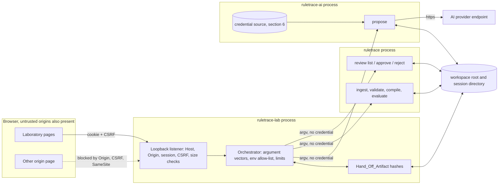

# RuleTrace Laboratory threat model (L1)

This is the threat model that Requirement 37 criterion 21 requires before any
implementation of `ruletrace-lab` starts. It is a draft. It changes no code.
It must pass an independent review, and the user must decide the items marked
**OPEN** in section 9, before task L2 starts.

The model does not claim that process separation alone isolates the AI
credential. Section 6 states what each candidate mechanism does and does not
prevent.

## 1. Scope and system

The system has three runtime executables (UD-38, Requirement 27.1):

| Process | Holds | May do | May never do |
| --- | --- | --- | --- |
| `ruletrace-lab` | Launch_Secret, session identifier, CSRF token, session directory | Serve a loopback HTTP interface; start `ruletrace` and `ruletrace-ai` with argument vectors; copy and hash Hand_Off_Artifacts; render subprocess output | Hold or read the AI credential; append to the Approval_Ledger; approve; compute an Outcome; open a non-loopback connection |
| `ruletrace` | Nothing secret | Ingest, validate, compile, evaluate, `review list`, `review approve`, `review reject` | Network; read a credential variable (27.13); start a subprocess (27.6) |
| `ruletrace-ai` | The AI credential, during a live run only | Read its configuration, consent, Source_Models and clauses; call the configured endpoint; write the Proposal_Store and the Transmission_Log | Write the Rulebook or the Approval_Ledger (27.3); read the ledger (27.7); approve (27.4) |

The browser is the user's ordinary browser. It talks only to the Laboratory
listener on `127.0.0.1:<port>` or `[::1]:<port>`.

Facts from the current code that this model relies on (read on 2026-11-18):

- `ruletrace-ai` reads the credential only through `std::env::var_os` of the
  one variable that `credential_env_var` names. For `propose` the read comes
  after every configuration, capability and consent check; for `models` it
  comes after the configuration checks only (Req 35.18). `--dry-run` reads
  none (`crates/rt-ai-responses/src/credential.rs`,
  `crates/rt-ai-tool/src/config.rs` `load`). `mock-replay` reads no variable.
- The credential is a `Credential` newtype with a redacted `Debug` and no
  `Display`. Output goes through one `Redactor`. There is no zeroization.
- The HTTPS stack (`ureq` with `rustls` and embedded `webpki-roots`) reads no
  proxy variable and no certificate file (`rt-ai-responses/src/transport.rs`,
  `tests/proxy_env.rs`).
- Neither `ruletrace` nor `ruletrace-ai` starts a subprocess. The process tree
  under the Laboratory is therefore one level deep.
- `ruletrace review approve` takes an exclusive advisory lock on
  `<ledger>.lock`, recovers any commit journal, and then rechecks the target,
  the Reviewer (UD-23), the transition, the Rule_Content_Hash and the
  post-approval validation under that lock (`rt-review/src/plan.rs`). A
  second approval of one revision returns RT-APR-0204 (exit 3). A held lock
  returns RT-APR-0212 (exit 70).
- The two CLIs accept option values only as the next argument after a known
  option name. They support neither `--` nor `--name=value`. A value that
  starts with `--` is read as a missing value (`rt-cli/src/args.rs` `scan_from`,
  `rt-ai-tool/src/cli.rs`).

## 2. Assets

| Id | Asset | Why it matters |
| --- | --- | --- |
| A1 | AI provider credential | Billing, data access at the provider |
| A2 | Approval_Ledger and Rulebook integrity | Only approved rules execute (Req 26) |
| A3 | Correctness of displayed Outcomes and proofs | The product's claim (Req 34, 36.5) |
| A4 | Source_Documents and Competition_Data confidentiality | User files; only consented text may leave (Req 28.7) |
| A5 | Launch_Secret, session identifier, CSRF token | Whoever holds them can act as the user in the Laboratory |
| A6 | Files outside the workspace root and the session directory | Path traversal target |
| A7 | Availability of the user's machine | Runaway subprocesses, disk use |

## 3. Actors and assumptions

| Id | Actor | In scope |
| --- | --- | --- |
| X1 | A web page in the user's browser on any other origin, including another port on 127.0.0.1 | Yes |
| X2 | A DNS-rebinding attacker who makes a name resolve to 127.0.0.1 | Yes |
| X3 | Another OS user on the same machine (loopback is shared between users) | Yes |
| X4 | Malicious content: a Source_Document, a Proposal, a provider response, a file name, a CSV cell | Yes |
| X5 | A malicious process that runs as the same OS user | **No.** It can read the user's files, the ledger and the process memory of every process of that user. No design of the Laboratory prevents that. The model states where this limit matters (section 6) |
| X6 | The AI provider | Partly: its responses are untrusted (X4); its handling of sent data is governed by consent and `store:false` (Req 28) |

Assumptions:

1. The user runs the Laboratory on a personal computer (Req 37 user story).
2. The terminal that started `ruletrace-lab` is trusted. It is the channel of
   the Launch_Secret.
3. The OS loopback interface does not accept packets from other hosts.

## 4. Trust boundaries and data flows

Boundaries:

- B1 browser to listener (HTTP over loopback).
- B2 Laboratory to subprocess (argument vector, environment, files, exit code,
  standard output and standard error).
- B3 credential source to `ruletrace-ai` (section 6).
- B4 `ruletrace-ai` to the provider (existing Req 28 and 29 controls).
- B5 files on disk between steps (Hand_Off_Artifacts, Req 36.9).

## 5. Threats and mitigations

Each row names the requirement that carries the control and the test that
must show it. A test name in quotes is a planned test of task L4.

### 5.1 B1: browser to listener

| Id | Threat | Mitigation | Req | Evidence required |
| --- | --- | --- | --- | --- |
| T1 | Remote host reaches the listener | Bind only `127.0.0.1` or `::1`; refuse any other address at start (exit 2); drop a non-loopback peer | 37.1, 37.2 | Address table test; peer-check unit test |
| T2 | DNS rebinding: `evil.example` resolves to 127.0.0.1 and its page calls the Laboratory | Host must equal byte for byte `127.0.0.1:<port>` or `[::1]:<port>` of the actual listener; `localhost` and every name refused | 37.3 | Host table test with the listed values; mutant that removes the check |
| T3 | Cross-site request forgery from another origin, including another port on 127.0.0.1 | Exact Origin check; Sec-Fetch-Site fallback; CSRF token bound to the session in a header or body; no state change on GET, HEAD, OPTIONS. Note: every port of 127.0.0.1 is the same *site*, so SameSite=Strict does not block a page on another local port. The Origin check and the token do | 37.4, 37.9 | Request matrix test; mutants for each check |
| T4 | Cross-origin read of responses | No CORS headers; OPTIONS 405; CORP same-origin; nosniff | 37.10 | Exact header test |
| T5 | Session theft through the URL (history, referrer, logs) | Launch_Secret never in a URL; exchanged once by POST for a cookie; Referrer-Policy no-referrer; request log without query strings | 37.5, 37.6, 37.22 | Log scan test; URL scan of every served page |
| T6 | Another OS user (X3) connects to the port | Without the Launch_Secret no session exists; every request without a valid cookie is 401 | 37.5 to 37.7 | Unauthenticated request matrix |
| T7 | Cookie leakage to another local port. Browsers do not isolate cookies by port, so the session cookie is also sent to any server on `127.0.0.1:<other port>` that the user's browser visits. A server run by another OS user (X3) could capture it and then send forged requests with the right Host and Origin, because it is not a browser | Residual on a shared machine. Mitigations: personal-machine assumption; session idle timeout; one session; explicit end. Not accepted as residual by the user (UD-39). Candidate mitigation (LT-6, OPEN): HTTP Basic authentication whose protection space includes the port, replacing the session cookie (design §11.18.5); alternative: an origin-scoped token in `sessionStorage` sent by script | 37.6, 37.8 | Documented residual risk; if LT-6 is chosen, a test that the cookie alone is refused |
| T8 | Session fixation or cookie tossing: another local port sets `rt_lab_session=<attacker value>` for 127.0.0.1 | The server accepts only the identifier it issued for the single current session; a cookie header with two session cookies, or an unknown identifier, is 401 | 37.6, 37.24 | Cookie matrix test |
| T9 | Clickjacking of the approval button | `frame-ancestors 'none'`, `X-Frame-Options: DENY` | 37.10, 37.11 | Header test |
| T10 | Cross-site scripting through document text, Proposal text, file names or Diagnostics | Context escaping of every value; no inline script or style; CSP `default-src 'none'` with `'self'` sources; data responses with a declared content type | 37.11, 37.16 | Payload test per displayed field; HTML asset scan |
| T11 | Remote assets (fonts, scripts) leak use or allow injection | Assets embedded in the binary; no other origin referenced; no outbound connection | 37.12 | Asset scan; network-namespace test |
| T12 | Oversized or slow requests exhaust memory or threads | Limits on header bytes, body bytes (1 MiB control requests, upload limits of §5.4), one request per connection; design values, not requirement text (LT-9): a 10 s deadline for the request line and headers and a 30 s deadline for the body; at most 16 concurrent connections (further connections are closed without a response); a fixed pool of 4 worker threads (design §11.18.4, Req 37.27); overload answered with 503 | 37.14, 37.26 | Limit boundary tests (at limit accepted, limit + 1 refused with 413); slow-header and connection-cap tests |
| T12a | Request smuggling and parser confusion | Exactly one `Content-Length` with only ASCII digits; `Transfer-Encoding` refused; obsolete line folding, bare LF, lone CR, NUL and non-ASCII bytes in the request line or a header name refused with 400; duplicate Host refused (37.3) | 37.3, 37.15 | Property test over generated request bytes; table of each malformed form |
| T12b | Browser cache, Back button, prefetch | `Cache-Control: no-store` on every response that carries session data or a CSRF token; GET, HEAD and prefetch have no side effect (37.9); every accepted POST answers 303 to a GET (a refused POST answers 4xx, or gets no response when the connection is closed by a connection limit or a deadline); the status page refresh is a GET with no side effect; a resubmitted stale form is refused by the state version (37.25) | 37.9, 37.10, 37.25 | Header test; resubmission test |
| T12c | Multipart abuse (boundary tricks, duplicate parts, oversized part headers) | Exactly one file part and the CSRF field per upload; part headers at most 4 KiB; the boundary from the Content-Type only; anything else 400 | 37.15, 37.26 | Property test over generated multipart bodies |
| T12d | Launch_Secret in terminal scrollback, terminal logs (tmux, IDE, supervisors capturing standard error) or a shared screen | Printed once to standard error, never as a command argument (so not in shell history); the start page warns; the secret is consumed on first use, so a later read of the scrollback cannot open a session while one exists; no expiry before first use (residual R-L7) | 37.5, 37.6 | Test that the secret appears once in standard error and in no file Note: under the LT-6 candidate (HTTP Basic authentication) the secret is presented on every request and is no longer consumed on first use, so this mitigation changes; the LT-6 review must reassess T12d |
| T12e | Login CSRF on `POST /session` | Safe only because the secret has at least 128 bits and is unguessable; Host and Origin checks apply (37.9) | 37.4, 37.5 | Exchange matrix test |
| T12f | Browser extensions reading the pages | Out of scope like X5; the pages carry no credential (37.20) | 37.20 | none |

### 5.2 B2: Laboratory to subprocess

| Id | Threat | Mitigation | Req | Evidence required |
| --- | --- | --- | --- | --- |
| T13 | Shell injection | No shell; `std::process::Command` with one argument per element; only `ruletrace` and `ruletrace-ai`, resolved from the directory of `ruletrace-lab` or a path named at start | 36.3, 37.14 | Source scan; recording stand-in test |
| T14 | Argument injection: a request value read as an option | Values appear only immediately after their option name. The Laboratory refuses, before any subprocess starts, a value that starts with `-`, contains a NUL, a control character, or a line break. Paths are built by the Laboratory and are absolute. Because the CLIs support neither `--` nor `name=value` (section 1), the wording of 37.14 cannot be met literally: see RN-32 in design §9.4 | 37.14, 37.15 | Tests with `--create-ledger`, `-x`, `;`, `$(…)`, newline and NUL as Reviewer values |
| T15 | Environment leaks into a subprocess (credential, proxy, locale) | `env_clear()` and an explicit allow-list per executable and platform (design §11.6). The credential variable is never in the list | 37.14, 37.20 | Test that reads the child environment through a recording stand-in |
| T16 | Runaway subprocess | 300 s wall clock, 16 MiB combined output; on breach the child is killed and reaped and the step fails with a Laboratory Diagnostic; no truncated output is displayed | 37.14 | Stand-in that sleeps and one that floods output |
| T17 | Orphaned children after a Laboratory crash | Orderly shutdown kills and reaps every child. After a crash (SIGKILL, power loss) a child runs to its own end: `ruletrace` commands are local and short; `ruletrace-ai` ends within its own deadlines. Automatic kill on parent death needs platform APIs (Linux `PR_SET_PDEATHSIG`, Windows Job Objects) that need `unsafe` or a new dependency: **rejected as a residual by the user (UD-39)**. Candidate (LT-7, OPEN): a lifeline pipe on standard input that each child watches and exits on when the Laboratory dies (design §11.18.6), with crash tests per platform | 37.17 | Shutdown test; crash residual documented |
| T18 | Malformed subprocess output misleads the display | Exit code checked against the executable's set; structured files parsed strictly by `rt-json`; any other output shown only as escaped text | 36.21 | Malformed-output stand-in tests |
| T19 | Evaluate exit 4 or provenance exit 2 shown as a failure, or an Indeterminate Outcome shown as decided | Result classification of Req 36.21 as amended and design §11.18.7 (the table of §11.8 is superseded): exit 4 is an executed evaluation with complete results; each Outcome is shown with its own status from the results file | 34.9, 36.14, 36.15 | Tests per exit code with a real `ruletrace` |

### 5.3 B5: files between steps

| Id | Threat | Mitigation | Req | Evidence required |
| --- | --- | --- | --- | --- |
| T20 | A file changes between display and use (time of check to time of use) | SHA-256 recorded when produced and checked immediately before the next subprocess; mismatch stops the workflow | 36.9 | Mutation between steps test |
| T21 | A file changes between the approval display and `review approve` | The confirmation carries rule, revision and Rule_Content_Hash; `ruletrace review approve` recomputes the hash under the ledger lock and refuses a stale hash (RT-APR-0203). This holds whichever browser tab sent the request | 36.6, 36.7, 37.25 | Stale-hash test with two tabs |
| T22 | Path traversal through a request path or an uploaded file name | Paths only inside the workspace root and the session directory; canonicalization; uploaded files stored under names the Laboratory chooses (SHA-256 hex plus a fixed extension); the user's file name is display text only | 37.13 | Traversal table: `..`, absolute, symlink out of root |
| T23 | Symlink swap after canonicalization | The session directory is created with mode 0700 by the Laboratory and only the Laboratory and its children write into it. Workspace files are read, hashed and copied into the session directory before use. Residual: a same-user process (X5) can still swap files. On Windows there is no mode 0700: the directory is created under the user's own temporary directory and inherits the ACL of that directory, which may also grant SYSTEM and Administrators; L2 must verify who else has access; the path check of 37.13 also refuses device names (`CON`, `NUL`, `COM1` and the like), `\\?\` and `\\.\` prefixes, alternate data streams (`:` after the drive letter) and compares names case-insensitively | 37.13, 37.18 | Symlink test; Windows path table; residual documented |
| T24 | Hash-valid but malicious AI output treated as trusted | A valid hash proves only that the bytes did not change. Proposals stay untrusted, are labelled untrusted, and reach compilation only through `ruletrace review approve` | 36.10, 36.11 | Display test; approval path test |
| T25 | Stale session directories fill the disk or are mistaken for live ones | Each session directory carries a marker file and an advisory lock held by the live Laboratory; at start only marked directories whose lock can be taken are deleted | 37.18 | Two-instance test; crash-leftover test |

### 5.4 Uploads

| Id | Threat | Mitigation | Req | Evidence required |
| --- | --- | --- | --- | --- |
| T26 | Unbounded upload | Per-file limit of the file kind (design §11.9, at most 16 MiB), total per session 64 MiB, refused with 413 before the body is buffered beyond the limit | 37.26 | Boundary tests per kind |
| T27 | Upload used to place an executable or overwrite a workspace file | Uploads land only in the session directory under Laboratory-chosen names; nothing is executed from it | 37.13, 37.26 | Name and location test |

### 5.5 Approval

| Id | Threat | Mitigation | Req | Evidence required |
| --- | --- | --- | --- | --- |
| T28 | Automatic approval (timer, demo load, end of a proposal run) | `review approve` and `review reject` are started only from a validated human request | 36.8 | Demo-mode run with ledger hash unchanged |
| T29 | AI identity entered as Reviewer | Refused by `ruletrace review` (UD-23 string comparison, RT-APR-0201). The Laboratory adds no second check that could disagree; it displays the refusal | 36.7 | Test with each AI identity of the configuration |
| T30 | Two tabs or a double click approve twice | One workflow, review or upload operation at a time per session (`POST /session/end` pre-empts, RN-45); a second concurrent request gets 409; `review approve` refuses the second decision (RT-APR-0204) | 37.25 | Concurrent request test |
| T31 | Approval of something other than what was displayed | Confirmation must equal the displayed rule, revision and hash; `review approve` checks them again | 36.6, 36.7 | Mismatch tests per field |
| T32 | Reviewer identity treated as authentication | Not prevented and not claimed: the first version does not authenticate Reviewers (R-8). The Laboratory states this next to the Reviewer field | R-8, 34.1 | Text check |

## 6. Credential isolation (Req 37.20, 37.21; UD-38 item 1)

### 6.1 What has to be shown

The user listed five properties. Each mechanism is judged against them.

| Id | Property |
| --- | --- |
| P1 | The Laboratory cannot read the credential |
| P2 | `ruletrace-ai` obtains the credential when explicitly needed |
| P3 | The credential does not enter the approval process (`ruletrace`) |
| P4 | The credential cannot be recovered from the Laboratory's logs, artifacts or browser session |
| P5 | The mechanism works on the supported development and demonstration platforms (Linux, macOS, Windows in CI; the user's Linux machine for the demonstration) |

P1 has two strengths that must not be confused:

- **P1-code**: no code path in `ruletrace-lab` reads, receives or stores the
  credential. This is enforced by the dependency graph, a source scan, the
  start refusal of 37.21 and canary tests.
- **P1-os**: the operating system prevents the Laboratory process from reading
  the credential even if its code were malicious. Under X5 (same-user
  processes) this holds for no mechanism below except M6, because a process
  of the same user can read that user's credential store, files and, with
  default settings, the memory of its own child processes (on Linux with Yama
  `ptrace_scope` 1 a parent may trace its children).

The design claims P1-code. It claims P1-os only for M6.

### 6.2 Mechanisms considered

| Id | Mechanism | P1-code | P1-os | P2 | P3 | P4 | P5 | Req 28 change | New dependency |
| --- | --- | --- | --- | --- | --- | --- | --- | --- | --- |
| M1 | The Laboratory inherits the variable and passes it to `ruletrace-ai` | **No**: the value is in the Laboratory's environment block from the moment it starts | No | Yes | Yes (allow-list) | Weak | Yes | No | No |
| M2 | OS credential store read by `ruletrace-ai` only (macOS Keychain, Windows Credential Manager, Linux Secret Service or kernel keyutils). The configuration names a store entry (service and account), never a value | Yes | No (same-user readable on all three) | Yes | Yes | Yes | **Unproven**: Secret Service needs a D-Bus session and an unlocked keyring; headless CI needs a set-up step; Windows and macOS CI behaviour must be tested | **Yes**: a second credential source beside `credential_env_var` | Yes: `keyring-core` plus one store crate per platform (Linux store crates pull D-Bus) |
| M3 | Credential broker: a separate long-running process holds the credential and hands it to `ruletrace-ai` over a local socket or named pipe | Yes | No: the Laboratory can connect to the same socket | Yes | Yes | Yes | Needs per-platform IPC | Yes | Possibly; and a fourth long-running process, or a new `ruletrace-ai` command (changes 27.2) |
| M4 | Credential file with owner-only permissions, path in the configuration, read only by `ruletrace-ai` | Yes | No | Yes | Yes | Yes | Yes | Yes. The earlier decision for an environment-variable name only (UD-18 in the requirements register; `consistency-analysis.md` line 23) rejected a credential file path | No |
| M5 | User-run live step: for a live provider the Laboratory shows the exact `ruletrace-ai propose` argument vector; the user runs it in a terminal where the variable is set; the Laboratory then imports the resulting batch as an untrusted, hash-bound Hand_Off_Artifact | Yes | No: the credential is in a terminal and a process of the same OS user, readable by that user; M5 shortens the exposure (the credential is in no process the Laboratory starts) but does not isolate | Yes | Yes | Yes | Yes, no platform API | No | No |
| M6 | `ruletrace-ai` runs as a different OS user that alone can read the credential | Yes | **Yes** | Yes | Yes | Yes | Needs administrator set-up per platform; not reproducible for judges | Possibly | No |
| M7 | `ruletrace-ai` prompts for the credential on the controlling terminal | Yes | No (shared terminal) | Yes, but per run | Yes | Yes | Terminal handling differs per platform; no terminal under the test harness | Yes | No |
| M8 | Launcher that is not the Laboratory: a small separate program starts `ruletrace-lab` without the variable and serves `ruletrace-ai` starts with it (UD-38 item 1) | Yes | No: the launcher and the Laboratory run as the same user, and the Laboratory must ask the launcher to start `ruletrace-ai`, which is the broker problem of M3 | Yes | Yes | Yes | Needs per-platform IPC between Laboratory and launcher | Yes (new runtime executable, changes 27.1) | Possibly |

M8 reduces to M3 plus a fourth runtime executable and is rejected for that reason (Req 27.1 fixes three). M1 is rejected (D2 of UD-38: a mechanism that makes the credential reachable by
the Laboratory is rejected). M6 is rejected for the demonstration because it
needs privileged set-up, and recorded as the only option with P1-os. M7 is
rejected because it cannot run in the automated canary test of 37.20.

M5 gives P1-code and a shorter exposure, not P1-os. M5 does not satisfy the user's statement that the Laboratory "must orchestrate
`ruletrace-ai` as a subprocess when AI-assisted interpretation is requested"
for live runs. It does satisfy it for demo mode (mock-replay needs no
credential) and it needs no change to Req 28.

### 6.3 Recommendation (decided by UD-39: M5 with import; no credential store in this release)

(Amended by UD-39, 2026-11-18.) The user selected M5 with proposal import for this release and ruled out an OS credential store; Req 28 is unchanged. Items 2 and 3 below are kept as the record of the alternative and are not planned. The Laboratory reads no AI_Configuration, so §6.5 is resolved by the credential-name registry and the launch scripts of design §11.18.1 instead of options (a) to (c). Under M5 the Laboratory gives P1-code; it does not give P1-os, and the documentation states that a process of the same OS user is outside the boundary.

1. **If LT-1 selects M5 (recommended):** demo mode starts `ruletrace-ai` with `mock-replay` as a
   subprocess. No credential exists anywhere in the Laboratory's process tree.
   Live provider runs use M5: the Laboratory never starts a credentialed
   `ruletrace-ai`. This needs no requirement change and no new dependency.
2. **Candidate for live orchestration (decision LT-1):** M2, behind a feasibility
   spike (task L1b) that must pass on Linux (desktop with Secret Service, and
   headless with keyutils), macOS and Windows, in CI and on the user's machine,
   before any production code. M2 needs:
   - an amendment of Req 28 criteria 2, 5 and 13 and of 27.1's table (a second
     credential source, still never a value in the configuration);
   - a dependency decision with the justification of Req 21.5, and edge rules
     that keep the store crates out of every tree except `rt-ai-tool`'s;
   - a store-entry command or a documented OS tool for the user to save the
     credential (for example `secret-tool store`, `security
     add-generic-password -w` with a prompt, PowerShell `Get-Credential`), and
     no command that takes the value as an argument.
3. M2 gives P1-code and not P1-os. The Laboratory documentation must say so.

If the spike fails on a platform, M5 stays the live mechanism on that platform
and the documentation says which platform uses which mechanism.

### 6.4 Controls independent of the mechanism

| Control | Property | Req |
| --- | --- | --- |
| `ruletrace-lab` refuses to start when the credential variable that the named AI_Configuration names is present in its environment (exit 2, the name only). The value was already in the process at start; the refusal limits the exposure and nothing is logged | P1-code, P4 | 37.21 |
| `env_clear()` plus allow-list for every child; the credential variable is never on the list | P1-code, P3 | 37.14 |
| No dependency edge from `ruletrace-lab` to any `rt-ai-*` crate, any credential store crate or any network crate; source scan for `env::var` other than the allow-listed start-up check | P1-code | 24.13 |
| Canary test of 37.20: a canary reaches the stub provider from `ruletrace-ai` and appears in none of: the Laboratory's environment, files of the workspace and the session directory, the Laboratory's standard output and standard error, every HTTP response, the environment of each `ruletrace` child | P1-code, P3, P4 | 37.20 |
| The browser never receives the credential: no endpoint returns configuration values except the provider identifier, protocol and model | P4 | 37.16, 37.20 |

### 6.5 How 37.21 learns the variable name

The start refusal needs the name in the AI_Configuration. The Laboratory may
not depend on an AI crate. Options (**OPEN, LT-3**):

- (a) The Laboratory reads the TOML file with `toml_edit` (already a workspace
  dependency, allowed today only in `rt-ai-tool`) and extracts only
  `credential_env_var` (schema 1) or `provider.credential_env_var`
  (schema 2). A second reader of one field; a test pins it against
  `rt-ai-tool`'s reader on every committed configuration.
- (b) `ruletrace-ai propose --dry-run` reports the variable name; the
  Laboratory parses that output. It needs a stable machine-readable dry-run
  output (an option change of `ruletrace-ai`).
- (c) Under M5 the Laboratory receives the path of the live configuration
  only to show the command, and reads from it nothing but the variable name
  by option (a). Without (a) or (b) the 37.21 refusal would apply to mock
  configurations only and would have no live test. So (c) is not a separate
  option: M5 still needs (a) or (b).

Recommendation: (a) under both M5 and M2.

## 7. Session design summary

Details are in design §11.5. In short:

- Launch_Secret: 128 bits from the OS random source, printed once to the
  starting terminal, exchanged once by POST from the start page form.
- One Laboratory_Session at a time. Several tabs that send the same cookie are
  the same session. A second exchange is refused because the secret is
  consumed, so a second exchange gets 401 (37.6) also while a step runs.
  When the session ends (explicit end, 30 minutes idle), a restart of
  `ruletrace-lab` is needed (recommended; **OPEN, LT-5**; printing a new
  secret instead needs RN-47).
- Cookie `rt_lab_session`: HttpOnly, SameSite=Strict, Path=/, no Domain, no
  Secure (plain http on loopback).
- CSRF token: one per session, in a hidden form field or a request header,
  compared in constant time.
- Workflow and review requests are serialized per session. A request that
  arrives while another runs gets 409. Each such form carries the session's
  state version; a stale version gets 409 and a fresh page. `POST
  /session/end` is not serialized: it pre-empts a running step, kills and
  reaps its child and ends the session (37.17, RN-45).

## 8. Residual risks

| Id | Risk | Why accepted or open |
| --- | --- | --- |
| R-L1 | Same-user malicious process (X5) can read the credential store, the ledger and the session directory | Outside any user-space design; stated in the documentation |
| R-L2 | Cookie sent to other local ports (T7) | **Not accepted (UD-39).** Open until LT-6 is resolved |
| R-L3 | Children survive a Laboratory crash (T17) | **Not accepted (UD-39).** Open until LT-7 is demonstrated per platform. 2026-11-20: the lifeline prototype with stand-in children is shown on Linux, macOS and Windows (`docs/security/2026-11-20-lt7-lifeline-evidence.md`); real executables, V-1, V-2, V-4 and the LT-7 decision outstanding, so the risk stays open. 2026-11-20 (later): real-executable checks pass on the three platforms (`docs/security/2026-11-20-lt7-lifeline-real-executables.md`); V-1, V-2, V-4 and the review acceptance remain, so the risk stays open |
| R-L4 | Reviewer identity is not authenticated (T32, R-8) | First-version limit, stated |
| R-L5 | Symlink swap by a same-user process (T23) | Same as R-L1 |
| R-L6 | The in-memory credential in `ruletrace-ai` is not zeroized | Existing behaviour; the process is short-lived; a zeroizing type is a separate change |
| R-L7 | An unconsumed Launch_Secret has no expiry, and LT-5 would print further secrets | 128 bits make guessing impossible; the residual is a reader of the scrollback before the user's first exchange; LT-5 conflicts with 37.5 ("print it once", RN-47) |

## 9. Decisions needed before L2

| Id | Question | Recommendation | Status |
| --- | --- | --- | --- |
| LT-1 | Live credential mechanism for orchestrated runs | M5 now; M2 after a passing spike (L1b) and a Req 28 amendment | **Decided (UD-39 A):** M5, user-run live step and import; no credential store in this release |
| LT-2 | Whether to amend Req 28 for an OS credential store | Only after L1b passes | **Decided (UD-39 A):** Req 28 unchanged |
| LT-3 | How 37.21 learns the variable name | (a), a one-field TOML read pinned against `rt-ai-tool` | **Decided (UD-39 A):** the Laboratory reads no AI_Configuration; a credential-name registry and launch scripts (design §11.18.1) |
| LT-4 | HTTP server implementation | Standard library only, a strict HTTP/1.1 subset (design §11.4) | **Decided (UD-39):** standard library, server-rendered forms |
| LT-5 | New Launch_Secret after a session ends, or restart required | Restart required (keeps 37.5 "once"; no requirement change); printing a new secret needs RN-47 | **Decided (UD-39):** restart; no Launch_Secret reused |
| LT-6 | Second origin-scoped secret against cross-port cookie leakage | Not in L2; revisit if the Laboratory ever targets shared machines | **OPEN.** Deferral rejected by the user. Candidate: HTTP Basic authentication (origin-scoped protection space), design §11.18.5; needs evidence and review. 2026-11-20: server-side prototype tests pass on three platforms (run `44733286392`); check order decided (UD-45: Host, Origin, credentials, CSRF); the amendment of Req 37.5 to 37.7 is drafted (UD-45 section 4) and awaits approval of the wording; the browser protocol has not been run |
| LT-7 | Kill children on Laboratory crash | Accept the bounded residual; no `unsafe` | **OPEN.** Crash orphans rejected by the user. Candidate: lifeline pipe, design §11.18.6; needs crash tests per platform. 2026-11-20: prototype crash tests pass on Linux, macOS and Windows, run `44733286392`, maximum 109 ms against the 5 s bound (`docs/security/2026-11-20-lt7-lifeline-evidence.md`). Still needed: real `ruletrace`/`ruletrace-ai` children (13.3), V-1, V-2, V-4, RN-50 and the user's LT-7 decision. 2026-11-20 (later): RN-50 confirmed and the 5 s bound set (UD-44); `--lifeline-stdin` implemented (`efa4a6d`) and its real-executable checks pass on Linux, macOS and Windows, run `44753380080`, maximum 27.93 ms (`docs/security/2026-11-20-lt7-lifeline-real-executables.md`). Still needed: V-1, V-2, V-4 and an independent reviewer's acceptance of this mitigation |
| LT-8 | Upload limits | 16 MiB per file at most (lower per-kind limits apply), 64 MiB per session; re-check when task 11.1 commits the real snapshots | **Decided (UD-39):** 16 MiB per file, 64 MiB per session, 1 MiB control request, streamed enforcement |
| LT-9 | Connection limits: 10 s header deadline, 30 s body deadline, 16 concurrent connections | As stated (design values) | **Decided (UD-39):** 16 connections, 4 concurrent requests, finite timeouts, 503 on overload (design §11.18.4) |

## 10. Review record

| Date | Reviewer | Result |
| --- | --- | --- |
| 2026-11-18 | independent reviewer, `docs/reviews/2026-11-18-review-L1-threat-model-d0c821c.md` | CHANGES REQUIRED (B1 to B3, N1 to N11) |
| 2026-11-18 | independent reviewer, `docs/reviews/2026-11-18-review-L1-fix-6f7e851.md` | APPROVED WITH FINDINGS (F1 to F7, low; addressed in `66ef6ec`, which was not separately reviewed) |
| 2026-11-18 | independent reviewer, `docs/reviews/2026-11-18-review-tasks-a4628bd.md` | APPROVED WITH FINDINGS (task plan) |
| 2026-11-18 | independent reviewer, `docs/reviews/2026-11-18-review-doc-66ef6ec.md` | APPROVED WITH FINDINGS (R1 to R5, low; addressed in the UD-39 commit) |
| (pending) | independent reviewer | UD-39 changes, LT-6 and LT-7 |
| 2026-11-20 | independent reviewer, `docs/reviews/2026-11-20-review-lt7ev-263a662.md` | LT-7 prototype evidence record and these LT-7 updates (result in that report; it does not accept the LT-7 mitigation, which needs the items above) |
| 2026-11-20 | independent reviewer, `docs/reviews/2026-11-20-review-rex-efa4a6d.md` | real-executable evidence record and these LT-7 updates (result in that report; it does not accept the LT-7 mitigation, which needs V-1, V-2 and V-4) |
